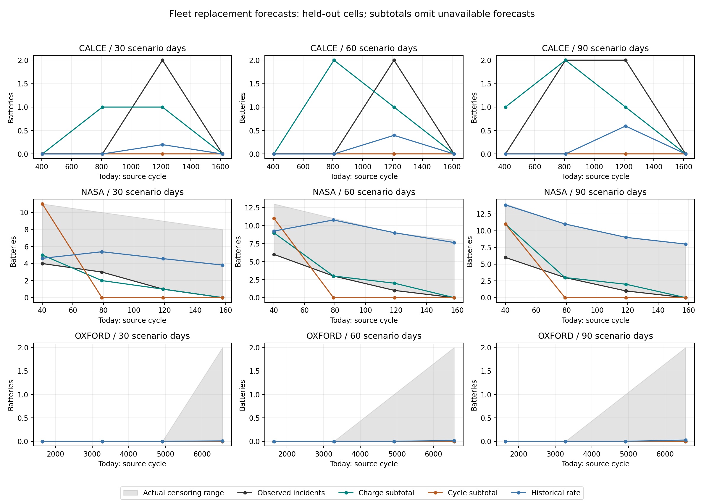

# Fleet replacement-count forecasting

The current charge-based fleet-count forecast does not establish reliable replacement budgeting: many fleet members lack usable forecasts or complete follow-up. On the matched, fully observed subset its mean absolute count error is 0.37 batteries, versus 0.80 for cycle count and 0.43 for historical replacement rate; this comparison is conditional on coverage. These small, overlapping retrospective fleets are insufficient for a commercial replacement-budgeting accuracy claim.

## What was tested

Preregistered fixed today fractions 20/40/60/80% of each recorded fleet age range;
30/60/90 days =60/120/180 source cycles. Only held-out SoH histories enter the
raw linear RUL forecasts. Probabilities were unavailable at registration: counts
are deterministic forecast subtotals, not expected counts from calibrated risks.

NASA has 34 inventory cells, CALCE7, Oxford8. Laboratory ages are artificially
synchronised; they do not describe a real fleet's commissioning-date mix. Each
cell's own model excluded that cell from training; LOCO still uses other fleet
members' full labelled histories. This is retrospective cross-cell validation,
not a training-data calendar cutoff or a prospective fleet trial.

## Predicted vs actual counts, primary LOCO protocol

`charge_unknown`/`cycle_unknown` are unavailable incident forecasts, not predicted
healthy cells. Already-below cells are outside incident counts. Actual counts
are bounds when follow-up ends early. Errors are exact only on the explicitly
matched subset (`matched_cells`, both forecasts usable and outcome known).
Full-fleet subtotal error bounds and all LODO rows are in [scenarios.csv](scenarios.csv).

| dataset   |   today |   days |   inventory_cells |   already_below |   charge_count_subtotal |   charge_unknown |   cycle_count_subtotal |   cycle_unknown |   historical_rate_count |   actual_count_lower |   actual_count_upper |   matched_cells |   matched_actual |   charge_matched_error |   cycle_matched_error |   historical_matched_error |
|:----------|--------:|-------:|------------------:|----------------:|------------------------:|-----------------:|-----------------------:|----------------:|------------------------:|---------------------:|---------------------:|----------------:|-----------------:|-----------------------:|----------------------:|---------------------------:|
| calce     |     404 |     30 |                 7 |               0 |                       0 |                4 |                      0 |               0 |                    0.00 |                    0 |                    0 |               3 |             0.00 |                   0.00 |                  0.00 |                       0.00 |
| calce     |     404 |     60 |                 7 |               0 |                       0 |                4 |                      0 |               0 |                    0.00 |                    0 |                    0 |               3 |             0.00 |                   0.00 |                  0.00 |                       0.00 |
| calce     |     404 |     90 |                 7 |               0 |                       1 |                4 |                      0 |               0 |                    0.00 |                    0 |                    0 |               3 |             0.00 |                   1.00 |                  0.00 |                       0.00 |
| calce     |     807 |     30 |                 7 |               0 |                       1 |                3 |                      0 |               0 |                    0.00 |                    0 |                    0 |               4 |             0.00 |                   1.00 |                  0.00 |                       0.00 |
| calce     |     807 |     60 |                 7 |               0 |                       2 |                3 |                      0 |               0 |                    0.00 |                    0 |                    0 |               4 |             0.00 |                   2.00 |                  0.00 |                       0.00 |
| calce     |     807 |     90 |                 7 |               0 |                       2 |                3 |                      0 |               0 |                    0.00 |                    2 |                    2 |               4 |             2.00 |                   0.00 |                 -2.00 |                      -2.00 |
| calce     |    1210 |     30 |                 7 |               4 |                       1 |                1 |                      0 |               0 |                    0.20 |                    2 |                    2 |               2 |             2.00 |                  -1.00 |                 -2.00 |                      -1.87 |
| calce     |    1210 |     60 |                 7 |               4 |                       1 |                1 |                      0 |               0 |                    0.40 |                    2 |                    2 |               2 |             2.00 |                  -1.00 |                 -2.00 |                      -1.74 |
| calce     |    1210 |     90 |                 7 |               4 |                       1 |                1 |                      0 |               0 |                    0.60 |                    2 |                    2 |               2 |             2.00 |                  -1.00 |                 -2.00 |                      -1.60 |
| calce     |    1613 |     30 |                 7 |               7 |                       0 |                0 |                      0 |               0 |                    0.00 |                    0 |                    0 |               0 |             0.00 |                 nan    |                nan    |                     nan    |
| calce     |    1613 |     60 |                 7 |               7 |                       0 |                0 |                      0 |               0 |                    0.00 |                    0 |                    0 |               0 |             0.00 |                 nan    |                nan    |                     nan    |
| calce     |    1613 |     90 |                 7 |               7 |                       0 |                0 |                      0 |               0 |                    0.00 |                    0 |                    0 |               0 |             0.00 |                 nan    |                nan    |                     nan    |
| nasa      |      40 |     30 |                34 |              19 |                       5 |                4 |                     11 |               4 |                    4.62 |                    4 |                   11 |               7 |             4.00 |                   1.00 |                  3.00 |                      -1.85 |
| nasa      |      40 |     60 |                34 |              19 |                       9 |                4 |                     11 |               4 |                    9.23 |                    6 |                   13 |               7 |             6.00 |                   0.00 |                  1.00 |                      -1.69 |
| nasa      |      40 |     90 |                34 |              19 |                      11 |                4 |                     11 |               4 |                   13.85 |                    6 |                   14 |               6 |             6.00 |                   0.00 |                  0.00 |                      -0.46 |
| nasa      |      79 |     30 |                34 |              23 |                       2 |                7 |                      0 |               7 |                    5.38 |                    3 |                   10 |               4 |             3.00 |                  -1.00 |                 -3.00 |                      -1.04 |
| nasa      |      79 |     60 |                34 |              23 |                       3 |                7 |                      0 |               7 |                   10.77 |                    3 |                   11 |               3 |             3.00 |                  -1.00 |                 -3.00 |                      -0.06 |
| nasa      |      79 |     90 |                34 |              23 |                       3 |                7 |                      0 |               7 |                   11.00 |                    3 |                   11 |               3 |             3.00 |                  -1.00 |                 -3.00 |                       0.00 |
| nasa      |     119 |     30 |                34 |              25 |                       1 |                7 |                      0 |               7 |                    4.58 |                    1 |                    9 |               1 |             1.00 |                   0.00 |                 -1.00 |                      -0.49 |
| nasa      |     119 |     60 |                34 |              25 |                       2 |                7 |                      0 |               7 |                    9.00 |                    1 |                    9 |               1 |             1.00 |                   0.00 |                 -1.00 |                       0.00 |
| nasa      |     119 |     90 |                34 |              25 |                       2 |                7 |                      0 |               7 |                    9.00 |                    1 |                    9 |               1 |             1.00 |                   0.00 |                 -1.00 |                       0.00 |
| nasa      |     158 |     30 |                34 |              26 |                       0 |                7 |                      0 |               7 |                    3.82 |                    0 |                    8 |               0 |             0.00 |                 nan    |                nan    |                     nan    |
| nasa      |     158 |     60 |                34 |              26 |                       0 |                7 |                      0 |               7 |                    7.64 |                    0 |                    8 |               0 |             0.00 |                 nan    |                nan    |                     nan    |
| nasa      |     158 |     90 |                34 |              26 |                       0 |                7 |                      0 |               7 |                    8.00 |                    0 |                    8 |               0 |             0.00 |                 nan    |                nan    |                     nan    |
| oxford    |    1640 |     30 |                 8 |               0 |                       0 |                0 |                      0 |               0 |                    0.00 |                    0 |                    0 |               8 |             0.00 |                   0.00 |                  0.00 |                       0.00 |
| oxford    |    1640 |     60 |                 8 |               0 |                       0 |                0 |                      0 |               0 |                    0.00 |                    0 |                    0 |               8 |             0.00 |                   0.00 |                  0.00 |                       0.00 |
| oxford    |    1640 |     90 |                 8 |               0 |                       0 |                0 |                      0 |               0 |                    0.00 |                    0 |                    0 |               8 |             0.00 |                   0.00 |                  0.00 |                       0.00 |
| oxford    |    3280 |     30 |                 8 |               0 |                       0 |                0 |                      0 |               0 |                    0.00 |                    0 |                    0 |               8 |             0.00 |                   0.00 |                  0.00 |                       0.00 |
| oxford    |    3280 |     60 |                 8 |               0 |                       0 |                0 |                      0 |               0 |                    0.00 |                    0 |                    0 |               8 |             0.00 |                   0.00 |                  0.00 |                       0.00 |
| oxford    |    3280 |     90 |                 8 |               0 |                       0 |                0 |                      0 |               0 |                    0.00 |                    0 |                    0 |               8 |             0.00 |                   0.00 |                  0.00 |                       0.00 |
| oxford    |    4920 |     30 |                 8 |               0 |                       0 |                0 |                      0 |               0 |                    0.00 |                    0 |                    0 |               8 |             0.00 |                   0.00 |                  0.00 |                       0.00 |
| oxford    |    4920 |     60 |                 8 |               0 |                       0 |                0 |                      0 |               0 |                    0.00 |                    0 |                    1 |               7 |             0.00 |                   0.00 |                  0.00 |                       0.00 |
| oxford    |    4920 |     90 |                 8 |               0 |                       0 |                0 |                      0 |               0 |                    0.00 |                    0 |                    1 |               7 |             0.00 |                   0.00 |                  0.00 |                       0.00 |
| oxford    |    6560 |     30 |                 8 |               1 |                       0 |                2 |                      0 |               2 |                    0.01 |                    0 |                    2 |               5 |             0.00 |                   0.00 |                  0.00 |                       0.01 |
| oxford    |    6560 |     60 |                 8 |               1 |                       0 |                2 |                      0 |               2 |                    0.02 |                    0 |                    2 |               5 |             0.00 |                   0.00 |                  0.00 |                       0.01 |
| oxford    |    6560 |     90 |                 8 |               1 |                       0 |                2 |                      0 |               2 |                    0.03 |                    0 |                    2 |               5 |             0.00 |                   0.00 |                  0.00 |                       0.02 |

## Error and systematic bias

Positive signed bias means too many predicted replacements. Matched LOCO mean
bias: charge -0.03, cycle -0.53,
historical rate -0.43 batteries. This is NOT proof that
individual errors cancel: conditioning on available forecasts and follow-up can
change bias. Full-fleet prediction and outcome bounds are too incomplete to infer
unconditional bias. Overlapping windows are correlated; no independent-sample CI
or significance claim is made.

The small overall bias also masks opposite directions: CALCE slightly
overpredicts on the matched subset, NASA underpredicts, and Oxford's matched
windows contain no actual replacements. That zero-incident result does not test
whether Oxford replacement counts can be caught accurately.

| dataset   |   mean_matched_cells |   matched_windows_with_events |   charge_signed_bias |   mean_unknown_forecasts |   mean_unknown_outcomes |
|:----------|---------------------:|------------------------------:|---------------------:|-------------------------:|------------------------:|
| calce     |                2.250 |                             4 |                0.111 |                    2.000 |                   0.000 |
| nasa      |                2.750 |                             9 |               -0.222 |                    6.250 |                   7.750 |
| oxford    |                7.083 |                             0 |                0.000 |                    0.500 |                   0.667 |

| validation            | dataset   |   days | method     |   scored_scenarios |   mean_matched_cells |   mae_count |   rmse_count |   signed_bias_count |
|:----------------------|:----------|-------:|:-----------|-------------------:|---------------------:|------------:|-------------:|--------------------:|
| leave_one_cell_out    | calce     |     30 | charge     |                  3 |                2.250 |       0.667 |        0.816 |               0.000 |
| leave_one_cell_out    | calce     |     30 | cycle      |                  3 |                2.250 |       0.667 |        1.155 |              -0.667 |
| leave_one_cell_out    | calce     |     30 | historical |                  3 |                2.250 |       0.623 |        1.078 |              -0.623 |
| leave_one_cell_out    | calce     |     60 | charge     |                  3 |                2.250 |       1.000 |        1.291 |               0.333 |
| leave_one_cell_out    | calce     |     60 | cycle      |                  3 |                2.250 |       0.667 |        1.155 |              -0.667 |
| leave_one_cell_out    | calce     |     60 | historical |                  3 |                2.250 |       0.578 |        1.002 |              -0.578 |
| leave_one_cell_out    | calce     |     90 | charge     |                  3 |                2.250 |       0.667 |        0.816 |               0.000 |
| leave_one_cell_out    | calce     |     90 | cycle      |                  3 |                2.250 |       1.333 |        1.633 |              -1.333 |
| leave_one_cell_out    | calce     |     90 | historical |                  3 |                2.250 |       1.201 |        1.480 |              -1.201 |
| leave_one_cell_out    | nasa      |     30 | charge     |                  3 |                3.000 |       0.667 |        0.816 |               0.000 |
| leave_one_cell_out    | nasa      |     30 | cycle      |                  3 |                3.000 |       2.333 |        2.517 |              -0.333 |
| leave_one_cell_out    | nasa      |     30 | historical |                  3 |                3.000 |       1.127 |        1.256 |              -1.127 |
| leave_one_cell_out    | nasa      |     60 | charge     |                  3 |                2.750 |       0.333 |        0.577 |              -0.333 |
| leave_one_cell_out    | nasa      |     60 | cycle      |                  3 |                2.750 |       1.667 |        1.915 |              -1.000 |
| leave_one_cell_out    | nasa      |     60 | historical |                  3 |                2.750 |       0.585 |        0.978 |              -0.585 |
| leave_one_cell_out    | nasa      |     90 | charge     |                  3 |                2.500 |       0.333 |        0.577 |              -0.333 |
| leave_one_cell_out    | nasa      |     90 | cycle      |                  3 |                2.500 |       1.333 |        1.826 |              -1.333 |
| leave_one_cell_out    | nasa      |     90 | historical |                  3 |                2.500 |       0.154 |        0.266 |              -0.154 |
| leave_one_cell_out    | oxford    |     30 | charge     |                  4 |                7.250 |       0.000 |        0.000 |               0.000 |
| leave_one_cell_out    | oxford    |     30 | cycle      |                  4 |                7.250 |       0.000 |        0.000 |               0.000 |
| leave_one_cell_out    | oxford    |     30 | historical |                  4 |                7.250 |       0.002 |        0.003 |               0.002 |
| leave_one_cell_out    | oxford    |     60 | charge     |                  4 |                7.000 |       0.000 |        0.000 |               0.000 |
| leave_one_cell_out    | oxford    |     60 | cycle      |                  4 |                7.000 |       0.000 |        0.000 |               0.000 |
| leave_one_cell_out    | oxford    |     60 | historical |                  4 |                7.000 |       0.003 |        0.007 |               0.003 |
| leave_one_cell_out    | oxford    |     90 | charge     |                  4 |                7.000 |       0.000 |        0.000 |               0.000 |
| leave_one_cell_out    | oxford    |     90 | cycle      |                  4 |                7.000 |       0.000 |        0.000 |               0.000 |
| leave_one_cell_out    | oxford    |     90 | historical |                  4 |                7.000 |       0.005 |        0.010 |               0.005 |
| leave_one_dataset_out | calce     |     30 | charge     |                  0 |                0.000 |     nan     |      nan     |             nan     |
| leave_one_dataset_out | calce     |     30 | cycle      |                  0 |                0.000 |     nan     |      nan     |             nan     |
| leave_one_dataset_out | calce     |     30 | historical |                  0 |                0.000 |     nan     |      nan     |             nan     |
| leave_one_dataset_out | calce     |     60 | charge     |                  0 |                0.000 |     nan     |      nan     |             nan     |
| leave_one_dataset_out | calce     |     60 | cycle      |                  0 |                0.000 |     nan     |      nan     |             nan     |
| leave_one_dataset_out | calce     |     60 | historical |                  0 |                0.000 |     nan     |      nan     |             nan     |
| leave_one_dataset_out | calce     |     90 | charge     |                  0 |                0.000 |     nan     |      nan     |             nan     |
| leave_one_dataset_out | calce     |     90 | cycle      |                  0 |                0.000 |     nan     |      nan     |             nan     |
| leave_one_dataset_out | calce     |     90 | historical |                  0 |                0.000 |     nan     |      nan     |             nan     |
| leave_one_dataset_out | nasa      |     30 | charge     |                  3 |                3.000 |       2.333 |        2.646 |              -2.333 |
| leave_one_dataset_out | nasa      |     30 | cycle      |                  3 |                3.000 |       2.667 |        2.944 |              -2.667 |
| leave_one_dataset_out | nasa      |     30 | historical |                  3 |                3.000 |       1.127 |        1.256 |              -1.127 |
| leave_one_dataset_out | nasa      |     60 | charge     |                  3 |                2.750 |       3.000 |        3.697 |              -3.000 |
| leave_one_dataset_out | nasa      |     60 | cycle      |                  3 |                2.750 |       3.333 |        3.916 |              -3.333 |
| leave_one_dataset_out | nasa      |     60 | historical |                  3 |                2.750 |       0.585 |        0.978 |              -0.585 |
| leave_one_dataset_out | nasa      |     90 | charge     |                  3 |                2.500 |       3.000 |        3.697 |              -3.000 |
| leave_one_dataset_out | nasa      |     90 | cycle      |                  3 |                2.500 |       3.333 |        3.916 |              -3.333 |
| leave_one_dataset_out | nasa      |     90 | historical |                  3 |                2.500 |       0.154 |        0.266 |              -0.154 |
| leave_one_dataset_out | oxford    |     30 | charge     |                  0 |                0.000 |     nan     |      nan     |             nan     |
| leave_one_dataset_out | oxford    |     30 | cycle      |                  0 |                0.000 |     nan     |      nan     |             nan     |
| leave_one_dataset_out | oxford    |     30 | historical |                  0 |                0.000 |     nan     |      nan     |             nan     |
| leave_one_dataset_out | oxford    |     60 | charge     |                  0 |                0.000 |     nan     |      nan     |             nan     |
| leave_one_dataset_out | oxford    |     60 | cycle      |                  0 |                0.000 |     nan     |      nan     |             nan     |
| leave_one_dataset_out | oxford    |     60 | historical |                  0 |                0.000 |     nan     |      nan     |             nan     |
| leave_one_dataset_out | oxford    |     90 | charge     |                  0 |                0.000 |     nan     |      nan     |             nan     |
| leave_one_dataset_out | oxford    |     90 | cycle      |                  0 |                0.000 |     nan     |      nan     |             nan     |
| leave_one_dataset_out | oxford    |     90 | historical |                  0 |                0.000 |     nan     |      nan     |             nan     |

## Missing histories and small samples

Distinct reason counts (repeated across horizons, not independent batteries):

| validation            | dataset   | charge_reason                     |   scenario_cell_records |
|:----------------------|:----------|:----------------------------------|------------------------:|
| leave_one_cell_out    | calce     | estimated                         |                      27 |
| leave_one_cell_out    | calce     | flat_or_increasing_recent_trend   |                      24 |
| leave_one_cell_out    | nasa      | estimated                         |                      51 |
| leave_one_cell_out    | nasa      | history_ended                     |                      72 |
| leave_one_cell_out    | nasa      | no_prefix                         |                       3 |
| leave_one_cell_out    | nasa      | predicted_overdue                 |                       3 |
| leave_one_cell_out    | oxford    | estimated                         |                      87 |
| leave_one_cell_out    | oxford    | history_ended                     |                       6 |
| leave_one_dataset_out | calce     | estimated                         |                      33 |
| leave_one_dataset_out | calce     | flat_or_increasing_recent_trend   |                      15 |
| leave_one_dataset_out | calce     | predicted_overdue                 |                       3 |
| leave_one_dataset_out | nasa      | estimated                         |                      33 |
| leave_one_dataset_out | nasa      | history_ended                     |                      72 |
| leave_one_dataset_out | nasa      | no_prefix                         |                       3 |
| leave_one_dataset_out | nasa      | predicted_overdue                 |                      21 |
| leave_one_dataset_out | oxford    | beyond_supported_forecast_horizon |                      24 |
| leave_one_dataset_out | oxford    | flat_or_increasing_recent_trend   |                      63 |
| leave_one_dataset_out | oxford    | history_ended                     |                       6 |

No true incident date is assigned to initially below-threshold cells. A prior
observed below-threshold check excludes a cell using only information available
at today. Interpolated crossings already before today but first observed later
are recorded as retrospective pre-existing events, not forecast incidents.
Oxford's 100-cycle checks are coarse relative to these horizons. The entire
inventory contains only 19 observed crossings (7 CALCE,10 NASA,2 Oxford); four
today points and three horizons do not create more independent endpoint events.

## Pitch interpretation

Defensible: the software can aggregate held-out battery forecasts and expose
count uncertainty, missing data and simple baselines. Unsupported: validated
fleet budgeting, unbiased replacement counts, accurate Baaz pack budgets or
operational cost savings. A prospective larger-fleet evaluation with recorded
commissioning ages, independent capacity checks, complete horizon follow-up and
calibrated probabilities is needed. Report both count accuracy and forecast
coverage; improve SoH/rate bias before relying on error cancellation.

## Reproduction

`python scripts/fleet_forecast.py` requires the frozen baseline and E1 artifacts.
No fitting, tuning, threshold selection or future-reference input to the forecast
occurs in this script. See [preregistration.md](preregistration.md),
[cell_audit.csv](cell_audit.csv) and [metrics.csv](metrics.csv).
