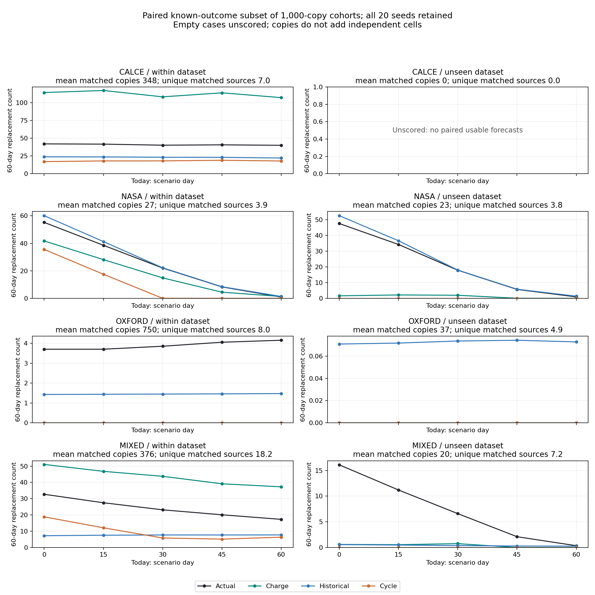

Charge-based counts do not beat both simple baselines on average in the larger, mixed-age cohorts (within-dataset count MAE 10.05, historical 4.14, cycle 5.89); missing coverage prevents a full-fleet accuracy claim. Historical rate still wins overall on unseen battery types (MAE: charge 3.90, historical 1.19, cycle 4.12), although charge narrowly wins in mixed fleets on a very small covered subset. Baaz would need real pack commissioning dates, swap logs, replacement records and periodic independent capacity checks on many held-out packs, with at least 90 days of follow-up.

# Fleet forecast v2

## Fixed design and forecast method

Preregistration was committed as `c97e10773641b57e28e7c157da402084d5858469` before the first simulation run.
All 20 preregistered seeds, 50/200/1,000 installed copies, four fleet kinds,
five today points (0/15/30/45/60), both holdout protocols and 30/60/90-day horizons
were used: **7,200 scenario rows**. No parameters were tuned on these results.
Days are scenarios at 2 source lab cycles/day, not measured field calendar days.
Commissioning dates are independently uniform over each source dataset's age
span before day 0 (CALCE 1,008; NASA 98.5; Oxford 4,100 days). Smaller cohorts
are nested prefixes of the same 1,000-copy layouts, with no eligibility filtering.

**Deterministic v1 RUL crossing counts were used.** E6's probabilities/intervals
failed calibration, and its horizons omit the 60-cycle/30-day risk needed here;
they are not validated calibrated probabilities for this aggregation.
The charge model is the frozen training-selected charge-only baseline; the
cycle comparator is frozen E1 quadratic-cycle Ridge, each fed to v1's raw linear
RUL rule. Every resampled copy uses its source's own held-out predictions.
The fold audit verified test membership and exclusion from training/selection
for all 164 available method/source/protocol
combinations; 32 combinations have no
predictions and remain explicitly missing, not evaluated with a fitted refit.

The historical comparator uses observed prior crossing events divided by past
observed at-risk battery-days, then `min(1, rate × horizon)` per at-risk copy.
This adapts v1's elapsed-fleet-time rate to staggered entry, as preregistered.
It uses only past checks/events from the same simulated fleet in both protocols.
LODO therefore tests a learned model's unseen-type transfer against an operator
with local historical records, not a cold start with no local history.
Mixed LODO aggregates three routed models, each excluding its copy's dataset;
it is not one model with all three datasets simultaneously unseen.

## Comparison: paired usable forecasts and known outcomes

These are **conditional counts**, requiring both model forecasts and known truth
on the same copies. Each method column is **mean predicted count / MAE / signed
bias**, in batteries per scenario; positive bias means too many replacements
predicted, negative means too few. Values average the five
dates and all 20 seeds, with empty cases unscored. “Scored / 100” gives the
nonempty cases; actual and matched copies/sources average those same scored
cases, so the mean actual count never exceeds that table's matched population.
Unique-source ranges describe the full installed layouts, not independent
replicates. Every count/error at every individual today is in [scenarios.csv](scenarios.csv).

### Within dataset (LOCO)

| Fleet   |    N |   Days | Unique sources   |   Scored / 100 | Matched copies / sources   |   Actual | Charge predicted / MAE / bias   | Historical predicted / MAE / bias   | Cycle predicted / MAE / bias   |
|:--------|-----:|-------:|:-----------------|---------------:|:---------------------------|---------:|:--------------------------------|:------------------------------------|:-------------------------------|
| calce   |   50 |     30 | 7–7              |            100 | 17.6 / 6.5                 |     1.07 | 2.52 / 1.67 / +1.45             | 0.57 / 0.86 / -0.50                 | 0.38 / 1.01 / -0.69            |
| calce   |   50 |     60 | 7–7              |            100 | 17.6 / 6.5                 |     2.12 | 5.50 / 3.44 / +3.38             | 1.13 / 1.38 / -0.99                 | 0.75 / 1.71 / -1.37            |
| calce   |   50 |     90 | 7–7              |            100 | 17.6 / 6.5                 |     3.11 | 7.96 / 4.87 / +4.85             | 1.70 / 1.79 / -1.41                 | 1.24 / 2.19 / -1.87            |
| calce   |  200 |     30 | 7–7              |            100 | 70.0 / 7.0                 |     4.18 | 9.85 / 5.79 / +5.67             | 2.31 / 2.29 / -1.87                 | 1.75 / 2.87 / -2.43            |
| calce   |  200 |     60 | 7–7              |            100 | 70.0 / 7.0                 |     8.30 | 22.61 / 14.31 / +14.31          | 4.61 / 3.85 / -3.69                 | 3.49 / 5.05 / -4.81            |
| calce   |  200 |     90 | 7–7              |            100 | 70.0 / 7.0                 |    12.20 | 33.04 / 20.84 / +20.84          | 6.92 / 5.39 / -5.28                 | 5.37 / 6.95 / -6.83            |
| calce   | 1000 |     30 | 7–7              |            100 | 347.7 / 7.0                |    20.40 | 46.69 / 26.29 / +26.29          | 11.59 / 8.88 / -8.81                | 9.27 / 11.13 / -11.13          |
| calce   | 1000 |     60 | 7–7              |            100 | 347.7 / 7.0                |    40.94 | 112.21 / 71.27 / +71.27         | 23.18 / 17.76 / -17.76              | 18.03 / 22.91 / -22.91         |
| calce   | 1000 |     90 | 7–7              |            100 | 347.7 / 7.0                |    61.68 | 162.43 / 100.75 / +100.75       | 34.77 / 26.91 / -26.91              | 28.96 / 32.72 / -32.72         |
| mixed   |   50 |     30 | 22–30            |            100 | 18.9 / 10.9                |     0.82 | 1.06 / 0.76 / +0.24             | 0.21 / 0.81 / -0.61                 | 0.43 / 0.73 / -0.39            |
| mixed   |   50 |     60 | 22–30            |            100 | 18.8 / 10.8                |     1.39 | 2.22 / 1.23 / +0.83             | 0.42 / 1.20 / -0.97                 | 0.57 / 1.02 / -0.82            |
| mixed   |   50 |     90 | 22–30            |            100 | 18.7 / 10.8                |     1.76 | 3.10 / 1.56 / +1.34             | 0.63 / 1.36 / -1.13                 | 0.71 / 1.27 / -1.05            |
| mixed   |  200 |     30 | 38–47            |            100 | 76.0 / 16.1                |     2.72 | 4.44 / 2.12 / +1.72             | 0.75 / 2.08 / -1.97                 | 1.22 / 1.74 / -1.50            |
| mixed   |  200 |     60 | 38–47            |            100 | 75.3 / 15.9                |     4.77 | 9.19 / 4.48 / +4.42             | 1.49 / 3.37 / -3.28                 | 1.88 / 3.05 / -2.89            |
| mixed   |  200 |     90 | 38–47            |            100 | 75.0 / 15.9                |     6.52 | 12.72 / 6.22 / +6.20            | 2.22 / 4.33 / -4.30                 | 2.59 / 4.03 / -3.93            |
| mixed   | 1000 |     30 | 49–49            |            100 | 379.8 / 18.6               |    14.20 | 21.54 / 7.50 / +7.34            | 3.83 / 10.37 / -10.37               | 6.86 / 7.42 / -7.34            |
| mixed   | 1000 |     60 | 49–49            |            100 | 376.2 / 18.2               |    24.15 | 43.61 / 19.46 / +19.46          | 7.58 / 16.57 / -16.57               | 9.66 / 14.49 / -14.49          |
| mixed   | 1000 |     90 | 49–49            |            100 | 374.1 / 17.9               |    32.23 | 60.49 / 28.26 / +28.26          | 11.31 / 20.92 / -20.92              | 12.58 / 19.65 / -19.65         |
| nasa    |   50 |     30 | 24–28            |             66 | 2.7 / 2.1                  |     1.53 | 1.32 / 0.73 / -0.21             | 1.63 / 0.76 / +0.10                 | 0.85 / 1.17 / -0.68            |
| nasa    |   50 |     60 | 24–28            |             62 | 2.4 / 1.9                  |     2.15 | 1.60 / 0.68 / -0.55             | 2.28 / 0.21 / +0.13                 | 0.89 / 1.29 / -1.26            |
| nasa    |   50 |     90 | 24–28            |             62 | 2.2 / 1.7                  |     2.15 | 1.61 / 0.63 / -0.53             | 2.21 / 0.06 / +0.06                 | 0.74 / 1.40 / -1.40            |
| nasa    |  200 |     30 | 33–34            |             79 | 7.9 / 3.7                  |     4.90 | 3.87 / 1.61 / -1.03             | 4.47 / 1.49 / -0.43                 | 2.67 / 3.01 / -2.23            |
| nasa    |  200 |     60 | 33–34            |             79 | 6.6 / 3.3                  |     6.18 | 4.49 / 1.76 / -1.68             | 6.39 / 0.49 / +0.21                 | 2.63 / 3.59 / -3.54            |
| nasa    |  200 |     90 | 33–34            |             79 | 6.3 / 3.1                  |     6.18 | 4.63 / 1.62 / -1.54             | 6.28 / 0.10 / +0.10                 | 2.30 / 3.87 / -3.87            |
| nasa    | 1000 |     30 | 34–34            |             91 | 34.6 / 4.7                 |    21.71 | 16.92 / 5.23 / -4.79            | 20.32 / 3.27 / -1.39                | 11.93 / 10.44 / -9.78          |
| nasa    | 1000 |     60 | 34–34            |             91 | 29.2 / 4.3                 |    27.37 | 19.76 / 7.73 / -7.62            | 29.18 / 1.80 / +1.80                | 11.66 / 15.71 / -15.71         |
| nasa    | 1000 |     90 | 34–34            |             91 | 27.7 / 3.9                 |    27.37 | 20.80 / 6.68 / -6.57            | 27.69 / 0.32 / +0.32                | 10.18 / 17.20 / -17.20         |
| oxford  |   50 |     30 | 8–8              |            100 | 38.0 / 8.0                 |     0.08 | 0.00 / 0.08 / -0.08             | 0.04 / 0.11 / -0.04                 | 0.00 / 0.08 / -0.08            |
| oxford  |   50 |     60 | 8–8              |            100 | 37.9 / 8.0                 |     0.21 | 0.00 / 0.21 / -0.21             | 0.07 / 0.26 / -0.14                 | 0.00 / 0.21 / -0.21            |
| oxford  |   50 |     90 | 8–8              |            100 | 37.8 / 8.0                 |     0.32 | 0.00 / 0.32 / -0.32             | 0.11 / 0.37 / -0.21                 | 0.00 / 0.32 / -0.32            |
| oxford  |  200 |     30 | 8–8              |            100 | 150.0 / 8.0                |     0.32 | 0.00 / 0.32 / -0.32             | 0.15 / 0.38 / -0.17                 | 0.00 / 0.32 / -0.32            |
| oxford  |  200 |     60 | 8–8              |            100 | 149.1 / 8.0                |     0.72 | 0.00 / 0.72 / -0.72             | 0.30 / 0.70 / -0.42                 | 0.00 / 0.72 / -0.72            |
| oxford  |  200 |     90 | 8–8              |            100 | 148.1 / 8.0                |     1.08 | 0.00 / 1.08 / -1.08             | 0.45 / 0.94 / -0.63                 | 0.00 / 1.08 / -1.08            |
| oxford  | 1000 |     30 | 8–8              |            100 | 754.2 / 8.0                |     1.85 | 0.00 / 1.85 / -1.85             | 0.73 / 1.25 / -1.12                 | 0.00 / 1.85 / -1.85            |
| oxford  | 1000 |     60 | 8–8              |            100 | 749.5 / 8.0                |     3.89 | 0.00 / 3.89 / -3.89             | 1.45 / 2.52 / -2.44                 | 0.00 / 3.89 / -3.89            |
| oxford  | 1000 |     90 | 8–8              |            100 | 744.9 / 8.0                |     5.91 | 0.00 / 5.91 / -5.91             | 2.16 / 3.76 / -3.75                 | 0.00 / 5.91 / -5.91            |

### Unseen dataset (LODO)

| Fleet   |    N |   Days | Unique sources   |   Scored / 100 | Matched copies / sources   | Actual   | Charge predicted / MAE / bias   | Historical predicted / MAE / bias   | Cycle predicted / MAE / bias   |
|:--------|-----:|-------:|:-----------------|---------------:|:---------------------------|:---------|:--------------------------------|:------------------------------------|:-------------------------------|
| calce   |   50 |     30 | 7–7              |              0 | Unscored                   | Unscored | Unscored                        | Unscored                            | Unscored                       |
| calce   |   50 |     60 | 7–7              |              0 | Unscored                   | Unscored | Unscored                        | Unscored                            | Unscored                       |
| calce   |   50 |     90 | 7–7              |              0 | Unscored                   | Unscored | Unscored                        | Unscored                            | Unscored                       |
| calce   |  200 |     30 | 7–7              |              0 | Unscored                   | Unscored | Unscored                        | Unscored                            | Unscored                       |
| calce   |  200 |     60 | 7–7              |              0 | Unscored                   | Unscored | Unscored                        | Unscored                            | Unscored                       |
| calce   |  200 |     90 | 7–7              |              0 | Unscored                   | Unscored | Unscored                        | Unscored                            | Unscored                       |
| calce   | 1000 |     30 | 7–7              |              0 | Unscored                   | Unscored | Unscored                        | Unscored                            | Unscored                       |
| calce   | 1000 |     60 | 7–7              |              0 | Unscored                   | Unscored | Unscored                        | Unscored                            | Unscored                       |
| calce   | 1000 |     90 | 7–7              |              0 | Unscored                   | Unscored | Unscored                        | Unscored                            | Unscored                       |
| mixed   |   50 |     30 | 22–30            |             67 | 1.7 / 1.5                  | 0.51     | 0.01 / 0.49 / -0.49             | 0.02 / 0.51 / -0.49                 | 0.00 / 0.51 / -0.51            |
| mixed   |   50 |     60 | 22–30            |             65 | 1.6 / 1.4                  | 0.62     | 0.03 / 0.58 / -0.58             | 0.04 / 0.61 / -0.58                 | 0.00 / 0.62 / -0.62            |
| mixed   |   50 |     90 | 22–30            |             65 | 1.5 / 1.4                  | 0.62     | 0.05 / 0.57 / -0.57             | 0.06 / 0.60 / -0.56                 | 0.00 / 0.62 / -0.62            |
| mixed   |  200 |     30 | 38–47            |             95 | 4.3 / 3.3                  | 1.05     | 0.03 / 1.02 / -1.02             | 0.04 / 1.04 / -1.01                 | 0.00 / 1.05 / -1.05            |
| mixed   |  200 |     60 | 38–47            |             93 | 4.1 / 3.2                  | 1.31     | 0.06 / 1.25 / -1.25             | 0.08 / 1.27 / -1.23                 | 0.00 / 1.31 / -1.31            |
| mixed   |  200 |     90 | 38–47            |             93 | 4.0 / 3.1                  | 1.31     | 0.10 / 1.22 / -1.22             | 0.12 / 1.26 / -1.19                 | 0.00 / 1.31 / -1.31            |
| mixed   | 1000 |     30 | 49–49            |            100 | 22.0 / 7.6                 | 5.67     | 0.21 / 5.46 / -5.46             | 0.22 / 5.49 / -5.45                 | 0.00 / 5.67 / -5.67            |
| mixed   | 1000 |     60 | 49–49            |            100 | 19.8 / 7.2                 | 7.27     | 0.38 / 6.89 / -6.89             | 0.39 / 6.96 / -6.88                 | 0.00 / 7.27 / -7.27            |
| mixed   | 1000 |     90 | 49–49            |            100 | 19.1 / 6.9                 | 7.27     | 0.46 / 6.81 / -6.81             | 0.57 / 6.82 / -6.70                 | 0.00 / 7.27 / -7.27            |
| nasa    |   50 |     30 | 24–28            |             65 | 2.5 / 2.0                  | 1.37     | 0.06 / 1.31 / -1.31             | 1.53 / 0.71 / +0.16                 | 0.00 / 1.37 / -1.37            |
| nasa    |   50 |     60 | 24–28            |             59 | 2.2 / 1.8                  | 2.00     | 0.10 / 1.90 / -1.90             | 2.15 / 0.22 / +0.15                 | 0.00 / 2.00 / -2.00            |
| nasa    |   50 |     90 | 24–28            |             59 | 2.1 / 1.7                  | 2.00     | 0.10 / 1.90 / -1.90             | 2.05 / 0.05 / +0.05                 | 0.00 / 2.00 / -2.00            |
| nasa    |  200 |     30 | 33–34            |             79 | 7.2 / 3.6                  | 4.23     | 0.18 / 4.05 / -4.05             | 4.06 / 1.31 / -0.16                 | 0.00 / 4.23 / -4.23            |
| nasa    |  200 |     60 | 33–34            |             76 | 6.0 / 3.2                  | 5.55     | 0.30 / 5.25 / -5.25             | 5.77 / 0.48 / +0.22                 | 0.00 / 5.55 / -5.55            |
| nasa    |  200 |     90 | 33–34            |             76 | 5.6 / 3.0                  | 5.55     | 0.38 / 5.17 / -5.17             | 5.63 / 0.08 / +0.08                 | 0.00 / 5.55 / -5.55            |
| nasa    | 1000 |     30 | 34–34            |             91 | 31.1 / 4.6                 | 18.52    | 0.74 / 17.78 / -17.78           | 18.28 / 2.52 / -0.24                | 0.00 / 18.52 / -18.52          |
| nasa    | 1000 |     60 | 34–34            |             91 | 25.0 / 4.2                 | 23.23    | 1.26 / 21.97 / -21.97           | 24.96 / 1.73 / +1.73                | 0.00 / 23.23 / -23.23          |
| nasa    | 1000 |     90 | 34–34            |             91 | 23.5 / 3.8                 | 23.23    | 1.60 / 21.63 / -21.63           | 23.51 / 0.27 / +0.27                | 0.00 / 23.23 / -23.23          |
| oxford  |   50 |     30 | 8–8              |             87 | 2.1 / 1.7                  | 0.00     | 0.00 / 0.00 / +0.00             | 0.00 / 0.00 / +0.00                 | 0.00 / 0.00 / +0.00            |
| oxford  |   50 |     60 | 8–8              |             87 | 2.1 / 1.7                  | 0.00     | 0.00 / 0.00 / +0.00             | 0.00 / 0.00 / +0.00                 | 0.00 / 0.00 / +0.00            |
| oxford  |   50 |     90 | 8–8              |             87 | 2.1 / 1.7                  | 0.00     | 0.00 / 0.00 / +0.00             | 0.01 / 0.01 / +0.01                 | 0.00 / 0.00 / +0.00            |
| oxford  |  200 |     30 | 8–8              |            100 | 7.8 / 3.6                  | 0.00     | 0.00 / 0.00 / +0.00             | 0.01 / 0.01 / +0.01                 | 0.00 / 0.00 / +0.00            |
| oxford  |  200 |     60 | 8–8              |            100 | 7.8 / 3.6                  | 0.00     | 0.00 / 0.00 / +0.00             | 0.02 / 0.02 / +0.02                 | 0.00 / 0.00 / +0.00            |
| oxford  |  200 |     90 | 8–8              |            100 | 7.8 / 3.6                  | 0.00     | 0.00 / 0.00 / +0.00             | 0.02 / 0.02 / +0.02                 | 0.00 / 0.00 / +0.00            |
| oxford  | 1000 |     30 | 8–8              |            100 | 37.4 / 4.9                 | 0.00     | 0.00 / 0.00 / +0.00             | 0.04 / 0.04 / +0.04                 | 0.00 / 0.00 / +0.00            |
| oxford  | 1000 |     60 | 8–8              |            100 | 37.4 / 4.9                 | 0.00     | 0.00 / 0.00 / +0.00             | 0.07 / 0.07 / +0.07                 | 0.00 / 0.00 / +0.00            |
| oxford  | 1000 |     90 | 8–8              |            100 | 37.4 / 4.9                 | 0.00     | 0.00 / 0.00 / +0.00             | 0.11 / 0.11 / +0.11                 | 0.00 / 0.00 / +0.00            |

The v1 unseen-dataset historical-rate finding must be assessed per dataset as
well as overall; group counts below use strict lower paired MAE (ties do not win).

| Protocol   | Fleet   |   Scored size/horizon groups (of 9) |   Charge beats both |   Historical beats charge |
|:-----------|:--------|------------------------------------:|--------------------:|--------------------------:|
| LOCO       | calce   |                                   9 |                   0 |                         9 |
| LOCO       | mixed   |                                   9 |                   0 |                         7 |
| LOCO       | nasa    |                                   9 |                   1 |                         8 |
| LOCO       | oxford  |                                   9 |                   0 |                         5 |
| LODO       | calce   |                                   0 |                   0 |                         0 |
| LODO       | mixed   |                                   9 |                   9 |                         0 |
| LODO       | nasa    |                                   9 |                   0 |                         9 |
| LODO       | oxford  |                                   9 |                   0 |                         0 |

Historical rate still wins the overall scored LODO comparison and every NASA
size/horizon group. The mixed LODO exception is small: at N=1,000 and 60 days,
charge MAE is 6.89 versus historical
6.96, on only 19.8
matched copies out of 582.1 at risk
(3.4%).
It does not establish unseen-type fleet accuracy. CALCE LODO has **no paired
score**, because the cycle model abstains on every at-risk copy; the charge
model still covers 356.7 of 532.9
at-risk copies on average, with its own-population scores retained separately.
Oxford's LODO paired population contains **zero actual incidents**; its zero
charge/cycle MAE is not evidence of catching replacement events.

Equal weighting of the available scored fleet-kind/size/horizon groups gives the
following averages; CALCE's nine unscored LODO groups are omitted, never assigned
zero error. Within-dataset and unseen-dataset MAEs use different covered
populations and **cannot be compared as a model-improvement estimate**.
The absolute-count average combines different cohort sizes; per-100 diagnostics
expose the scale and coverage dependence. No statistical significance or
independent-sample uncertainty claim is made.

| validation            | method     |   mae_count |   signed_bias_count |   mae_per100_installed |   mae_per100_matched |
|:----------------------|:-----------|------------:|--------------------:|-----------------------:|---------------------:|
| leave_one_cell_out    | charge     |      10.052 |               7.770 |                  2.535 |               13.945 |
| leave_one_cell_out    | cycle      |       5.889 |              -5.747 |                  1.647 |               19.020 |
| leave_one_cell_out    | historical |       4.136 |              -3.760 |                  1.180 |                5.819 |
| leave_one_dataset_out | charge     |       3.898 |              -3.898 |                  1.131 |               35.202 |
| leave_one_dataset_out | cycle      |       4.122 |              -4.122 |                  1.194 |               37.036 |
| leave_one_dataset_out | historical |       1.193 |              -0.798 |                  0.392 |               13.281 |

Per 100 **matched** copies, macro-averaged over sizes/horizons:

| validation            | kind   | method     | mae_per100_matched   | bias_per100_matched   |
|:----------------------|:-------|:-----------|:---------------------|:----------------------|
| leave_one_cell_out    | calce  | charge     | 19.195               | 18.938                |
| leave_one_cell_out    | calce  | cycle      | 7.607                | -6.901                |
| leave_one_cell_out    | calce  | historical | 6.033                | -5.199                |
| leave_one_cell_out    | mixed  | charge     | 5.609                | 4.830                 |
| leave_one_cell_out    | mixed  | cycle      | 4.355                | -3.847                |
| leave_one_cell_out    | mixed  | historical | 4.810                | -4.368                |
| leave_one_cell_out    | nasa   | charge     | 30.467               | -21.857               |
| leave_one_cell_out    | nasa   | cycle      | 63.610               | -60.611               |
| leave_one_cell_out    | nasa   | historical | 11.956               | 1.730                 |
| leave_one_cell_out    | oxford | charge     | 0.507                | -0.507                |
| leave_one_cell_out    | oxford | cycle      | 0.507                | -0.507                |
| leave_one_cell_out    | oxford | historical | 0.476                | -0.309                |
| leave_one_dataset_out | calce  | charge     | Unscored             | Unscored              |
| leave_one_dataset_out | calce  | cycle      | Unscored             | Unscored              |
| leave_one_dataset_out | calce  | historical | Unscored             | Unscored              |
| leave_one_dataset_out | mixed  | charge     | 26.577               | -26.577               |
| leave_one_dataset_out | mixed  | cycle      | 28.121               | -28.121               |
| leave_one_dataset_out | mixed  | historical | 27.657               | -25.976               |
| leave_one_dataset_out | nasa   | charge     | 79.028               | -79.028               |
| leave_one_dataset_out | nasa   | cycle      | 82.986               | -82.986               |
| leave_one_dataset_out | nasa   | historical | 11.990               | 3.241                 |
| leave_one_dataset_out | oxford | charge     | 0.000                | 0.000                 |
| leave_one_dataset_out | oxford | cycle      | 0.000                | 0.000                 |
| leave_one_dataset_out | oxford | historical | 0.197                | 0.197                 |

RMSE, signed bias, and both normalizations for each group are in
[metrics.csv](metrics.csv). [method_specific_metrics.csv](method_specific_metrics.csv)
also retains each method's own known-outcome population; those cohorts differ
and cannot be read as a paired competition.

## Full-cohort coverage and effects on counts

Nominal cohorts contain already-below and unsupported copies. Already-below
copies are excluded from **incident** risk, never replenished; even day 0 may
contain prior retirements. Thus 1,000 installed copies do not mean 1,000 active
batteries or 1,000 usable forecasts. Means below are over dates/seeds, without
triple counting horizons. “Missing” is among at-risk copies; “overdue” is a
usable forecast of a pre-today crossing and contributes zero future incidents.

| Protocol   | Fleet   |    N |   At risk |   Already below |   Charge missing |   Cycle missing |   Charge overdue |   At-risk unique |   Charge usable unique |
|:-----------|:--------|-----:|----------:|----------------:|-----------------:|----------------:|-----------------:|-----------------:|-----------------------:|
| LOCO       | calce   |   50 |      27.3 |            22.7 |              9.7 |             0.0 |              0.4 |              6.9 |                    6.5 |
| LOCO       | calce   |  200 |     107.4 |            92.6 |             37.4 |             0.1 |              1.0 |              7.0 |                    7.0 |
| LOCO       | calce   | 1000 |     532.9 |           467.1 |            185.2 |             0.7 |              5.5 |              7.0 |                    7.0 |
| LOCO       | mixed   |   50 |      29.0 |            21.0 |              9.7 |             5.9 |              0.2 |             15.3 |                   11.2 |
| LOCO       | mixed   |  200 |     116.0 |            84.0 |             38.5 |            24.1 |              0.7 |             23.1 |                   16.9 |
| LOCO       | mixed   | 1000 |     582.1 |           417.9 |            195.8 |           126.4 |              3.7 |             26.9 |                   20.1 |
| LOCO       | nasa    |   50 |      12.6 |            37.4 |             10.0 |             9.9 |              0.3 |              7.4 |                    2.0 |
| LOCO       | nasa    |  200 |      55.4 |           144.6 |             46.2 |            45.6 |              1.1 |             11.2 |                    4.2 |
| LOCO       | nasa    | 1000 |     274.8 |           725.2 |            228.9 |           225.1 |              4.6 |             13.0 |                    6.4 |
| LOCO       | oxford  |   50 |      46.8 |             3.2 |              8.6 |             7.8 |              0.0 |              8.0 |                    8.0 |
| LOCO       | oxford  |  200 |     187.2 |            12.8 |             36.5 |            32.4 |              0.0 |              8.0 |                    8.0 |
| LOCO       | oxford  | 1000 |     937.4 |            62.6 |            179.1 |           158.4 |              0.0 |              8.0 |                    8.0 |
| LODO       | calce   |   50 |      27.3 |            22.7 |              9.2 |            27.3 |              0.6 |              6.9 |                    6.5 |
| LODO       | calce   |  200 |     107.4 |            92.6 |             35.5 |           107.4 |              1.9 |              7.0 |                    7.0 |
| LODO       | calce   | 1000 |     532.9 |           467.1 |            176.2 |           532.9 |              8.8 |              7.0 |                    7.0 |
| LODO       | mixed   |   50 |      29.0 |            21.0 |             20.9 |            16.2 |              0.5 |             15.3 |                    6.1 |
| LODO       | mixed   |  200 |     116.0 |            84.0 |             84.3 |            64.1 |              1.9 |             23.1 |                   11.7 |
| LODO       | mixed   | 1000 |     582.1 |           417.9 |            426.3 |           319.2 |             11.3 |             26.9 |                   18.0 |
| LODO       | nasa    |   50 |      12.6 |            37.4 |             10.2 |             9.9 |              1.1 |              7.4 |                    1.9 |
| LODO       | nasa    |  200 |      55.4 |           144.6 |             46.6 |            45.5 |              4.3 |             11.2 |                    4.0 |
| LODO       | nasa    | 1000 |     274.8 |           725.2 |            231.2 |           224.7 |             21.1 |             13.0 |                    6.3 |
| LODO       | oxford  |   50 |      46.8 |             3.2 |             43.7 |            10.1 |              0.0 |              8.0 |                    2.3 |
| LODO       | oxford  |  200 |     187.2 |            12.8 |            173.7 |            42.0 |              0.0 |              8.0 |                    5.3 |
| LODO       | oxford  | 1000 |     937.4 |            62.6 |            872.8 |           205.3 |              0.0 |              8.0 |                    6.9 |

For each model, a missing forecast can add 0–1 future incidents. Its subtotal is
the sum over usable copies, and the upper bound adds every missing copy. Actual
counts similarly add unknown outcomes to known incidents. The following
1,000-copy examples show means of the per-scenario bounds; signed error bounds
combine both missing predictions and unknown truth. These are **not calibrated
probability intervals**, and there is no exact full-cohort MAE when truth or
forecasts are missing.

| Protocol   | Fleet   |   Days | Actual bounds   | Charge bounds   |   Historical | Charge bias bounds   | Historical bias bounds   | Cycle bias bounds   |
|:-----------|:--------|-------:|:----------------|:----------------|-------------:|:---------------------|:-------------------------|:--------------------|
| LOCO       | calce   |     30 | 29.5–29.5       | 46.7–231.9      |         17.8 | [+17.2, +202.4]      | [-11.7, -11.7]           | [-16.6, -15.9]      |
| LOCO       | calce   |     60 | 58.9–58.9       | 112.2–297.4     |         35.5 | [+53.3, +238.5]      | [-23.4, -23.4]           | [-31.5, -30.9]      |
| LOCO       | calce   |     90 | 88.9–88.9       | 162.4–347.6     |         53.3 | [+73.5, +258.7]      | [-35.6, -35.6]           | [-42.8, -42.1]      |
| LOCO       | mixed   |     30 | 18.3–130.4      | 23.2–219.0      |          5.9 | [-107.2, +200.7]     | [-124.5, -12.4]          | [-119.6, +118.9]    |
| LOCO       | mixed   |     60 | 31.8–148.2      | 48.3–244.1      |         11.7 | [-100.0, +212.2]     | [-136.5, -20.1]          | [-132.8, +110.0]    |
| LOCO       | mixed   |     90 | 43.1–162.2      | 66.4–262.2      |         17.6 | [-95.9, +219.0]      | [-144.6, -25.5]          | [-140.8, +104.8]    |
| LOCO       | nasa    |     30 | 23.7–257.9      | 20.0–248.9      |        164.8 | [-237.9, +225.2]     | [-93.1, +141.1]          | [-238.3, +221.0]    |
| LOCO       | nasa    |     60 | 29.9–269.8      | 30.3–259.2      |        274.8 | [-239.5, +229.3]     | [+5.0, +244.9]           | [-250.1, +214.8]    |
| LOCO       | nasa    |     90 | 30.0–271.7      | 35.1–264.0      |        274.8 | [-236.6, +234.0]     | [+3.1, +244.8]           | [-252.0, +214.7]    |
| LOCO       | oxford  |     30 | 1.9–112.1       | 0.0–179.1       |          0.9 | [-112.1, +177.3]     | [-111.2, -0.9]           | [-112.1, +156.6]    |
| LOCO       | oxford  |     60 | 3.9–119.7       | 0.0–179.1       |          1.8 | [-119.7, +175.2]     | [-117.9, -2.1]           | [-119.7, +154.6]    |
| LOCO       | oxford  |     90 | 5.9–127.2       | 0.0–179.1       |          2.7 | [-127.2, +173.2]     | [-124.5, -3.2]           | [-127.2, +152.5]    |
| LODO       | calce   |     30 | 29.5–29.5       | 59.8–235.9      |         17.8 | [+30.2, +206.4]      | [-11.7, -11.7]           | [-29.5, +503.4]     |
| LODO       | calce   |     60 | 58.9–58.9       | 135.7–311.9     |         35.5 | [+76.8, +252.9]      | [-23.4, -23.4]           | [-58.9, +474.0]     |
| LODO       | calce   |     90 | 88.9–88.9       | 192.6–368.7     |         53.3 | [+103.6, +279.8]     | [-35.6, -35.6]           | [-88.9, +444.0]     |
| LODO       | mixed   |     30 | 18.3–130.4      | 21.0–447.3      |          5.9 | [-109.4, +429.0]     | [-124.5, -12.4]          | [-130.4, +300.9]    |
| LODO       | mixed   |     60 | 31.8–148.2      | 46.0–472.3      |         11.7 | [-102.2, +440.5]     | [-136.5, -20.1]          | [-148.2, +287.4]    |
| LODO       | mixed   |     90 | 43.1–162.2      | 64.6–490.9      |         17.6 | [-97.6, +447.8]      | [-144.6, -25.5]          | [-162.2, +276.1]    |
| LODO       | nasa    |     30 | 23.7–257.9      | 1.7–232.9       |        164.8 | [-256.2, +209.1]     | [-93.1, +141.1]          | [-257.9, +201.0]    |
| LODO       | nasa    |     60 | 29.9–269.8      | 2.4–233.5       |        274.8 | [-267.4, +203.6]     | [+5.0, +244.9]           | [-269.8, +194.8]    |
| LODO       | nasa    |     90 | 30.0–271.7      | 2.7–233.9       |        274.8 | [-268.9, +203.9]     | [+3.1, +244.8]           | [-271.7, +194.7]    |
| LODO       | oxford  |     30 | 1.9–112.1       | 0.0–872.8       |          0.9 | [-112.1, +870.9]     | [-111.2, -0.9]           | [-112.1, +203.5]    |
| LODO       | oxford  |     60 | 3.9–119.7       | 0.0–872.8       |          1.8 | [-119.7, +868.9]     | [-117.9, -2.1]           | [-119.7, +201.4]    |
| LODO       | oxford  |     90 | 5.9–127.2       | 0.0–872.8       |          2.7 | [-127.2, +866.9]     | [-124.5, -3.2]           | [-127.2, +199.4]    |

All sizes' subtotal error bounds, full prediction/truth signed error bounds and
absolute-error lower/upper bounds are in [scenarios.csv](scenarios.csv).
Positive and negative source-specific biases need not cancel in another age mix;
resampling a common biased degradation curve can scale its bias with fleet size.
The common-support scores above omit these uncertain members and cannot prove
whole-fleet replacement accuracy.

[coverage.csv](coverage.csv) lists every fleet/date/protocol, including source
support and already-below/overdue counts. [abstention_reasons.csv](abstention_reasons.csv)
counts no-prefix, ended, short, flat/increasing, and unsupported histories by
method; these are repeated copy/date records, not independent batteries.
There were 0 scenario rows with zero historical
exposure (fixed zero-rate fallback). Missing reference prefixes and retrospectively
pre-existing crossings are retained in the audit and scenario columns.

## Predicted vs actual over time

The fixed 60-day/1,000-copy plot retains **all** 20 seeds and averages the
nonempty scored cases at each today. Empty cases remain unscored rather than
zero errors. Each panel's actual and all predictions use that panel's same
paired known-outcome subset; protocol
panels can have different subsets. It is not a plot of full installed-cohort
counts. Cohort membership/coverage can change as today advances.

## Real independent support and limitations

**Resampling does not create new independent batteries: a 1,000-copy CALCE fleet
still contains only 7 real degradation histories.** The source pools have 7
CALCE, 34 NASA and 8 Oxford inventory cells, but only 41 total cells have eligible
held-out charge predictions and only 19 have observed reference-threshold events.
NASA's inventory includes sources without usable charge histories. Oxford's
coarse 100-cycle capacity checks and few crossings limit short-horizon evidence.
The table gives unique sampled sources across the 20 layouts (min–max);
the comparison tables additionally show unique sources surviving matched scoring.

| Fleet   |    N | All unique   | CALCE   | NASA   | Oxford   |
|:--------|-----:|:-------------|:--------|:-------|:---------|
| calce   |   50 | 7–7          | 7–7     | 0–0    | 0–0      |
| calce   |  200 | 7–7          | 7–7     | 0–0    | 0–0      |
| calce   | 1000 | 7–7          | 7–7     | 0–0    | 0–0      |
| mixed   |   50 | 22–30        | 5–7     | 8–15   | 5–8      |
| mixed   |  200 | 38–47        | 7–7     | 23–32  | 7–8      |
| mixed   | 1000 | 49–49        | 7–7     | 34–34  | 8–8      |
| nasa    |   50 | 24–28        | 0–0     | 24–28  | 0–0      |
| nasa    |  200 | 33–34        | 0–0     | 33–34  | 0–0      |
| nasa    | 1000 | 34–34        | 0–0     | 34–34  | 0–0      |
| oxford  |   50 | 8–8          | 0–0     | 0–0    | 8–8      |
| oxford  |  200 | 8–8          | 0–0     | 0–0    | 8–8      |
| oxford  | 1000 | 8–8          | 0–0     | 0–0    | 8–8      |

Repeated copies, the five dates, overlapping horizons, nested sizes and 20 seeds
do not increase this independent support. Larger simulated cohorts test arithmetic
and sensitivity to this age mixture, **not validated accuracy at 1,000-pack scale**.
The uniform age spans use retrospective record extents only to construct the
scenario, and do not represent measured Baaz demographics. Sampling uses the
whole inventory, with no rejection of failed forecasts or missing outcomes.

Known-below status and historical rates use only checks already observed at
today. Ground truth uses the frozen interpolated first 70% reference crossing;
an endpoint interpolated before today but first detected later is explicitly
flagged as retrospectively pre-existing. Right-censored follow-up is never an
invented zero. Ended charge records are unsupported even if a last fitted trend
could be extrapolated. Other cells' full trajectories can enter training under
cell holdout, so this is not a prospective calendar-cutoff trial. These are lab
cells and surrogate threshold incidents, not Baaz packs or actual replacements.

## Exact data needed from a Baaz pilot

- **Pack registry and commissioning dates:** stable pack ID, cell/pack model,
  chemistry, nominal/rated Ah or Wh, original commissioning timestamp, entry/exit
  dates, refurbishment/transfer history and station/vehicle ID linkage. Preserve
  one ID through every swap so age and prior replacements can be reconstructed.
- **Timestamped swap logs:** pack ID, station/vehicle, swap-in/out timestamps,
  start/end SoC, Ah/Wh throughput, distance/duty and temperature; charge telemetry
  (time, current, voltage, temperature and QC flags) tied to the same pack/cycle.
  Measure partial-swap throughput to replace the artificial 2-lab-cycles/day rule.
- **Replacement records:** pack ID, decision/removal/replacement dates, reason
  (capacity fade, failure, damage, policy, lost/retired), measured trigger and
  successor ID, including no-replacement follow-up and non-capacity removals as
  competing events. Distinguish routine swaps from permanent pack replacement.
- **Periodic independent capacity checks:** pack ID, date, measured discharge
  Ah/Wh, rated reference, SoH, test current, temperature, voltage cutoffs and
  instrument/protocol/QC. Include checks near end of life and the last check for
  packs still operating; do not derive the truth label from charge-model output.
- **Evaluation extract:** a real mixed-age active fleet with many unique packs
  and enough independently observed replacement events, complete records through
  each 30/60/90-day horizon (at least 90 days after the final today), and dated
  censoring/exit reasons. Freeze pack/type/calendar training holdouts, forecasts,
  thresholds, baselines and coverage rules before outcomes; retain abstentions.
  Keep any target-type calibration packs separate from held-out evaluation packs.

## Reproduction and integrity

From the repository root: `.venv/bin/python scripts/fleet_forecast_v2.py`.
To refresh only presentation from saved scores, use the same command with
`--report-only`; the manifest records unchanged raw-result hashes for that step.
The runner checks the committed preregistration and frozen baseline, audits all
available prediction folds, and hashes pre-existing tracked files before/after.
It writes only v2 artifacts; it does not regenerate v1, fit models, update the
dashboard or change main reports. See [run_manifest.json](run_manifest.json) for
input/code hashes, software versions and exact seeds/settings;
[layouts.csv](layouts.csv) for commissioning/source copies;
[source_fold_audit.csv](source_fold_audit.csv) for holdout provenance;
[source_support.csv](source_support.csv) for each sampled fleet's real support;
and [copy_date_audit.parquet](copy_date_audit.parquet) for every master-layout
copy/date/protocol, with smaller sizes selected by `copy_index < N`.
