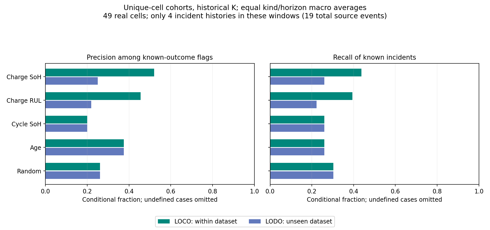

Charge SoH picks the right batteries better than cycle SoH, age and random on the paired known-outcome comparisons within datasets, but that advantage does not survive unseen battery types. The RUL alternative does not establish a consistent advantage either. This supports only a clearly labelled workflow demo for Baaz, not an accuracy claim: just 4 of the 19 source incident histories appear in the unique-cell windows, with synthetic commissioning dates and incomplete outcomes.

# Hybrid fleet forecast

## Design and leakage controls

Preregistration commit: `a4285040ff8b02552af01aee53caaec75eb0fc8b`, made before ranking evaluation. No model
fitting, tuning, score transformation or post-result seed selection occurred.
All earlier tracked artifacts were hashed before/after and remain unchanged.
There are 7,200 v2 cohort/date/horizon/protocol cases and 120 unique-cell cases,
each retaining five methods and two planned K modes, including unavailable
oracle records: **73,200 method/K rows**.

The v2 evaluation reads the saved 50/200/1,000-copy staggered layouts, all 20
seeds, five today points (0/15/30/45/60), three horizons (30/60/90 days), and both
holdout protocols. Unique cohorts contain each original inventory cell once:
CALCE 7, NASA 34, Oxford 8; mixed is their 49-cell union. Their offsets are the
first occurrence of each cell in the first registered v2 single-dataset layout,
reused in mixed. These are **synthetic commissioning dates**, not real pack dates;
the unique version has no duplicate source cell within a cohort. All histories
advance at the same fixed two-source-cycles/day scenario conversion.

Only saved held-out training-selected charge predictions and E1 cycle-only
predictions are used. Every available source was re-audited against its training/
selection and outer-test membership; LODO excludes its entire dataset. Mixed
LODO routes each source to the model excluding that source dataset. Other cells'
full trajectories may be in training; this is not prospective calendar holdout.
Ranking functions receive only model scores, age and fixed outcome-blind tie
keys. Reference capacity labels and future observations never enter a score.

## Fixed rankings, budgets and missing scores

- **Charge SoH (primary):** lowest latest raw held-out predicted SoH first.
- **Charge RUL (secondary):** shortest frozen v2 raw linear remaining life first,
  including finite overdue/negative RUL. It is reported independently of SoH.
- **Cycle SoH:** lowest latest raw E1 cycle-model predicted SoH first.
- **Age:** oldest since commissioning first.
- **Random:** 2,000 equivalent uniform top-K draws per available case, with
  fixed seeds shared between protocols. Hypergeometric category draws evaluate
  uniformly selected sets without sorting 2,000 full permutations. Exact random
  expected positives are saved as a check; random draws add no real evidence.

Current SoH needs a finite last raw past point; absent or ended eligible histories
are missing. RUL retains v2's insufficient/flat/unsupported/ended/no-prefix rules.
For each model, finite scores rank first; **all missing-score members follow,
oldest first**, with SHA-256 tie-breaking fixed before the study. Missing members
are never dropped. This tests each score plus its registered availability/fallback
policy; fallback counts must accompany ranking metrics.

**Historical K is the primary usable budget:** v2's local observed first-crossing
events / observed at-risk battery-days, multiplied by horizon and at-risk size,
capped at that size, then rounded half-up. Unique cohorts recompute this rate
from their own past. All methods use the same K and at-risk pool; no future-label
or paired-availability filtering occurs before selection. Routine swaps are not
permanent replacements. Past events here are reference-threshold detections.

**Oracle K is diagnostic only, unusable in practice:** actual future incidents
in that same pool, available only when every at-risk outcome is known. Unknown
outcomes do not become non-events and are not filtered out to create an oracle.
The ranking order stays fixed; only the K cutoff changes.

## Precision and recall: unique real cells first

Each method entry is **precision / recall (%)**, macro-averaged over defined
today cases. Precision is the fraction of flagged **known-outcome** members
that crossed 70%; recall is the fraction of **known incidents** that were flagged.
These are exact only in fully observed cases; otherwise they are conditional
diagnostics, and methods can have different known-flag denominators. The paired
differences below compare only mutually defined cases. Full-population bounds
are reported later. “—” means undefined, not zero or perfect accuracy.
K=0 leaves precision undefined and gives recall=0 if incidents exist; no incidents
leaves recall undefined. Incident-source counts are distinct real histories with
at least one known incident in that group's windows, not independent events per row.

### Primary: historical K, unique-cell cohorts

| Protocol   | Fleet   |   Days | Real sources   |   Incident sources | K available / cases   | Charge SoH P / R %   | Charge RUL P / R %   | Cycle SoH P / R %   | Age P / R %   | Random P / R %   |
|:-----------|:--------|-------:|:---------------|-------------------:|:----------------------|:---------------------|:---------------------|:--------------------|:--------------|:-----------------|
| LOCO       | calce   |     30 | 7–7            |                  1 | 5 / 5                 | — / 0.0              | — / 0.0              | — / 0.0             | — / 0.0       | — / 0.0          |
| LOCO       | calce   |     60 | 7–7            |                  1 | 5 / 5                 | — / 0.0              | — / 0.0              | — / 0.0             | — / 0.0       | — / 0.0          |
| LOCO       | calce   |     90 | 7–7            |                  1 | 5 / 5                 | — / 0.0              | — / 0.0              | — / 0.0             | — / 0.0       | — / 0.0          |
| LOCO       | mixed   |     30 | 49–49          |                  4 | 5 / 5                 | — / 0.0              | — / 0.0              | — / 0.0             | — / 0.0       | — / 0.0          |
| LOCO       | mixed   |     60 | 49–49          |                  4 | 5 / 5                 | 60.0 / 75.0          | 60.0 / 75.0          | 0.0 / 0.0           | 0.0 / 0.0     | 10.0 / 5.1       |
| LOCO       | mixed   |     90 | 49–49          |                  4 | 5 / 5                 | 100.0 / 85.0         | 80.0 / 80.0          | 0.0 / 0.0           | 0.0 / 0.0     | 14.1 / 5.0       |
| LOCO       | nasa    |     30 | 34–34          |                  3 | 5 / 5                 | 12.5 / 33.3          | 0.0 / 0.0            | 12.5 / 33.3         | 100.0 / 33.3  | 18.7 / 63.0      |
| LOCO       | nasa    |     60 | 34–34          |                  3 | 5 / 5                 | 37.5 / 100.0         | 37.5 / 100.0         | 37.5 / 100.0        | 37.5 / 100.0  | 37.5 / 100.0     |
| LOCO       | nasa    |     90 | 34–34          |                  3 | 5 / 5                 | 50.0 / 100.0         | 50.0 / 100.0         | 50.0 / 100.0        | 50.0 / 100.0  | 50.0 / 100.0     |
| LOCO       | oxford  |     30 | 8–8            |                  0 | 5 / 5                 | — / —                | — / —                | — / —               | — / —         | — / —            |
| LOCO       | oxford  |     60 | 8–8            |                  0 | 5 / 5                 | — / —                | — / —                | — / —               | — / —         | — / —            |
| LOCO       | oxford  |     90 | 8–8            |                  0 | 5 / 5                 | — / —                | — / —                | — / —               | — / —         | — / —            |
| LODO       | calce   |     30 | 7–7            |                  1 | 5 / 5                 | — / 0.0              | — / 0.0              | — / 0.0             | — / 0.0       | — / 0.0          |
| LODO       | calce   |     60 | 7–7            |                  1 | 5 / 5                 | — / 0.0              | — / 0.0              | — / 0.0             | — / 0.0       | — / 0.0          |
| LODO       | calce   |     90 | 7–7            |                  1 | 5 / 5                 | — / 0.0              | — / 0.0              | — / 0.0             | — / 0.0       | — / 0.0          |
| LODO       | mixed   |     30 | 49–49          |                  4 | 5 / 5                 | — / 0.0              | — / 0.0              | — / 0.0             | — / 0.0       | — / 0.0          |
| LODO       | mixed   |     60 | 49–49          |                  4 | 5 / 5                 | 0.0 / 0.0            | 0.0 / 0.0            | 0.0 / 0.0           | 0.0 / 0.0     | 10.0 / 5.1       |
| LODO       | mixed   |     90 | 49–49          |                  4 | 5 / 5                 | — / 0.0              | — / 0.0              | 0.0 / 0.0           | 0.0 / 0.0     | 14.1 / 5.0       |
| LODO       | nasa    |     30 | 34–34          |                  3 | 5 / 5                 | 12.5 / 33.3          | 0.0 / 0.0            | 12.5 / 33.3         | 100.0 / 33.3  | 18.7 / 63.0      |
| LODO       | nasa    |     60 | 34–34          |                  3 | 5 / 5                 | 37.5 / 100.0         | 37.5 / 100.0         | 37.5 / 100.0        | 37.5 / 100.0  | 37.5 / 100.0     |
| LODO       | nasa    |     90 | 34–34          |                  3 | 5 / 5                 | 50.0 / 100.0         | 50.0 / 100.0         | 50.0 / 100.0        | 50.0 / 100.0  | 50.0 / 100.0     |
| LODO       | oxford  |     30 | 8–8            |                  0 | 5 / 5                 | — / —                | — / —                | — / —               | — / —         | — / —            |
| LODO       | oxford  |     60 | 8–8            |                  0 | 5 / 5                 | — / —                | — / —                | — / —               | — / —         | — / —            |
| LODO       | oxford  |     90 | 8–8            |                  0 | 5 / 5                 | — / —                | — / —                | — / —               | — / —         | — / —            |

### Diagnostic only: oracle K, unique-cell cohorts

An available oracle with zero incidents has K=0 and undefined P/R. K availability
does not imply an informative positive-event ranking test.

| Protocol   | Fleet   |   Days | Real sources   |   Incident sources | K available / cases   | Charge SoH P / R %   | Charge RUL P / R %   | Cycle SoH P / R %   | Age P / R %   | Random P / R %   |
|:-----------|:--------|-------:|:---------------|-------------------:|:----------------------|:---------------------|:---------------------|:--------------------|:--------------|:-----------------|
| LOCO       | calce   |     30 | 7–7            |                  1 | 5 / 5                 | 100.0 / 100.0        | 100.0 / 100.0        | 100.0 / 100.0       | 100.0 / 100.0 | 23.9 / 23.9      |
| LOCO       | calce   |     60 | 7–7            |                  1 | 5 / 5                 | 100.0 / 100.0        | 100.0 / 100.0        | 100.0 / 100.0       | 100.0 / 100.0 | 25.5 / 25.5      |
| LOCO       | calce   |     90 | 7–7            |                  1 | 5 / 5                 | 100.0 / 100.0        | 80.0 / 80.0          | 100.0 / 100.0       | 100.0 / 100.0 | 24.9 / 24.9      |
| LOCO       | mixed   |     30 | 49–49          |                  4 | 0 / 5                 | — / —                | — / —                | — / —               | — / —         | — / —            |
| LOCO       | mixed   |     60 | 49–49          |                  4 | 0 / 5                 | — / —                | — / —                | — / —               | — / —         | — / —            |
| LOCO       | mixed   |     90 | 49–49          |                  4 | 0 / 5                 | — / —                | — / —                | — / —               | — / —         | — / —            |
| LOCO       | nasa    |     30 | 34–34          |                  3 | 0 / 5                 | — / —                | — / —                | — / —               | — / —         | — / —            |
| LOCO       | nasa    |     60 | 34–34          |                  3 | 0 / 5                 | — / —                | — / —                | — / —               | — / —         | — / —            |
| LOCO       | nasa    |     90 | 34–34          |                  3 | 0 / 5                 | — / —                | — / —                | — / —               | — / —         | — / —            |
| LOCO       | oxford  |     30 | 8–8            |                  0 | 0 / 5                 | — / —                | — / —                | — / —               | — / —         | — / —            |
| LOCO       | oxford  |     60 | 8–8            |                  0 | 0 / 5                 | — / —                | — / —                | — / —               | — / —         | — / —            |
| LOCO       | oxford  |     90 | 8–8            |                  0 | 0 / 5                 | — / —                | — / —                | — / —               | — / —         | — / —            |
| LODO       | calce   |     30 | 7–7            |                  1 | 5 / 5                 | 100.0 / 100.0        | 100.0 / 100.0        | 0.0 / 0.0           | 100.0 / 100.0 | 23.9 / 23.9      |
| LODO       | calce   |     60 | 7–7            |                  1 | 5 / 5                 | 100.0 / 100.0        | 100.0 / 100.0        | 0.0 / 0.0           | 100.0 / 100.0 | 25.5 / 25.5      |
| LODO       | calce   |     90 | 7–7            |                  1 | 5 / 5                 | 100.0 / 100.0        | 80.0 / 80.0          | 0.0 / 0.0           | 100.0 / 100.0 | 24.9 / 24.9      |
| LODO       | mixed   |     30 | 49–49          |                  4 | 0 / 5                 | — / —                | — / —                | — / —               | — / —         | — / —            |
| LODO       | mixed   |     60 | 49–49          |                  4 | 0 / 5                 | — / —                | — / —                | — / —               | — / —         | — / —            |
| LODO       | mixed   |     90 | 49–49          |                  4 | 0 / 5                 | — / —                | — / —                | — / —               | — / —         | — / —            |
| LODO       | nasa    |     30 | 34–34          |                  3 | 0 / 5                 | — / —                | — / —                | — / —               | — / —         | — / —            |
| LODO       | nasa    |     60 | 34–34          |                  3 | 0 / 5                 | — / —                | — / —                | — / —               | — / —         | — / —            |
| LODO       | nasa    |     90 | 34–34          |                  3 | 0 / 5                 | — / —                | — / —                | — / —               | — / —         | — / —            |
| LODO       | oxford  |     30 | 8–8            |                  0 | 0 / 5                 | — / —                | — / —                | — / —               | — / —         | — / —            |
| LODO       | oxford  |     60 | 8–8            |                  0 | 0 / 5                 | — / —                | — / —                | — / —               | — / —         | — / —            |
| LODO       | oxford  |     90 | 8–8            |                  0 | 0 / 5                 | — / —                | — / —                | — / —               | — / —         | — / —            |

### Paired comparisons on unique cells, historical K

Differences are **charge minus baseline, percentage points**, equally averaged
over available fleet-kind/horizon groups. Precision and recall use their own
mutually defined cases; window-record totals are correlated repeated evaluations,
not independent batteries. A consistent advantage requires positive differences
for both metrics against all three alternatives; do not choose SoH or RUL after
seeing which looks better. Detailed per-dataset/horizon paired counts and real
positive-source support are in [paired_comparisons.csv](paired_comparisons.csv).

| validation            | model      | baseline   | metric    |   defined_groups |   paired_window_records |   difference_pp |
|:----------------------|:-----------|:-----------|:----------|-----------------:|------------------------:|----------------:|
| leave_one_cell_out    | charge_rul | age        | precision |                4 |                      14 |           35.00 |
| leave_one_cell_out    | charge_rul | age        | recall    |                9 |                      23 |           13.52 |
| leave_one_cell_out    | charge_rul | cycle_soh  | precision |                5 |                       9 |            0.00 |
| leave_one_cell_out    | charge_rul | cycle_soh  | recall    |                9 |                      23 |           13.52 |
| leave_one_cell_out    | charge_rul | random     | precision |                5 |                      16 |           23.18 |
| leave_one_cell_out    | charge_rul | random     | recall    |                9 |                      23 |            9.10 |
| leave_one_cell_out    | charge_soh | age        | precision |                5 |                      15 |           22.00 |
| leave_one_cell_out    | charge_soh | age        | recall    |                9 |                      23 |           17.78 |
| leave_one_cell_out    | charge_soh | cycle_soh  | precision |                5 |                      11 |           20.00 |
| leave_one_cell_out    | charge_soh | cycle_soh  | recall    |                9 |                      23 |           17.78 |
| leave_one_cell_out    | charge_soh | random     | precision |                5 |                      18 |           25.94 |
| leave_one_cell_out    | charge_soh | random     | recall    |                9 |                      23 |           13.35 |
| leave_one_dataset_out | charge_rul | age        | precision |                4 |                       7 |          -25.00 |
| leave_one_dataset_out | charge_rul | age        | recall    |                9 |                      23 |           -3.70 |
| leave_one_dataset_out | charge_rul | cycle_soh  | precision |                4 |                      10 |           -3.12 |
| leave_one_dataset_out | charge_rul | cycle_soh  | recall    |                9 |                      23 |           -3.70 |
| leave_one_dataset_out | charge_rul | random     | precision |                4 |                      10 |           -7.36 |
| leave_one_dataset_out | charge_rul | random     | recall    |                9 |                      23 |           -8.13 |
| leave_one_dataset_out | charge_soh | age        | precision |                4 |                       7 |          -12.50 |
| leave_one_dataset_out | charge_soh | age        | recall    |                9 |                      23 |            0.00 |
| leave_one_dataset_out | charge_soh | cycle_soh  | precision |                4 |                      10 |            0.00 |
| leave_one_dataset_out | charge_soh | cycle_soh  | recall    |                9 |                      23 |            0.00 |
| leave_one_dataset_out | charge_soh | random     | precision |                4 |                      10 |           -4.23 |
| leave_one_dataset_out | charge_soh | random     | recall    |                9 |                      23 |           -4.42 |

The positive within-dataset charge-SoH comparison is descriptive and is driven
by a few mixed-fleet windows. It does not persist in LODO: SoH ties cycle SoH on
the paired conditional metrics, loses precision to age, and loses both metrics
to random. RUL does not dominate all alternatives even within datasets.

The unique-cell **CALCE historical budget rounds to K=0 at every today/horizon**,
so its primary recall is zero when that one source incident is in the horizon;
ranking cannot repair a zero replacement budget. Its 100% oracle results are
one real incident history repeated across windows, also caught by age, not
evidence of model superiority. Unique NASA flags **every at-risk member** at
60 and 90 days, making all ranking methods identical at those cutoffs; its
100% known-incident recall therefore does not demonstrate useful prioritization.
Oxford has no unique-cell incident windows. These cases sharply limit the test.

## One ranking comparison chart

This uses unique-cell historical K only. Bars average available fleet-kind/
horizon groups equally; conditional denominators and omitted undefined cases
are exposed in [metrics.csv](metrics.csv) and the bounds table, not evidence of
complete-fleet accuracy. Mixed and single-dataset cohorts share real histories.

## V2 layout sensitivity: copies are not new batteries

The following tables average sizes equally, then all fixed seeds/dates within
each size. They describe the operating scenario of flagging copies; they do not
multiply independent evidence. Real-source ranges are shown instead of labelling
1,000 copies as a sample of 1,000 real batteries. For size-specific precision/
recall, defined cases, K, fallback, and unique/event support, see [metrics.csv](metrics.csv).

### Primary: historical K on saved v2 layouts

| Protocol   | Fleet   |   Days | Real sources   |   Incident sources | K available / cases   | Charge SoH P / R %   | Charge RUL P / R %   | Cycle SoH P / R %   | Age P / R %   | Random P / R %   |
|:-----------|:--------|-------:|:---------------|-------------------:|:----------------------|:---------------------|:---------------------|:--------------------|:--------------|:-----------------|
| LOCO       | calce   |     30 | 7–7            |                  7 | 300 / 300             | 63.4 / 42.3          | 48.6 / 30.5          | 41.6 / 26.2         | 40.2 / 25.7   | 5.7 / 3.5        |
| LOCO       | calce   |     60 | 7–7            |                  7 | 300 / 300             | 80.5 / 53.6          | 54.1 / 34.2          | 55.0 / 35.9         | 57.3 / 37.6   | 11.1 / 6.9       |
| LOCO       | calce   |     90 | 7–7            |                  7 | 300 / 300             | 87.8 / 56.7          | 60.1 / 37.6          | 63.6 / 40.9         | 66.4 / 42.8   | 16.5 / 10.1      |
| LOCO       | mixed   |     30 | 22–49          |                 19 | 300 / 300             | 76.8 / 19.0          | 71.7 / 15.9          | 51.2 / 11.5         | 0.0 / 0.0     | 3.8 / 0.6        |
| LOCO       | mixed   |     60 | 22–49          |                 19 | 300 / 300             | 83.3 / 39.8          | 72.6 / 29.5          | 76.0 / 28.9         | 5.8 / 1.4     | 6.8 / 2.3        |
| LOCO       | mixed   |     90 | 22–49          |                 19 | 300 / 300             | 89.9 / 42.2          | 75.0 / 30.5          | 84.4 / 31.0         | 8.7 / 1.8     | 9.6 / 3.2        |
| LOCO       | nasa    |     30 | 24–34          |                 10 | 300 / 300             | 63.7 / 95.7          | 64.8 / 90.0          | 63.3 / 95.3         | 74.1 / 21.4   | 60.8 / 60.5      |
| LOCO       | nasa    |     60 | 24–34          |                 10 | 300 / 300             | 86.0 / 99.6          | 85.7 / 98.7          | 86.0 / 99.6         | 85.1 / 95.7   | 85.4 / 98.3      |
| LOCO       | nasa    |     90 | 24–34          |                 10 | 300 / 300             | 88.4 / 100.0         | 88.4 / 100.0         | 88.4 / 100.0        | 88.4 / 100.0  | 88.4 / 100.0     |
| LOCO       | oxford  |     30 | 8–8            |                  2 | 300 / 300             | 0.0 / 0.0            | 0.0 / 0.0            | 0.0 / 0.0           | — / 0.0       | 0.2 / 0.0        |
| LOCO       | oxford  |     60 | 8–8            |                  2 | 300 / 300             | 0.0 / 0.0            | 0.0 / 0.0            | 0.0 / 0.0           | — / 0.0       | 0.5 / 0.1        |
| LOCO       | oxford  |     90 | 8–8            |                  2 | 300 / 300             | 0.0 / 0.0            | 0.0 / 0.0            | 0.0 / 0.0           | — / 0.0       | 0.7 / 0.3        |
| LODO       | calce   |     30 | 7–7            |                  7 | 300 / 300             | 62.8 / 42.3          | 60.1 / 39.6          | 0.0 / 0.0           | 40.2 / 25.7   | 5.7 / 3.5        |
| LODO       | calce   |     60 | 7–7            |                  7 | 300 / 300             | 80.8 / 53.4          | 69.2 / 44.0          | 0.0 / 0.0           | 57.3 / 37.6   | 11.1 / 6.9       |
| LODO       | calce   |     90 | 7–7            |                  7 | 300 / 300             | 87.0 / 56.5          | 68.1 / 42.8          | 0.0 / 0.0           | 66.4 / 42.8   | 16.5 / 10.1      |
| LODO       | mixed   |     30 | 22–49          |                 19 | 300 / 300             | 56.3 / 8.3           | 53.7 / 9.1           | 0.7 / 0.2           | 0.0 / 0.0     | 3.8 / 0.6        |
| LODO       | mixed   |     60 | 22–49          |                 19 | 300 / 300             | 83.7 / 26.3          | 73.7 / 22.6          | 4.0 / 1.6           | 5.8 / 1.4     | 6.8 / 2.3        |
| LODO       | mixed   |     90 | 22–49          |                 19 | 300 / 300             | 93.4 / 30.7          | 78.4 / 24.3          | 7.4 / 2.6           | 8.7 / 1.8     | 9.6 / 3.2        |
| LODO       | nasa    |     30 | 24–34          |                 10 | 300 / 300             | 63.6 / 95.6          | 60.7 / 78.4          | 63.4 / 95.3         | 74.1 / 21.4   | 60.8 / 60.5      |
| LODO       | nasa    |     60 | 24–34          |                 10 | 300 / 300             | 86.0 / 99.6          | 85.6 / 98.6          | 86.0 / 99.6         | 85.1 / 95.7   | 85.4 / 98.3      |
| LODO       | nasa    |     90 | 24–34          |                 10 | 300 / 300             | 88.4 / 100.0         | 88.4 / 100.0         | 88.4 / 100.0        | 88.4 / 100.0  | 88.4 / 100.0     |
| LODO       | oxford  |     30 | 8–8            |                  2 | 300 / 300             | 0.0 / 0.0            | 0.0 / 0.0            | 0.0 / 0.0           | — / 0.0       | 0.2 / 0.0        |
| LODO       | oxford  |     60 | 8–8            |                  2 | 300 / 300             | 0.0 / 0.0            | 0.0 / 0.0            | 0.0 / 0.0           | — / 0.0       | 0.5 / 0.1        |
| LODO       | oxford  |     90 | 8–8            |                  2 | 300 / 300             | 0.0 / 0.0            | 0.0 / 0.0            | 0.0 / 0.0           | — / 0.0       | 0.7 / 0.3        |

### Diagnostic only: oracle K on saved v2 layouts

| Protocol   | Fleet   |   Days | Real sources   |   Incident sources | K available / cases   | Charge SoH P / R %   | Charge RUL P / R %   | Cycle SoH P / R %   | Age P / R %   | Random P / R %   |
|:-----------|:--------|-------:|:---------------|-------------------:|:----------------------|:---------------------|:---------------------|:--------------------|:--------------|:-----------------|
| LOCO       | calce   |     30 | 7–7            |                  7 | 300 / 300             | 61.3 / 61.3          | 38.6 / 38.6          | 36.0 / 36.0         | 38.0 / 38.0   | 6.1 / 6.1        |
| LOCO       | calce   |     60 | 7–7            |                  7 | 300 / 300             | 76.4 / 76.4          | 44.3 / 44.3          | 47.3 / 47.3         | 50.3 / 50.3   | 11.4 / 11.4      |
| LOCO       | calce   |     90 | 7–7            |                  7 | 300 / 300             | 79.5 / 79.5          | 47.6 / 47.6          | 55.3 / 55.3         | 59.3 / 59.3   | 16.5 / 16.5      |
| LOCO       | mixed   |     30 | 22–49          |                 19 | 0 / 300               | — / —                | — / —                | — / —               | — / —         | — / —            |
| LOCO       | mixed   |     60 | 22–49          |                 19 | 0 / 300               | — / —                | — / —                | — / —               | — / —         | — / —            |
| LOCO       | mixed   |     90 | 22–49          |                 19 | 0 / 300               | — / —                | — / —                | — / —               | — / —         | — / —            |
| LOCO       | nasa    |     30 | 24–34          |                 10 | 0 / 300               | — / —                | — / —                | — / —               | — / —         | — / —            |
| LOCO       | nasa    |     60 | 24–34          |                 10 | 0 / 300               | — / —                | — / —                | — / —               | — / —         | — / —            |
| LOCO       | nasa    |     90 | 24–34          |                 10 | 0 / 300               | — / —                | — / —                | — / —               | — / —         | — / —            |
| LOCO       | oxford  |     30 | 8–8            |                  2 | 0 / 300               | — / —                | — / —                | — / —               | — / —         | — / —            |
| LOCO       | oxford  |     60 | 8–8            |                  2 | 0 / 300               | — / —                | — / —                | — / —               | — / —         | — / —            |
| LOCO       | oxford  |     90 | 8–8            |                  2 | 0 / 300               | — / —                | — / —                | — / —               | — / —         | — / —            |
| LODO       | calce   |     30 | 7–7            |                  7 | 300 / 300             | 61.9 / 61.9          | 53.9 / 53.9          | 0.0 / 0.0           | 38.0 / 38.0   | 6.1 / 6.1        |
| LODO       | calce   |     60 | 7–7            |                  7 | 300 / 300             | 74.8 / 74.8          | 57.3 / 57.3          | 0.0 / 0.0           | 50.3 / 50.3   | 11.4 / 11.4      |
| LODO       | calce   |     90 | 7–7            |                  7 | 300 / 300             | 79.0 / 79.0          | 55.2 / 55.2          | 0.0 / 0.0           | 59.3 / 59.3   | 16.5 / 16.5      |
| LODO       | mixed   |     30 | 22–49          |                 19 | 0 / 300               | — / —                | — / —                | — / —               | — / —         | — / —            |
| LODO       | mixed   |     60 | 22–49          |                 19 | 0 / 300               | — / —                | — / —                | — / —               | — / —         | — / —            |
| LODO       | mixed   |     90 | 22–49          |                 19 | 0 / 300               | — / —                | — / —                | — / —               | — / —         | — / —            |
| LODO       | nasa    |     30 | 24–34          |                 10 | 0 / 300               | — / —                | — / —                | — / —               | — / —         | — / —            |
| LODO       | nasa    |     60 | 24–34          |                 10 | 0 / 300               | — / —                | — / —                | — / —               | — / —         | — / —            |
| LODO       | nasa    |     90 | 24–34          |                 10 | 0 / 300               | — / —                | — / —                | — / —               | — / —         | — / —            |
| LODO       | oxford  |     30 | 8–8            |                  2 | 0 / 300               | — / —                | — / —                | — / —               | — / —         | — / —            |
| LODO       | oxford  |     60 | 8–8            |                  2 | 0 / 300               | — / —                | — / —                | — / —               | — / —         | — / —            |
| LODO       | oxford  |     90 | 8–8            |                  2 | 0 / 300               | — / —                | — / —                | — / —               | — / —         | — / —            |

## Censoring bounds and forecast coverage

If T known incidents and Uf unknown outcomes are flagged, full precision lies
between T/K and (T+Uf)/K. Recall bounds also allow unknown outcomes outside the
flagged set to be incidents; see the preregistration for exact formulas and
zero-denominator rules. Means below are means of per-scenario bounds, not
calibrated uncertainty intervals or precision/recall estimates. Wide bounds
prevent a reliable ranking claim even when conditional metrics look good.

| Protocol   | Fleet   | Method     | Precision bounds %   | Recall bounds %   | Defined conditional P / R cases   |
|:-----------|:--------|:-----------|:---------------------|:------------------|:----------------------------------|
| LOCO       | calce   | Age        | [—, —]               | [0.0, 0.0]        | 0 / 9 of 15                       |
| LOCO       | calce   | Charge RUL | [—, —]               | [0.0, 0.0]        | 0 / 9 of 15                       |
| LOCO       | calce   | Charge SoH | [—, —]               | [0.0, 0.0]        | 0 / 9 of 15                       |
| LOCO       | calce   | Cycle SoH  | [—, —]               | [0.0, 0.0]        | 0 / 9 of 15                       |
| LOCO       | calce   | Random     | [—, —]               | [0.0, 0.0]        | 0 / 9 of 15                       |
| LOCO       | mixed   | Age        | [0.0, 0.0]           | [0.0, 0.0]        | 10 / 11 of 15                     |
| LOCO       | mixed   | Charge RUL | [70.0, 70.0]         | [4.7, 46.7]       | 10 / 11 of 15                     |
| LOCO       | mixed   | Charge SoH | [80.0, 80.0]         | [5.2, 48.3]       | 10 / 11 of 15                     |
| LOCO       | mixed   | Cycle SoH  | [0.0, 70.0]          | [0.0, 23.3]       | 3 / 11 of 15                      |
| LOCO       | mixed   | Random     | [6.8, 51.2]          | [0.4, 17.7]       | 10 / 11 of 15                     |
| LOCO       | nasa    | Age        | [4.6, 97.2]          | [68.3, 98.5]      | 5 / 3 of 15                       |
| LOCO       | nasa    | Charge RUL | [3.6, 94.9]          | [66.7, 98.0]      | 6 / 3 of 15                       |
| LOCO       | nasa    | Charge SoH | [4.6, 92.7]          | [68.0, 98.3]      | 8 / 3 of 15                       |
| LOCO       | nasa    | Cycle SoH  | [4.6, 92.7]          | [68.0, 98.3]      | 8 / 3 of 15                       |
| LOCO       | nasa    | Random     | [5.4, 93.4]          | [68.9, 99.1]      | 8 / 3 of 15                       |
| LOCO       | oxford  | Age        | [—, —]               | [0.0, 0.0]        | 0 / 0 of 15                       |
| LOCO       | oxford  | Charge RUL | [—, —]               | [0.0, 0.0]        | 0 / 0 of 15                       |
| LOCO       | oxford  | Charge SoH | [—, —]               | [0.0, 0.0]        | 0 / 0 of 15                       |
| LOCO       | oxford  | Cycle SoH  | [—, —]               | [0.0, 0.0]        | 0 / 0 of 15                       |
| LOCO       | oxford  | Random     | [—, —]               | [0.0, 0.0]        | 0 / 0 of 15                       |
| LODO       | calce   | Age        | [—, —]               | [0.0, 0.0]        | 0 / 9 of 15                       |
| LODO       | calce   | Charge RUL | [—, —]               | [0.0, 0.0]        | 0 / 9 of 15                       |
| LODO       | calce   | Charge SoH | [—, —]               | [0.0, 0.0]        | 0 / 9 of 15                       |
| LODO       | calce   | Cycle SoH  | [—, —]               | [0.0, 0.0]        | 0 / 9 of 15                       |
| LODO       | calce   | Random     | [—, —]               | [0.0, 0.0]        | 0 / 9 of 15                       |
| LODO       | mixed   | Age        | [0.0, 0.0]           | [0.0, 0.0]        | 10 / 11 of 15                     |
| LODO       | mixed   | Charge RUL | [0.0, 80.0]          | [0.0, 24.7]       | 2 / 11 of 15                      |
| LODO       | mixed   | Charge SoH | [0.0, 80.0]          | [0.0, 24.7]       | 2 / 11 of 15                      |
| LODO       | mixed   | Cycle SoH  | [0.0, 0.0]           | [0.0, 0.0]        | 10 / 11 of 15                     |
| LODO       | mixed   | Random     | [6.8, 51.2]          | [0.4, 17.7]       | 10 / 11 of 15                     |
| LODO       | nasa    | Age        | [4.6, 97.2]          | [68.3, 98.5]      | 5 / 3 of 15                       |
| LODO       | nasa    | Charge RUL | [3.6, 92.7]          | [66.7, 97.8]      | 8 / 3 of 15                       |
| LODO       | nasa    | Charge SoH | [4.6, 92.7]          | [68.0, 98.3]      | 8 / 3 of 15                       |
| LODO       | nasa    | Cycle SoH  | [4.6, 92.7]          | [68.0, 98.3]      | 8 / 3 of 15                       |
| LODO       | nasa    | Random     | [5.4, 93.4]          | [68.9, 99.1]      | 8 / 3 of 15                       |
| LODO       | oxford  | Age        | [—, —]               | [0.0, 0.0]        | 0 / 0 of 15                       |
| LODO       | oxford  | Charge RUL | [—, —]               | [0.0, 0.0]        | 0 / 0 of 15                       |
| LODO       | oxford  | Charge SoH | [—, —]               | [0.0, 0.0]        | 0 / 0 of 15                       |
| LODO       | oxford  | Cycle SoH  | [—, —]               | [0.0, 0.0]        | 0 / 0 of 15                       |
| LODO       | oxford  | Random     | [—, —]               | [0.0, 0.0]        | 0 / 0 of 15                       |

Every case's bounds, true positives, known false positives, flagged unknowns,
unique flagged/caught sources, zero-K status and draw availability are saved in
[scenario_metrics.csv](scenario_metrics.csv). Fully observed historical-K unique
metrics are separately saved in [exact_only_summary.csv](exact_only_summary.csv);
undefined exact metrics are not replaced with conditional ones.

Model availability and fallback, averaged over kinds' registered windows/sizes:
the unit below is **unique real sources per scenario**, not independent copies.
RUL and point-SoH have deliberately different eligibility requirements.

| Population   | Protocol   | Fleet   | Method     |   Mean at-risk real sources |   Mean missing real sources |   Mean fallback-selected real sources |
|:-------------|:-----------|:--------|:-----------|----------------------------:|----------------------------:|--------------------------------------:|
| unique       | LOCO       | calce   | Charge RUL |                        4.00 |                        1.00 |                                  0.00 |
| unique       | LOCO       | calce   | Charge SoH |                        4.00 |                        0.00 |                                  0.00 |
| unique       | LOCO       | calce   | Cycle SoH  |                        4.00 |                        0.00 |                                  0.00 |
| unique       | LOCO       | mixed   | Charge RUL |                       19.80 |                       10.00 |                                  0.00 |
| unique       | LOCO       | mixed   | Charge SoH |                       19.80 |                        8.40 |                                  0.00 |
| unique       | LOCO       | mixed   | Cycle SoH  |                       19.80 |                        8.40 |                                  0.00 |
| unique       | LOCO       | nasa    | Charge RUL |                        8.80 |                        8.00 |                                  7.00 |
| unique       | LOCO       | nasa    | Charge SoH |                        8.80 |                        7.40 |                                  6.40 |
| unique       | LOCO       | nasa    | Cycle SoH  |                        8.80 |                        7.40 |                                  6.40 |
| unique       | LOCO       | oxford  | Charge RUL |                        7.00 |                        1.00 |                                  0.00 |
| unique       | LOCO       | oxford  | Charge SoH |                        7.00 |                        1.00 |                                  0.00 |
| unique       | LOCO       | oxford  | Cycle SoH  |                        7.00 |                        1.00 |                                  0.00 |
| unique       | LODO       | calce   | Charge RUL |                        4.00 |                        1.60 |                                  0.00 |
| unique       | LODO       | calce   | Charge SoH |                        4.00 |                        0.00 |                                  0.00 |
| unique       | LODO       | calce   | Cycle SoH  |                        4.00 |                        0.00 |                                  0.00 |
| unique       | LODO       | mixed   | Charge RUL |                       19.80 |                       16.20 |                                  0.00 |
| unique       | LODO       | mixed   | Charge SoH |                       19.80 |                        8.40 |                                  0.00 |
| unique       | LODO       | mixed   | Cycle SoH  |                       19.80 |                        8.40 |                                  0.00 |
| unique       | LODO       | nasa    | Charge RUL |                        8.80 |                        7.60 |                                  6.60 |
| unique       | LODO       | nasa    | Charge SoH |                        8.80 |                        7.40 |                                  6.40 |
| unique       | LODO       | nasa    | Cycle SoH  |                        8.80 |                        7.40 |                                  6.40 |
| unique       | LODO       | oxford  | Charge RUL |                        7.00 |                        7.00 |                                  0.00 |
| unique       | LODO       | oxford  | Charge SoH |                        7.00 |                        1.00 |                                  0.00 |
| unique       | LODO       | oxford  | Cycle SoH  |                        7.00 |                        1.00 |                                  0.00 |
| v2           | LOCO       | calce   | Charge RUL |                        6.97 |                        6.38 |                                  0.00 |
| v2           | LOCO       | calce   | Charge SoH |                        6.97 |                        0.05 |                                  0.00 |
| v2           | LOCO       | calce   | Cycle SoH  |                        6.97 |                        0.05 |                                  0.00 |
| v2           | LOCO       | mixed   | Charge RUL |                       21.79 |                       16.61 |                                  0.00 |
| v2           | LOCO       | mixed   | Charge SoH |                       21.79 |                        8.49 |                                  0.00 |
| v2           | LOCO       | mixed   | Cycle SoH  |                       21.79 |                        8.49 |                                  0.00 |
| v2           | LOCO       | nasa    | Charge RUL |                       10.54 |                        8.65 |                                  7.88 |
| v2           | LOCO       | nasa    | Charge SoH |                       10.54 |                        8.02 |                                  7.44 |
| v2           | LOCO       | nasa    | Cycle SoH  |                       10.54 |                        8.02 |                                  7.44 |
| v2           | LOCO       | oxford  | Charge RUL |                        8.00 |                        6.52 |                                  0.00 |
| v2           | LOCO       | oxford  | Charge SoH |                        8.00 |                        3.69 |                                  0.00 |
| v2           | LOCO       | oxford  | Cycle SoH  |                        8.00 |                        3.69 |                                  0.00 |
| v2           | LODO       | calce   | Charge RUL |                        6.97 |                        6.30 |                                  0.00 |
| v2           | LODO       | calce   | Charge SoH |                        6.97 |                        0.05 |                                  0.00 |
| v2           | LODO       | calce   | Cycle SoH  |                        6.97 |                        0.05 |                                  0.00 |
| v2           | LODO       | mixed   | Charge RUL |                       21.79 |                       19.14 |                                  0.00 |
| v2           | LODO       | mixed   | Charge SoH |                       21.79 |                        8.49 |                                  0.00 |
| v2           | LODO       | mixed   | Cycle SoH  |                       21.79 |                        8.49 |                                  0.00 |
| v2           | LODO       | nasa    | Charge RUL |                       10.54 |                        9.12 |                                  8.22 |
| v2           | LODO       | nasa    | Charge SoH |                       10.54 |                        8.02 |                                  7.44 |
| v2           | LODO       | nasa    | Cycle SoH  |                       10.54 |                        8.02 |                                  7.44 |
| v2           | LODO       | oxford  | Charge RUL |                        8.00 |                        7.98 |                                  0.00 |
| v2           | LODO       | oxford  | Charge SoH |                        8.00 |                        3.69 |                                  0.00 |
| v2           | LODO       | oxford  | Cycle SoH  |                        8.00 |                        3.69 |                                  0.00 |

Population and zero-denominator audit (windows include both protocols, which
share truth and do not create new endpoint events):

| representation   | kind   |   windows |   fully_observed |   zero_K |   zero_known_incidents |   mean_at_risk |   mean_real_at_risk |   mean_unknown |   flag_all_nonempty_windows |
|:-----------------|:-------|----------:|-----------------:|---------:|-----------------------:|---------------:|--------------------:|---------------:|----------------------------:|
| unique           | calce  |        30 |               30 |       30 |                     12 |           4.00 |                4.00 |           0.00 |                           0 |
| unique           | mixed  |        30 |                0 |       10 |                      8 |          19.80 |               19.80 |           8.60 |                           0 |
| unique           | nasa   |        30 |                0 |        0 |                     24 |           8.80 |                8.80 |           7.60 |                          20 |
| unique           | oxford |        30 |                0 |       30 |                     30 |           7.00 |                7.00 |           1.00 |                           0 |
| v2               | calce  |      1800 |             1800 |        0 |                     56 |         222.55 |                6.97 |           0.00 |                           0 |
| v2               | mixed  |      1800 |                0 |      236 |                    142 |         242.37 |               21.79 |          47.62 |                           0 |
| v2               | nasa   |      1800 |                0 |        0 |                    450 |         114.28 |               10.54 |          99.10 |                        1146 |
| v2               | oxford |      1800 |                0 |     1020 |                    802 |         390.46 |                8.00 |          48.05 |                           0 |

## How much independent evidence is present?

Across all source data there are **only 19 observed first-crossing events**:
7 CALCE, 10 NASA, 2 Oxford; the complete inventory is 49 real cells, and only
41 have eligible held-out model predictions. In this fixed unique-cell age mix,
**4 distinct real incident-source histories** appear in any evaluated
incident window; across the resampled v2 layouts the corresponding count is
19. Sources already known below threshold are outside the future-incident
population. Repeated windows/horizons, both protocols, mixed plus single-dataset
cohorts, random draws and copies never create additional independent events.

Unique-cell source support below counts each real source once across windows.
When a dataset has zero incident sources it cannot test event capture; when it
has only a handful it is too small for a reliable superiority conclusion.
Oracle results may be absent because complete follow-up is unavailable, not
because a method has zero error.

| kind   |   days |   scenario_windows |   min_real_sources |   max_real_sources |   distinct_positive_sources |   mean_at_risk_unique |   mean_unknown |   mean_at_risk |   zero_historical_k |   zero_known_positives |   fully_observed_windows |   oracle_unavailable |
|:-------|-------:|-------------------:|-------------------:|-------------------:|----------------------------:|----------------------:|---------------:|---------------:|--------------------:|-----------------------:|-------------------------:|---------------------:|
| calce  |     30 |                  5 |                  7 |                  7 |                           1 |                  4.00 |           0.00 |           4.00 |                   5 |                      4 |                        5 |                    0 |
| calce  |     60 |                  5 |                  7 |                  7 |                           1 |                  4.00 |           0.00 |           4.00 |                   5 |                      2 |                        5 |                    0 |
| calce  |     90 |                  5 |                  7 |                  7 |                           1 |                  4.00 |           0.00 |           4.00 |                   5 |                      0 |                        5 |                    0 |
| mixed  |     30 |                  5 |                 49 |                 49 |                           4 |                 19.80 |           8.20 |          19.80 |                   5 |                      3 |                        0 |                    5 |
| mixed  |     60 |                  5 |                 49 |                 49 |                           4 |                 19.80 |           8.60 |          19.80 |                   0 |                      1 |                        0 |                    5 |
| mixed  |     90 |                  5 |                 49 |                 49 |                           4 |                 19.80 |           9.00 |          19.80 |                   0 |                      0 |                        0 |                    5 |
| nasa   |     30 |                  5 |                 34 |                 34 |                           3 |                  8.80 |           7.20 |           8.80 |                   0 |                      4 |                        0 |                    5 |
| nasa   |     60 |                  5 |                 34 |                 34 |                           3 |                  8.80 |           7.60 |           8.80 |                   0 |                      4 |                        0 |                    5 |
| nasa   |     90 |                  5 |                 34 |                 34 |                           3 |                  8.80 |           8.00 |           8.80 |                   0 |                      4 |                        0 |                    5 |
| oxford |     30 |                  5 |                  8 |                  8 |                           0 |                  7.00 |           1.00 |           7.00 |                   5 |                      5 |                        0 |                    5 |
| oxford |     60 |                  5 |                  8 |                  8 |                           0 |                  7.00 |           1.00 |           7.00 |                   5 |                      5 |                        0 |                    5 |
| oxford |     90 |                  5 |                  8 |                  8 |                           0 |                  7.00 |           1.00 |           7.00 |                   5 |                      5 |                        0 |                    5 |

The uniform age mixture and missing-first/ended histories can change rankings and
fallback exposure. Lower SoH MAE does not guarantee better top-K event selection,
especially across chemistries. The 70% endpoint is a lab capacity surrogate;
Oxford's coarse checks and initially left-censored NASA cells restrict timing
and support. No significance or independent-battery confidence interval is
computed from these correlated evaluations. A qualified demonstration can show
budgeting, prioritization and missing-data handling; these results cannot prove
Baaz replacement targeting accuracy or operating savings.

## Baaz data needed to test this properly

Stable **pack IDs/types** linked across stations/vehicles; original
**commissioning dates** and refurbishment/exit dates; timestamped **swap logs**
with SoC, Ah/Wh throughput and linked charge voltage/current/temperature traces;
dated permanent **replacement records** with pack ID, reason, trigger and successor
ID (distinct from routine swaps); and periodic independent **capacity checks**
with measured Ah/Wh, rated reference, temperature, current, voltage cutoffs and QC.
Follow every evaluation pack through 90 days after the final today, record exits
and competing removals, and freeze pack/type/calendar holdouts, K, rankings and
fallbacks before outcomes. Many more unique packs and independently observed
replacement events are needed; target-calibration packs must be separate.

## Reproduction and audit artifacts

From the repository root: `.venv/bin/python scripts/hybrid_fleet.py`.
Add `--report-only` to refresh prose/chart from saved scores without rerunning
rank selection or Monte Carlo draws; raw-output integrity is checked and logged.
Read [preregistration.md](preregistration.md) and [run_manifest.json](run_manifest.json)
for the pre-run commit, exact inputs, settings, software and integrity hashes.
[unique_layouts.csv](unique_layouts.csv) records each cell's one retained offset;
[source_fold_audit.csv](source_fold_audit.csv) records held-out provenance;
[rank_audit.parquet](rank_audit.parquet) records all at-risk units' raw scores,
per-method order, missing flags, ages and truth for independent replay;
[case_audit.csv](case_audit.csv) records each fleet/date/horizon population and
historical/oracle budget; [source_support.csv](source_support.csv) and
[source_id_map.json](source_id_map.json) decode distinct-source support/masks.
The runner writes only hybrid files and does not rerun earlier experiments.
