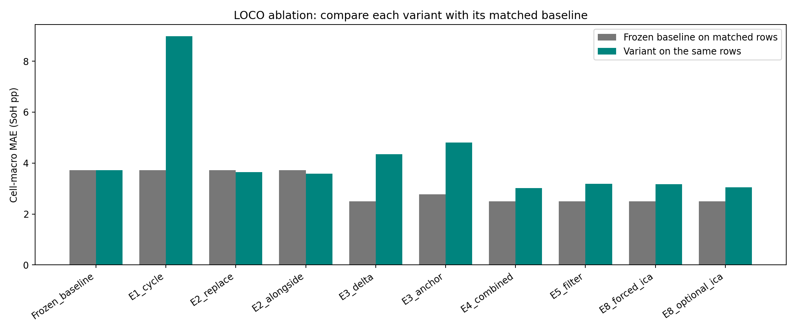
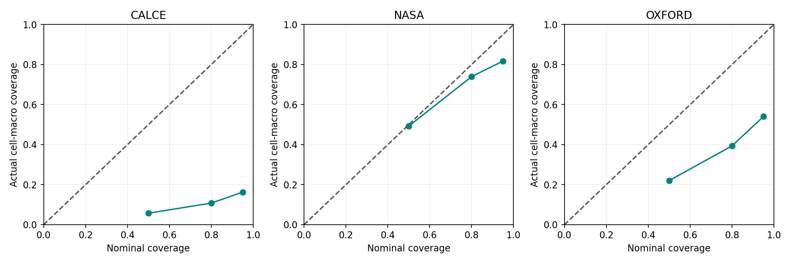
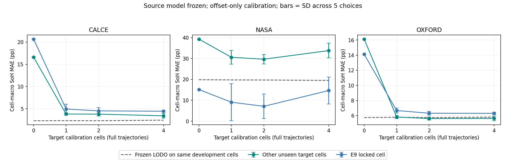

# Battery analytics: preregistered improvement results

**E1 answer: yes—the frozen charge-feature workflow beats the preregistered cycle-count-only curve on unseen cells, 3.72 versus 8.98 SoH percentage points cell-macro MAE.**

The simple charge-only baseline remains the recommendation. None of the added
tracking/feature pipelines establishes a robust improvement on a matched cohort;
probabilities are badly miscalibrated and short-horizon alerts remain weak.
Target calibration provides limited evidence for a paid validation pilot, not
out-of-the-box Baaz performance or validated replacement budgeting.

## Frozen reference and discipline

Tag `baseline-v1`; [hash manifest](baseline/manifest.json); [preregistration](preregistration.md).
Original source modules, prediction artifacts and metrics were verified unchanged.
Exact original 41 LOCO +3 LODO fold cell lists and inner splits were reused.
All new regressor fits are cell-balanced StandardScaler+Ridge(alpha1); E4/E8
representation selection occurs only inside the original inner cell split with
the preregistered 0.20-pp simpler-first rule. Noise and fleet priors use only
inner training cells; alert thresholds use only inner validation cells.

This is exploratory work on previously inspected public data. Cell separation
does not make the series an independent confirmatory trial. See all candidate
scores and provenance in each experiment's `audit.json`; no failed experiment
or difficult cell was removed after scoring. No hyperparameter changed after
outer-test results. [Deviations and implementation log](deviations.md).

## Ablation: primary and secondary metrics

Lower error is better. `delta_vs_matched_baseline_pp` >0 means WORSE on identical
rows. The frozen headline is 41 cells. K5 warmup variants score36; E3_anchor37.
Their lower unpaired averages cannot be advertised as gains over3.72. E6/E7
reuse E5 SoH, adding decisions rather than independent new SoH estimators.
E9 rows average five repeated choices (not independent cells); locked results
are separate. Missing matching fields are not a claim of full-cohort equivalence.

| experiment        | validation            |    n_rows |   n_cells |   cell_macro_mae_pp |   cell_macro_rmse_pp |   pooled_mae_pp |   pooled_rmse_pp |   equal_dataset_mae_pp |   matched_baseline_mae_pp |   delta_vs_matched_baseline_pp |
|:------------------|:----------------------|----------:|----------:|--------------------:|---------------------:|----------------:|-----------------:|-----------------------:|--------------------------:|-------------------------------:|
| Frozen_baseline   | leave_one_cell_out    | 14110.000 |    41.000 |               3.720 |                4.729 |           1.820 |            3.009 |                  2.588 |                   nan     |                        nan     |
| Frozen_baseline   | leave_one_dataset_out | 14110.000 |    41.000 |              13.887 |               14.942 |           4.778 |            8.071 |                  9.291 |                   nan     |                        nan     |
| E1_cycle          | leave_one_cell_out    | 14110.000 |    41.000 |               8.984 |                9.997 |           4.885 |            7.498 |                  6.028 |                     3.720 |                          5.264 |
| E1_cycle          | leave_one_dataset_out | 14110.000 |    41.000 |              48.996 |               63.380 |          20.505 |           60.808 |                 74.687 |                    13.887 |                         35.108 |
| E2_replace        | leave_one_cell_out    | 14110.000 |    41.000 |               3.639 |                4.667 |           1.813 |            2.971 |                  2.614 |                     3.720 |                         -0.081 |
| E2_replace        | leave_one_dataset_out | 14110.000 |    41.000 |              30.350 |               33.900 |          18.816 |           21.401 |                 23.801 |                    13.887 |                         16.462 |
| E2_alongside      | leave_one_cell_out    | 14110.000 |    41.000 |               3.578 |                4.603 |           1.814 |            2.954 |                  2.583 |                     3.720 |                         -0.142 |
| E2_alongside      | leave_one_dataset_out | 14110.000 |    41.000 |              62.611 |               65.202 |          30.459 |           40.032 |                 43.993 |                    13.887 |                         48.723 |
| E3_delta          | leave_one_cell_out    | 13924.000 |    36.000 |               4.344 |                5.560 |           3.982 |            5.195 |                  3.515 |                     2.502 |                          1.841 |
| E3_delta          | leave_one_dataset_out | 13924.000 |    36.000 |               7.578 |                8.812 |          10.516 |           11.730 |                  8.328 |                    12.244 |                         -4.666 |
| E3_anchor         | leave_one_cell_out    | 14069.000 |    37.000 |               4.805 |                5.806 |           5.269 |            7.149 |                  4.726 |                     2.779 |                          2.026 |
| E3_anchor         | leave_one_dataset_out | 14069.000 |    37.000 |              16.973 |               18.221 |           8.145 |           12.892 |                 13.713 |                    11.967 |                          5.006 |
| E4_combined       | leave_one_cell_out    | 13924.000 |    36.000 |               3.017 |                4.147 |           1.857 |            3.241 |                  2.209 |                     2.502 |                          0.515 |
| E4_combined       | leave_one_dataset_out | 13924.000 |    36.000 |              59.676 |               67.244 |          26.391 |           40.902 |                 61.699 |                    12.244 |                         47.433 |
| E5_filter         | leave_one_cell_out    | 13924.000 |    36.000 |               3.190 |                4.358 |           2.417 |            4.056 |                  2.497 |                     2.502 |                          0.687 |
| E5_filter         | leave_one_dataset_out | 13924.000 |    36.000 |              60.238 |               67.521 |          25.356 |           39.721 |                 60.451 |                    12.244 |                         47.994 |
| E6_probabilistic  | leave_one_cell_out    | 13924.000 |    36.000 |               3.190 |                4.358 |           2.417 |            4.056 |                  2.497 |                     2.502 |                          0.687 |
| E6_probabilistic  | leave_one_dataset_out | 13924.000 |    36.000 |              60.238 |               67.521 |          25.356 |           39.721 |                 60.451 |                    12.244 |                         47.994 |
| E7_fast           | leave_one_cell_out    | 13924.000 |    36.000 |               3.190 |                4.358 |           2.417 |            4.056 |                  2.497 |                     2.502 |                          0.687 |
| E7_fast           | leave_one_dataset_out | 13924.000 |    36.000 |              60.238 |               67.521 |          25.356 |           39.721 |                 60.451 |                    12.244 |                         47.994 |
| E8_forced_ica     | leave_one_cell_out    | 13924.000 |    36.000 |               3.173 |                4.352 |           1.811 |            3.355 |                  2.284 |                     2.502 |                          0.670 |
| E8_forced_ica     | leave_one_dataset_out | 13924.000 |    36.000 |              35.162 |               35.973 |          19.426 |           24.204 |                 27.656 |                    12.244 |                         22.918 |
| E8_optional_ica   | leave_one_cell_out    | 13924.000 |    36.000 |               3.042 |                4.173 |           1.858 |            3.240 |                  2.222 |                     2.502 |                          0.539 |
| E8_optional_ica   | leave_one_dataset_out | 13924.000 |    36.000 |              38.885 |               39.595 |          22.835 |           27.311 |                 30.512 |                    12.244 |                         26.641 |
| E9_k0_development | leave_one_dataset_out | 12055.000 |    38.000 |              31.432 |               35.213 |          18.562 |           21.532 |                 24.001 |                    14.467 |                         16.965 |
| E9_k0_locked      | leave_one_dataset_out |  2055.000 |     3.000 |              16.641 |               17.272 |          20.304 |           20.613 |                 16.641 |                     6.547 |                         10.094 |
| E9_k1_development | leave_one_dataset_out | 10246.200 |    35.000 |              22.508 |               26.733 |           6.285 |           12.269 |                 13.400 |                    14.851 |                          7.657 |
| E9_k1_locked      | leave_one_dataset_out |  2055.000 |     3.000 |               6.895 |                7.507 |           5.085 |            5.983 |                  6.895 |                     6.547 |                          0.348 |
| E9_k2_development | leave_one_dataset_out |  8399.400 |    32.000 |              22.671 |               27.217 |           6.347 |           12.633 |                 13.020 |                    15.340 |                          7.331 |
| E9_k2_locked      | leave_one_dataset_out |  2055.000 |     3.000 |               5.976 |                6.590 |           4.638 |            5.454 |                  5.976 |                     6.547 |                         -0.571 |
| E9_k4_development | leave_one_dataset_out |  4893.200 |    26.000 |              28.203 |               33.327 |           8.386 |           16.077 |                 14.275 |                    16.585 |                         11.618 |
| E9_k4_locked      | leave_one_dataset_out |  2055.000 |     3.000 |               8.469 |                9.045 |           4.705 |            5.682 |                  8.469 |                     6.547 |                          1.921 |

Full [metrics](all_metrics.csv), [matched baselines](all_matched_baselines.csv),
and per-experiment `coverage.csv` retain per-cell errors, raw/trailing-median,
row counts and unavailable cells. E9's complete metrics are in
[aggregate_metrics.csv](E9_calibration/aggregate_metrics.csv) and
[per-target/repetition metrics](E9_calibration/metrics.csv).

### Every variant by dataset

| experiment       | validation            | dataset   |   n_cells |   n_rows |   cell_macro_mae_pp |   cell_macro_rmse_pp |   pooled_mae_pp |
|:-----------------|:----------------------|:----------|----------:|---------:|--------------------:|---------------------:|----------------:|
| Frozen_baseline  | leave_one_cell_out    | calce     |         7 |    11911 |               1.592 |                2.081 |           1.627 |
| Frozen_baseline  | leave_one_cell_out    | nasa      |        26 |     1680 |               5.110 |                6.452 |           3.412 |
| Frozen_baseline  | leave_one_cell_out    | oxford    |         8 |      519 |               1.063 |                1.444 |           1.088 |
| Frozen_baseline  | leave_one_dataset_out | calce     |         7 |    11911 |               2.726 |                3.309 |           2.812 |
| Frozen_baseline  | leave_one_dataset_out | nasa      |        26 |     1680 |              19.396 |               20.544 |          18.413 |
| Frozen_baseline  | leave_one_dataset_out | oxford    |         8 |      519 |               5.750 |                6.912 |           5.768 |
| E1_cycle         | leave_one_cell_out    | calce     |         7 |    11911 |               4.225 |                5.571 |           4.407 |
| E1_cycle         | leave_one_cell_out    | nasa      |        26 |     1680 |              12.660 |               13.736 |           9.412 |
| E1_cycle         | leave_one_cell_out    | oxford    |         8 |      519 |               1.198 |                1.718 |           1.202 |
| E1_cycle         | leave_one_dataset_out | calce     |         7 |    11911 |              13.430 |               16.340 |          13.563 |
| E1_cycle         | leave_one_dataset_out | nasa      |        26 |     1680 |              12.764 |               14.531 |           9.310 |
| E1_cycle         | leave_one_dataset_out | oxford    |         8 |      519 |             197.868 |              263.302 |         216.071 |
| E2_replace       | leave_one_cell_out    | calce     |         7 |    11911 |               1.595 |                2.026 |           1.607 |
| E2_replace       | leave_one_cell_out    | nasa      |        26 |     1680 |               4.891 |                6.230 |           3.404 |
| E2_replace       | leave_one_cell_out    | oxford    |         8 |      519 |               1.357 |                1.895 |           1.384 |
| E2_replace       | leave_one_dataset_out | calce     |         7 |    11911 |              17.174 |               17.722 |          17.163 |
| E2_replace       | leave_one_dataset_out | nasa      |        26 |     1680 |              38.349 |               43.414 |          31.530 |
| E2_replace       | leave_one_dataset_out | oxford    |         8 |      519 |              15.881 |               17.137 |          15.575 |
| E2_alongside     | leave_one_cell_out    | calce     |         7 |    11911 |               1.597 |                2.018 |           1.608 |
| E2_alongside     | leave_one_cell_out    | nasa      |        26 |     1680 |               4.794 |                6.132 |           3.401 |
| E2_alongside     | leave_one_cell_out    | oxford    |         8 |      519 |               1.358 |                1.896 |           1.385 |
| E2_alongside     | leave_one_dataset_out | calce     |         7 |    11911 |              21.990 |               22.513 |          21.996 |
| E2_alongside     | leave_one_dataset_out | nasa      |        26 |     1680 |              85.177 |               88.916 |          92.289 |
| E2_alongside     | leave_one_dataset_out | oxford    |         8 |      519 |              24.811 |               25.483 |          24.549 |
| E3_delta         | leave_one_cell_out    | calce     |         7 |    11876 |               3.756 |                4.171 |           3.821 |
| E3_delta         | leave_one_cell_out    | nasa      |        21 |     1569 |               5.828 |                7.590 |           6.115 |
| E3_delta         | leave_one_cell_out    | oxford    |         8 |      479 |               0.962 |                1.446 |           0.980 |
| E3_delta         | leave_one_dataset_out | calce     |         7 |    11876 |              11.184 |               11.952 |          11.139 |
| E3_delta         | leave_one_dataset_out | nasa      |        21 |     1569 |               6.471 |                7.917 |           6.803 |
| E3_delta         | leave_one_dataset_out | oxford    |         8 |      479 |               7.328 |                8.416 |           7.218 |
| E3_anchor        | leave_one_cell_out    | calce     |         7 |    11904 |               5.103 |                5.425 |           5.043 |
| E3_anchor        | leave_one_cell_out    | nasa      |        22 |     1654 |               4.963 |                6.464 |           7.249 |
| E3_anchor        | leave_one_cell_out    | oxford    |         8 |      511 |               4.112 |                4.333 |           4.134 |
| E3_anchor        | leave_one_dataset_out | calce     |         7 |    11904 |               7.052 |                7.573 |           6.989 |
| E3_anchor        | leave_one_dataset_out | nasa      |        22 |     1654 |              21.852 |               23.247 |          15.111 |
| E3_anchor        | leave_one_dataset_out | oxford    |         8 |      511 |              12.234 |               13.717 |          12.521 |
| E4_combined      | leave_one_cell_out    | calce     |         7 |    11876 |               1.482 |                1.943 |           1.505 |
| E4_combined      | leave_one_cell_out    | nasa      |        21 |     1569 |               4.392 |                6.064 |           4.858 |
| E4_combined      | leave_one_cell_out    | oxford    |         8 |      479 |               0.751 |                1.045 |           0.761 |
| E4_combined      | leave_one_dataset_out | calce     |         7 |    11876 |              18.533 |               20.631 |          18.803 |
| E4_combined      | leave_one_dataset_out | nasa      |        21 |     1569 |              52.778 |               53.062 |          54.055 |
| E4_combined      | leave_one_dataset_out | oxford    |         8 |      479 |             113.786 |              145.258 |         123.902 |
| E5_filter        | leave_one_cell_out    | calce     |         7 |    11876 |               2.109 |                2.974 |           2.129 |
| E5_filter        | leave_one_cell_out    | nasa      |        21 |     1569 |               4.386 |                5.957 |           5.014 |
| E5_filter        | leave_one_cell_out    | oxford    |         8 |      479 |               0.994 |                1.374 |           1.030 |
| E5_filter        | leave_one_dataset_out | calce     |         7 |    11876 |              16.942 |               18.101 |          17.182 |
| E5_filter        | leave_one_dataset_out | nasa      |        21 |     1569 |              56.515 |               56.909 |          59.031 |
| E5_filter        | leave_one_dataset_out | oxford    |         8 |      479 |             107.896 |              138.620 |         117.722 |
| E6_probabilistic | leave_one_cell_out    | calce     |         7 |    11876 |               2.109 |                2.974 |           2.129 |
| E6_probabilistic | leave_one_cell_out    | nasa      |        21 |     1569 |               4.386 |                5.957 |           5.014 |
| E6_probabilistic | leave_one_cell_out    | oxford    |         8 |      479 |               0.994 |                1.374 |           1.030 |
| E6_probabilistic | leave_one_dataset_out | calce     |         7 |    11876 |              16.942 |               18.101 |          17.182 |
| E6_probabilistic | leave_one_dataset_out | nasa      |        21 |     1569 |              56.515 |               56.909 |          59.031 |
| E6_probabilistic | leave_one_dataset_out | oxford    |         8 |      479 |             107.896 |              138.620 |         117.722 |
| E7_fast          | leave_one_cell_out    | calce     |         7 |    11876 |               2.109 |                2.974 |           2.129 |
| E7_fast          | leave_one_cell_out    | nasa      |        21 |     1569 |               4.386 |                5.957 |           5.014 |
| E7_fast          | leave_one_cell_out    | oxford    |         8 |      479 |               0.994 |                1.374 |           1.030 |
| E7_fast          | leave_one_dataset_out | calce     |         7 |    11876 |              16.942 |               18.101 |          17.182 |
| E7_fast          | leave_one_dataset_out | nasa      |        21 |     1569 |              56.515 |               56.909 |          59.031 |
| E7_fast          | leave_one_dataset_out | oxford    |         8 |      479 |             107.896 |              138.620 |         117.722 |
| E8_forced_ica    | leave_one_cell_out    | calce     |         7 |    11876 |               1.417 |                1.845 |           1.436 |
| E8_forced_ica    | leave_one_cell_out    | nasa      |        21 |     1569 |               4.678 |                6.447 |           4.973 |
| E8_forced_ica    | leave_one_cell_out    | oxford    |         8 |      479 |               0.756 |                1.045 |           0.767 |
| E8_forced_ica    | leave_one_dataset_out | calce     |         7 |    11876 |              15.257 |               17.881 |          15.533 |
| E8_forced_ica    | leave_one_dataset_out | nasa      |        21 |     1569 |              47.487 |               47.769 |          48.545 |
| E8_forced_ica    | leave_one_dataset_out | oxford    |         8 |      479 |              20.224 |               20.839 |          20.554 |
| E8_optional_ica  | leave_one_cell_out    | calce     |         7 |    11876 |               1.481 |                1.939 |           1.504 |
| E8_optional_ica  | leave_one_cell_out    | nasa      |        21 |     1569 |               4.434 |                6.109 |           4.877 |
| E8_optional_ica  | leave_one_cell_out    | oxford    |         8 |      479 |               0.751 |                1.045 |           0.761 |
| E8_optional_ica  | leave_one_dataset_out | calce     |         7 |    11876 |              18.533 |               20.631 |          18.803 |
| E8_optional_ica  | leave_one_dataset_out | nasa      |        21 |     1569 |              52.778 |               53.062 |          54.055 |
| E8_optional_ica  | leave_one_dataset_out | oxford    |         8 |      479 |              20.224 |               20.839 |          20.554 |

### Low-health regions

Every variant and both protocols retain <70 and70–80% results in
[low_soh_bands.csv](low_soh_bands.csv); E9 bands are in its two complete metric
files above. Below are primary LOCO bands (sparse Oxford below70 is two points).

| experiment       | dataset   | band     |   n_cells |   n_rows |   cell_macro_mae_pp |   pooled_mae_pp |
|:-----------------|:----------|:---------|----------:|---------:|--------------------:|----------------:|
| Frozen_baseline  | calce     | below_70 |         7 |     3589 |               2.061 |           1.949 |
| Frozen_baseline  | calce     | 70_to_80 |         7 |     3141 |               1.305 |           1.486 |
| Frozen_baseline  | nasa      | below_70 |        14 |      334 |              16.054 |           6.083 |
| Frozen_baseline  | nasa      | 70_to_80 |        12 |      452 |               3.144 |           3.379 |
| Frozen_baseline  | oxford    | below_70 |         2 |        2 |               9.466 |           9.466 |
| Frozen_baseline  | oxford    | 70_to_80 |         7 |      113 |               1.586 |           1.527 |
| E1_cycle         | calce     | below_70 |         7 |     3589 |               7.824 |           7.023 |
| E1_cycle         | calce     | 70_to_80 |         7 |     3141 |               4.434 |           5.485 |
| E1_cycle         | nasa      | below_70 |        14 |      334 |              20.936 |           8.004 |
| E1_cycle         | nasa      | 70_to_80 |        12 |      452 |               5.337 |           6.090 |
| E1_cycle         | oxford    | below_70 |         2 |        2 |              14.837 |          14.837 |
| E1_cycle         | oxford    | 70_to_80 |         7 |      113 |               1.884 |           1.344 |
| E2_replace       | calce     | below_70 |         7 |     3589 |               1.899 |           1.705 |
| E2_replace       | calce     | 70_to_80 |         7 |     3141 |               1.470 |           1.589 |
| E2_replace       | nasa      | below_70 |        14 |      334 |              15.658 |           6.080 |
| E2_replace       | nasa      | 70_to_80 |        12 |      452 |               3.159 |           3.384 |
| E2_replace       | oxford    | below_70 |         2 |        2 |              11.759 |          11.759 |
| E2_replace       | oxford    | 70_to_80 |         7 |      113 |               1.632 |           1.911 |
| E2_alongside     | calce     | below_70 |         7 |     3589 |               1.906 |           1.699 |
| E2_alongside     | calce     | 70_to_80 |         7 |     3141 |               1.471 |           1.591 |
| E2_alongside     | nasa      | below_70 |        14 |      334 |              15.295 |           6.091 |
| E2_alongside     | nasa      | 70_to_80 |        12 |      452 |               3.192 |           3.305 |
| E2_alongside     | oxford    | below_70 |         2 |        2 |              11.773 |          11.773 |
| E2_alongside     | oxford    | 70_to_80 |         7 |      113 |               1.634 |           1.909 |
| E3_delta         | calce     | below_70 |         7 |     3589 |               3.219 |           3.823 |
| E3_delta         | calce     | 70_to_80 |         7 |     3141 |               3.362 |           3.548 |
| E3_delta         | nasa      | below_70 |         9 |      327 |              22.887 |          11.742 |
| E3_delta         | nasa      | 70_to_80 |        12 |      450 |               5.684 |           5.449 |
| E3_delta         | oxford    | below_70 |         2 |        2 |              10.558 |          10.558 |
| E3_delta         | oxford    | 70_to_80 |         7 |      113 |               1.449 |           1.696 |
| E3_anchor        | calce     | below_70 |         7 |     3589 |               5.249 |           5.287 |
| E3_anchor        | calce     | 70_to_80 |         7 |     3141 |               5.239 |           4.753 |
| E3_anchor        | nasa      | below_70 |        10 |      328 |              20.016 |          12.601 |
| E3_anchor        | nasa      | 70_to_80 |        12 |      452 |               6.721 |          10.016 |
| E3_anchor        | oxford    | below_70 |         2 |        2 |              12.207 |          12.207 |
| E3_anchor        | oxford    | 70_to_80 |         7 |      113 |               4.862 |           5.406 |
| E4_combined      | calce     | below_70 |         7 |     3589 |               1.681 |           1.503 |
| E4_combined      | calce     | 70_to_80 |         7 |     3141 |               1.381 |           1.451 |
| E4_combined      | nasa      | below_70 |         9 |      327 |              19.949 |           9.658 |
| E4_combined      | nasa      | 70_to_80 |        12 |      450 |               4.438 |           4.487 |
| E4_combined      | oxford    | below_70 |         2 |        2 |               6.488 |           6.488 |
| E4_combined      | oxford    | 70_to_80 |         7 |      113 |               1.244 |           1.146 |
| E5_filter        | calce     | below_70 |         7 |     3589 |               3.469 |           3.183 |
| E5_filter        | calce     | 70_to_80 |         7 |     3141 |               1.909 |           1.941 |
| E5_filter        | nasa      | below_70 |         9 |      327 |              21.385 |          10.186 |
| E5_filter        | nasa      | 70_to_80 |        12 |      450 |               4.553 |           4.617 |
| E5_filter        | oxford    | below_70 |         2 |        2 |              12.004 |          12.004 |
| E5_filter        | oxford    | 70_to_80 |         7 |      113 |               1.533 |           1.463 |
| E6_probabilistic | calce     | below_70 |         7 |     3589 |               3.469 |           3.183 |
| E6_probabilistic | calce     | 70_to_80 |         7 |     3141 |               1.909 |           1.941 |
| E6_probabilistic | nasa      | below_70 |         9 |      327 |              21.385 |          10.186 |
| E6_probabilistic | nasa      | 70_to_80 |        12 |      450 |               4.553 |           4.617 |
| E6_probabilistic | oxford    | below_70 |         2 |        2 |              12.004 |          12.004 |
| E6_probabilistic | oxford    | 70_to_80 |         7 |      113 |               1.533 |           1.463 |
| E7_fast          | calce     | below_70 |         7 |     3589 |               3.469 |           3.183 |
| E7_fast          | calce     | 70_to_80 |         7 |     3141 |               1.909 |           1.941 |
| E7_fast          | nasa      | below_70 |         9 |      327 |              21.385 |          10.186 |
| E7_fast          | nasa      | 70_to_80 |        12 |      450 |               4.553 |           4.617 |
| E7_fast          | oxford    | below_70 |         2 |        2 |              12.004 |          12.004 |
| E7_fast          | oxford    | 70_to_80 |         7 |      113 |               1.533 |           1.463 |
| E8_forced_ica    | calce     | below_70 |         7 |     3589 |               1.659 |           1.477 |
| E8_forced_ica    | calce     | 70_to_80 |         7 |     3141 |               1.388 |           1.423 |
| E8_forced_ica    | nasa      | below_70 |         9 |      327 |              20.740 |           9.900 |
| E8_forced_ica    | nasa      | 70_to_80 |        12 |      450 |               4.627 |           4.527 |
| E8_forced_ica    | oxford    | below_70 |         2 |        2 |               6.453 |           6.453 |
| E8_forced_ica    | oxford    | 70_to_80 |         7 |      113 |               1.228 |           1.179 |
| E8_optional_ica  | calce     | below_70 |         7 |     3589 |               1.699 |           1.512 |
| E8_optional_ica  | calce     | 70_to_80 |         7 |     3141 |               1.379 |           1.447 |
| E8_optional_ica  | nasa      | below_70 |         9 |      327 |              19.949 |           9.658 |
| E8_optional_ica  | nasa      | 70_to_80 |        12 |      450 |               4.438 |           4.487 |
| E8_optional_ica  | oxford    | below_70 |         2 |        2 |               6.488 |           6.488 |
| E8_optional_ica  | oxford    | 70_to_80 |         7 |      113 |               1.244 |           1.146 |

## E0: post-hoc sensitivities, not replacement headlines

At least20 eligible observations:36cells,14,104rows; excludes five cells and six
observations from the41-cell baseline. LOCO MAE2.499pp vs3.720 unrestricted;
LODO12.307 vs13.887. [Excluded cells](E0/excluded_cells.csv).

| validation            |   n_cells |   n_rows |   cell_macro_mae_pp |   pooled_mae_pp |   equal_dataset_mae_pp |
|:----------------------|----------:|---------:|--------------------:|----------------:|-----------------------:|
| leave_one_cell_out    |        36 |    14104 |               2.499 |           1.815 |                  2.001 |
| leave_one_dataset_out |        36 |    14104 |              12.307 |           4.770 |                  8.825 |

NASA below70 by fixed ambient groups:

| validation            | temperature_group   |   n_rows |   n_cells |   cell_macro_mae_pp |   cell_macro_rmse_pp |   pooled_mae_pp |   pooled_rmse_pp |   equal_dataset_mae_pp |
|:----------------------|:--------------------|---------:|----------:|--------------------:|---------------------:|----------------:|-----------------:|-----------------------:|
| leave_one_cell_out    | cold                |       22 |         6 |              18.373 |               18.378 |          38.116 |           41.410 |                 18.373 |
| leave_one_cell_out    | room                |      309 |         6 |               6.181 |                6.859 |           3.569 |            5.148 |                  6.181 |
| leave_one_cell_out    | warm                |        3 |         2 |              38.718 |               38.928 |          30.128 |           38.798 |                 38.718 |
| leave_one_dataset_out | cold                |       22 |         6 |              33.991 |               34.797 |          62.722 |           67.925 |                 33.991 |
| leave_one_dataset_out | room                |      309 |         6 |              21.490 |               21.669 |          21.117 |           21.329 |                 21.490 |
| leave_one_dataset_out | warm                |        3 |         2 |              25.068 |               25.192 |          20.905 |           24.080 |                 25.068 |

Cold is worse than room temperature, supporting part of the hypothesis, but
warm tests are worse still in LOCO and contain only THREE points from two cells.
This contradicts an exclusive cold explanation. Available capacity depends on
test conditions; these observations cannot identify reversible temperature loss
versus permanent ageing. Never validate a Delhi pack from these strata alone.

## E1: the cycle-count comparison

The fixed quadratic cycle-only Ridge gives8.984pp LOCO and48.996pp LODO. The
original charge-only workflow is3.720/13.887. Per dataset LOCO: CALCE4.225 vs1.592,
NASA12.660 vs5.110, Oxford1.198 vs1.063. Thus the charge advantage is substantial
overall but marginal on Oxford. Some individual cycle-only cells are easy;
that is not a fleet-wide accuracy claim. Known cycle count is legitimate for a
pack tracked since commissioning; it remains excluded from the unknown-age
baseline. Polynomial extrapolation and incompatible source ageing timescales
make cycle-only transfer especially poor. No post-result clipping was added.

The original fixed Ridge itself achieved3.635pp LOCO and10.461pp LODO. E2's tiny
within-dataset changes should be assessed against that simple fixed model too,
not credited entirely to new physics because family selection also differs.

## E2: normalised throughput

Four local positive-current integrals /ratedAh replace or supplement duration.
No discharge quantity or full-charge capacity is used. Every eligible interval
was integrable; [fallback log](E2_fallbacks.csv) records the count explicitly.
Replacing times gives3.639pp LOCO /30.350pp LODO; alongside gives3.578/62.611.
**The primary transfer hypothesis fails.** Normalising units does not normalise
voltage-curve shape, chemistry, test current or protocol. Do not recommend this
as a universal transfer fix; the within-dataset gains are small.

## E3: entry-relative features and one capacity anchor

K5 entry medians use only charge features; they do NOT assume entry SoH=100%.
The near-new interpretation is unjustified for already degraded cells. The
first five charges are warmup, with explicit loss of five cells. Delta-only
LOCO4.344 vs matched baseline2.502; LODO7.578 vs12.244. This is a transfer gain
under a changed entry-history assumption with worse local accuracy.

Single commissioning-labelled offset: exactly the first eligible capacity is
allowed, then excluded from scoring. LOCO4.805 vs paired2.779; LODO16.973 vs11.967.
A one-time label cannot correct different ageing slopes or curve nonlinearity;
it can also transmit a noisy/temperature-dependent entry check to every later
estimate. Do not present it as an improvement. Full entry-health bands are in
[E3_entry_health_metrics.csv](E3_entry_health_metrics.csv).

Initially left-censored strata (full table includes all censoring types):

| experiment   | validation            | dataset   | censoring                         |   n_rows |   n_cells |   cell_macro_mae_pp |   median_entry_soh |
|:-------------|:----------------------|:----------|:----------------------------------|---------:|----------:|--------------------:|-------------------:|
| E3_delta     | leave_one_cell_out    | nasa      | left_censored_already_below_70pct |      627 |         6 |               3.801 |              0.875 |
| E3_delta     | leave_one_dataset_out | nasa      | left_censored_already_below_70pct |      627 |         6 |               6.880 |              0.875 |
| E3_anchor    | leave_one_cell_out    | nasa      | left_censored_already_below_70pct |      652 |         7 |               8.035 |              0.865 |
| E3_anchor    | leave_one_dataset_out | nasa      | left_censored_already_below_70pct |      652 |         7 |              58.175 |              0.865 |

## E4: known-history combination

The original inner split chooses raw, throughput, alongside or delta features
plus cycle and squared-cycle; no test score chooses the representation. Same K5
cohort for every candidate. LOCO3.017 vs paired baseline2.502; LODO59.676 vs12.244.
It beats the simple cycle-count comparator locally, but adding age can damage
transfer severely. Original dataset cycle numbers are not comparable physical
throughput across these protocols. The baseline remains the default.

## E5: state-space tracking and interval calibration

State=SoH and rate, constant-velocity Gaussian dynamics, causal updates only.
Three-fold whole-cell cross-fits inside INNER TRAINING estimate observation
noise and select process noise; test references never initialise the tracker.
MAE3.190pp vs E4raw3.017, so smoothing is not an improvement. Saved metrics also
retain E4's trailing-five median comparison on identical rows.

| validation         | dataset   |   nominal |   n_rows |   n_cells |   pooled_coverage |   cell_macro_coverage |   mean_width_pp |
|:-------------------|:----------|----------:|---------:|----------:|------------------:|----------------------:|----------------:|
| leave_one_cell_out | calce     |     0.500 |    11876 |         7 |             0.058 |                 0.057 |           0.317 |
| leave_one_cell_out | calce     |     0.800 |    11876 |         7 |             0.108 |                 0.108 |           0.603 |
| leave_one_cell_out | calce     |     0.950 |    11876 |         7 |             0.162 |                 0.162 |           0.922 |
| leave_one_cell_out | nasa      |     0.500 |     1569 |        21 |             0.322 |                 0.493 |           4.185 |
| leave_one_cell_out | nasa      |     0.800 |     1569 |        21 |             0.548 |                 0.740 |           7.951 |
| leave_one_cell_out | nasa      |     0.950 |     1569 |        21 |             0.676 |                 0.817 |          12.160 |
| leave_one_cell_out | oxford    |     0.500 |      479 |         8 |             0.211 |                 0.220 |           0.626 |
| leave_one_cell_out | oxford    |     0.800 |      479 |         8 |             0.382 |                 0.393 |           1.190 |
| leave_one_cell_out | oxford    |     0.950 |      479 |         8 |             0.520 |                 0.540 |           1.819 |

The95% cell-macro coverages are16.2% CALCE,81.7% NASA,54.0% Oxford. These are
**uncalibrated bands**, not95% reliability. Repeated model errors are biased and
serially correlated; a filter treating observations as independent can become
confident without becoming accurate. A future correlated-bias/conformal model
would require a NEW preregistration, not retuning these test cells.

## E6: probabilistic RUL and first alerts

512 fixed Sobol Gaussian posterior draws, nonpositive projected rate, linear
future paths. Positive-rate draws imply no crossing. No future acceleration
uncertainty is added, so this approximation must earn calibration empirically.
Infinite RUL upper bounds remain infinite, never silently clipped.

Horizon28/120/180 labcycles =14/60/90 scenario days. Probability thresholds are
selected per fold/horizon by predeclared inner-validation event costs, with
explicit abstention if the inner validation set has no observed endpoint.
These are laboratory capacity crossings, not stranding, safety or field failures.

| method            | validation         | dataset   |   horizon_cycles |   events |   timely |   premature |   late |   none |   no_eligible_history |   timely_rate |   events_with_timely_observation |   lead_days_q25 |   lead_days_median |   lead_days_q75 |
|:------------------|:-------------------|:----------|-----------------:|---------:|---------:|------------:|-------:|-------:|----------------------:|--------------:|---------------------------------:|----------------:|-------------------:|----------------:|
| frozen_raw_linear | leave_one_cell_out | calce     |               28 |        7 |        0 |           7 |      0 |      0 |                     0 |         0.000 |                                7 |          65.208 |            124.500 |         182.142 |
| frozen_raw_linear | leave_one_cell_out | calce     |              120 |        7 |        0 |           7 |      0 |      0 |                     0 |         0.000 |                                7 |         486.208 |            502.200 |         605.219 |
| frozen_raw_linear | leave_one_cell_out | calce     |              180 |        7 |        0 |           7 |      0 |      0 |                     0 |         0.000 |                                7 |         492.475 |            522.167 |         605.969 |
| frozen_raw_linear | leave_one_cell_out | nasa      |               28 |       10 |        0 |           6 |      2 |      0 |                     2 |         0.000 |                                7 |          12.125 |             16.540 |          24.038 |
| frozen_raw_linear | leave_one_cell_out | nasa      |              120 |       10 |        6 |           0 |      2 |      0 |                     2 |         0.600 |                                7 |          12.375 |             16.540 |          46.336 |
| frozen_raw_linear | leave_one_cell_out | nasa      |              180 |       10 |        6 |           0 |      2 |      0 |                     2 |         0.600 |                                7 |          12.375 |             16.540 |          46.336 |
| frozen_raw_linear | leave_one_cell_out | oxford    |               28 |        2 |        0 |           0 |      0 |      2 |                     0 |         0.000 |                                0 |         nan     |            nan     |         nan     |
| frozen_raw_linear | leave_one_cell_out | oxford    |              120 |        2 |        0 |           0 |      0 |      2 |                     0 |         0.000 |                                2 |         nan     |            nan     |         nan     |
| frozen_raw_linear | leave_one_cell_out | oxford    |              180 |        2 |        0 |           0 |      0 |      2 |                     0 |         0.000 |                                2 |         nan     |            nan     |         nan     |
| probabilistic     | leave_one_cell_out | calce     |               28 |        7 |        0 |           2 |      5 |      0 |                     0 |         0.000 |                                7 |         -39.667 |            -25.250 |          13.142 |
| probabilistic     | leave_one_cell_out | calce     |              120 |        7 |        3 |           2 |      2 |      0 |                     0 |         0.429 |                                7 |         -10.167 |              6.750 |          55.142 |
| probabilistic     | leave_one_cell_out | calce     |              180 |        7 |        5 |           1 |      1 |      0 |                     0 |         0.714 |                                7 |           9.875 |             33.167 |          86.392 |
| probabilistic     | leave_one_cell_out | nasa      |               28 |       10 |        2 |           1 |      1 |      3 |                     3 |         0.200 |                                6 |           2.989 |              6.499 |          10.336 |
| probabilistic     | leave_one_cell_out | nasa      |              120 |       10 |        3 |           0 |      1 |      3 |                     3 |         0.300 |                                6 |           9.662 |             15.499 |          19.038 |
| probabilistic     | leave_one_cell_out | nasa      |              180 |       10 |        3 |           0 |      1 |      3 |                     3 |         0.300 |                                6 |          10.412 |             16.749 |          20.663 |
| probabilistic     | leave_one_cell_out | oxford    |               28 |        2 |        0 |           0 |      0 |      2 |                     0 |         0.000 |                                0 |         nan     |            nan     |         nan     |
| probabilistic     | leave_one_cell_out | oxford    |              120 |        2 |        0 |           0 |      0 |      2 |                     0 |         0.000 |                                2 |         nan     |            nan     |         nan     |
| probabilistic     | leave_one_cell_out | oxford    |              180 |        2 |        0 |           0 |      0 |      2 |                     0 |         0.000 |                                2 |         nan     |            nan     |         nan     |

At14days: probabilistic2/19 timely vs frozen0/19. At60days:6/19 vs6/19; at90days:
8/19 vs6/19. Fewer premature first alarms do not by themselves establish value:
late, none and no-history outcomes remain substantial. Denominators include all
19 observed endpoints. Oxford has no observation in either28-cycle event window.
See [event-level leads](E6_probabilistic/alert_events.csv),
[Brier scores](E6_probabilistic/brier.csv) and [risk reliability](E6_probabilistic/reliability.csv).

RUL interval calibration at the late-life anchors (all stages in linked CSV):

| validation         | dataset   | stage   |   nominal |   requested |   available |   coverage |   finite_upper_fraction |   finite_mean_width_cycles |
|:-------------------|:----------|:--------|----------:|------------:|------------:|-----------:|------------------------:|---------------------------:|
| leave_one_cell_out | calce     | late    |     0.500 |           7 |           7 |      0.000 |                   1.000 |                     24.836 |
| leave_one_cell_out | calce     | late    |     0.800 |           7 |           7 |      0.000 |                   1.000 |                     46.900 |
| leave_one_cell_out | calce     | late    |     0.950 |           7 |           7 |      0.000 |                   1.000 |                     73.298 |
| leave_one_cell_out | nasa      | late    |     0.500 |          10 |           6 |      0.333 |                   1.000 |                     48.623 |
| leave_one_cell_out | nasa      | late    |     0.800 |          10 |           6 |      0.500 |                   0.833 |                    202.667 |
| leave_one_cell_out | nasa      | late    |     0.950 |          10 |           6 |      0.500 |                   0.500 |                     18.681 |
| leave_one_cell_out | oxford    | late    |     0.500 |           2 |           2 |      0.000 |                   1.000 |                    320.847 |
| leave_one_cell_out | oxford    | late    |     0.800 |           2 |           2 |      0.000 |                   1.000 |                    604.263 |
| leave_one_cell_out | oxford    | late    |     0.950 |           2 |           2 |      0.000 |                   1.000 |                    931.577 |

### Arithmetic accuracy scale and feasible horizons

`RUL timing error ≈ SoH error / degradation rate` is a local error-propagation
diagnostic, **not a hard minimum achievable error**. Rates below use median
positive per-cell full-reference OLS degradation rates, with source-condition
confounding. They are descriptive evaluation quantities, not test-fitted priors.

| dataset   | validation            |   median_positive_rate_soh_per_cycle |   baseline_implied_error_cycles |   filter_implied_error_cycles |   filter_implied_error_scenario_days |
|:----------|:----------------------|-------------------------------------:|--------------------------------:|------------------------------:|-------------------------------------:|
| calce     | leave_one_cell_out    |                                0.000 |                          63.843 |                        84.599 |                               42.299 |
| calce     | leave_one_dataset_out |                                0.000 |                         109.317 |                       679.505 |                              339.753 |
| nasa      | leave_one_cell_out    |                                0.002 |                          23.192 |                        19.907 |                                9.954 |
| nasa      | leave_one_dataset_out |                                0.002 |                          88.029 |                       256.490 |                              128.245 |
| oxford    | leave_one_cell_out    |                                0.000 |                         351.627 |                       328.775 |                              164.387 |
| oxford    | leave_one_dataset_out |                                0.000 |                        1902.015 |                     35689.070 |                            17844.535 |

LOCO filter timing scales are roughly85cycles/42days CALCE,20cycles/10days NASA,
329cycles/164days Oxford. A14-day CALCE or any <=90-day Oxford promise is not
supported by this accuracy/cadence;60–90-day CALCE budgeting is more plausible
to investigate but not validated. NASA's faster apparent decline makes short
timing errors look smaller, but temperature effects, missing histories and
bad calibration prevent calling even that operationally feasible today.

## E7: fast-degradation detection

Upper25% training-rate cutoff; decision at20th E4 observation (after K5 warmup).
True labels use the held-out full-reference slope only for evaluation. Cells
with fewer than20 E4 observations abstain; recall including abstentions is shown.

| validation            | dataset   |   requested |   available |   tp |   fp |   fn |   precision |   recall_on_available |   recall_including_abstentions |   flagged_observed_eols |   median_eol_flagged |   median_eol_not_flagged |
|:----------------------|:----------|------------:|------------:|-----:|-----:|-----:|------------:|----------------------:|-------------------------------:|------------------------:|---------------------:|-------------------------:|
| leave_one_cell_out    | calce     |           7 |           7 |    0 |    0 |    2 |     nan     |                 0.000 |                          0.000 |                       0 |              nan     |                 1050.333 |
| leave_one_cell_out    | nasa      |          26 |          20 |    0 |    1 |    4 |       0.000 |                 0.000 |                          0.000 |                       1 |               96.729 |                   41.080 |
| leave_one_cell_out    | oxford    |           8 |           8 |    1 |    0 |    2 |       1.000 |                 0.333 |                          0.333 |                       0 |              nan     |                 6143.664 |
| leave_one_dataset_out | calce     |           7 |           7 |    0 |    1 |    0 |       0.000 |               nan     |                        nan     |                       1 |             1443.167 |                 1030.367 |
| leave_one_dataset_out | nasa      |          26 |          20 |    0 |    0 |   16 |     nan     |                 0.000 |                          0.000 |                       0 |              nan     |                   41.111 |
| leave_one_dataset_out | oxford    |           8 |           8 |    0 |    0 |    0 |     nan     |               nan     |                        nan     |                       0 |              nan     |                 6143.664 |

No CALCE true-fast cells are caught locally. NASA has one false flag and no true
catches; its flagged observed endpoint occurs later, not earlier, than the
unflagged median. Oxford catches1/3, too few cells for a product claim. Across
datasets, different cycle-age scales further undermine pooled rate comparisons.
Full descriptive fleet quartile membership and censoring remain in
[cell_flags.csv](E7_fast/cell_flags.csv).

## E8: incremental capacity

Fixed2mV grid and Savitzky–Golay11/poly2, prominence0.01, ten-bin peak separation;
peak voltage/height/±20mV area and explicit coverage flag. Missing peaks get
training-only median imputation, with all-missing columns explicit zero plus
the availability flag. A peak is a local numerical feature, not a validated
electrochemical attribution; the narrow upper window may truncate real peaks.

| dataset   |   n_rows |     peaks |   peak_coverage |
|:----------|---------:|----------:|----------------:|
| calce     |    11911 | 11911.000 |           1.000 |
| nasa      |     1680 |  1676.000 |           0.998 |
| oxford    |      519 |   519.000 |           1.000 |

Forced ICA3.173pp LOCO; optional inner-selected ICA3.042, vs E4without3.017.
LODO35.162/38.885 is still far worse than the frozen13.887. Optional inclusion
does not establish a gain; no post-test smoothing/window change was made.

## E9: target calibration learning curve

Source-only E2_replace Ridge stays frozen. Calibration is an additive offset
from k target cells' equal-cell mean residual. Five choices, k0/1/2/4. Critically,
**calibration uses complete labelled laboratory trajectories, not one entry
measurement or k independent capacity checks**. This is a substantial data
requirement for a pilot. The zero-cell E2 source model is worse than the original
baseline; reducing its bias does not automatically beat the original workflow.

| phase       | dataset   |   k |   mean_mae_pp |   sd_mae_pp |   min_mae_pp |   max_mae_pp |   mean_test_cells |   matched_k0_mae_pp |   matched_frozen_mae_pp |   change_from_matched_k0_pp |
|:------------|:----------|----:|--------------:|------------:|-------------:|-------------:|------------------:|--------------------:|------------------------:|----------------------------:|
| development | calce     |   0 |        16.594 |       0.000 |       16.594 |       16.594 |             6.000 |              16.594 |                   2.301 |                       0.000 |
| development | calce     |   1 |         3.811 |       0.276 |        3.631 |        4.293 |             5.000 |              16.718 |                   2.321 |                     -12.907 |
| development | calce     |   2 |         3.787 |       0.408 |        3.278 |        4.354 |             4.000 |              16.684 |                   2.306 |                     -12.897 |
| development | calce     |   4 |         3.408 |       0.508 |        2.754 |        4.089 |             2.000 |              16.914 |                   2.431 |                     -13.506 |
| development | nasa      |   0 |        39.277 |       0.000 |       39.277 |       39.277 |            25.000 |              39.277 |                  19.831 |                       0.000 |
| development | nasa      |   1 |        30.579 |       3.273 |       26.902 |       33.199 |            24.000 |              40.114 |                  19.731 |                      -9.535 |
| development | nasa      |   2 |        29.665 |       2.239 |       27.650 |       33.285 |            23.000 |              40.964 |                  19.696 |                     -11.299 |
| development | nasa      |   4 |        33.789 |       3.487 |       30.347 |       38.766 |            21.000 |              41.434 |                  19.474 |                      -7.644 |
| development | oxford    |   0 |        16.132 |       0.000 |       16.132 |       16.132 |             7.000 |              16.132 |                   5.738 |                       0.000 |
| development | oxford    |   1 |         5.810 |       0.203 |        5.646 |        6.031 |             6.000 |              15.943 |                   5.773 |                     -10.133 |
| development | oxford    |   2 |         5.607 |       0.208 |        5.467 |        5.973 |             5.000 |              16.170 |                   5.731 |                     -10.563 |
| development | oxford    |   4 |         5.628 |       0.312 |        5.376 |        6.136 |             3.000 |              16.280 |                   5.802 |                     -10.652 |
| locked      | calce     |   0 |        20.656 |       0.000 |       20.656 |       20.656 |             1.000 |              20.656 |                   5.274 |                       0.000 |
| locked      | calce     |   1 |         4.941 |       1.070 |        3.234 |        5.853 |             1.000 |              20.656 |                   5.274 |                     -15.715 |
| locked      | calce     |   2 |         4.521 |       0.727 |        3.421 |        5.200 |             1.000 |              20.656 |                   5.274 |                     -16.135 |
| locked      | calce     |   4 |         4.440 |       0.209 |        4.116 |        4.670 |             1.000 |              20.656 |                   5.274 |                     -16.216 |
| locked      | nasa      |   0 |        15.143 |       0.000 |       15.143 |       15.143 |             1.000 |              15.143 |                   8.535 |                       0.000 |
| locked      | nasa      |   1 |         9.074 |       8.878 |        3.452 |       24.809 |             1.000 |              15.143 |                   8.535 |                      -6.069 |
| locked      | nasa      |   2 |         7.096 |       5.908 |        1.377 |       16.417 |             1.000 |              15.143 |                   8.535 |                      -8.047 |
| locked      | nasa      |   4 |        14.668 |       6.409 |        7.134 |       22.905 |             1.000 |              15.143 |                   8.535 |                      -0.475 |
| locked      | oxford    |   0 |        14.124 |       0.000 |       14.124 |       14.124 |             1.000 |              14.124 |                   5.833 |                       0.000 |
| locked      | oxford    |   1 |         6.670 |       0.325 |        6.343 |        7.021 |             1.000 |              14.124 |                   5.833 |                      -7.454 |
| locked      | oxford    |   2 |         6.312 |       0.244 |        6.089 |        6.727 |             1.000 |              14.124 |                   5.833 |                      -7.812 |
| locked      | oxford    |   4 |         6.298 |       0.157 |        6.150 |        6.548 |             1.000 |              14.124 |                   5.833 |                      -7.826 |

Bars show SD across correlated choices, not independent-sample confidence
intervals. Test cohorts shrink with k: CALCE6→2, Oxford7→3, NASA25→21 development
cells. `matched_k0_mae_pp` explicitly compares the same evaluated cells.
One locked cell per target (CALCE CX2-16, NASA B0029, Oxford Cell1) is excluded
from every calibration/development choice. It was already present in earlier
public-data analyses: locked means locked for E9, not a fresh external trial.

CALCE and Oxford improve substantially over their uncalibrated E2 source model,
but after one cell the gains mostly plateau; NASA is unstable and k4 worsens.
Offset correction cannot fix shape/slope differences. Do not claim that four
packs suffice for Baaz or that error must fall monotonically with more packs.

## Separate fleet replacement-count experiment

[Fleet forecasting report](../fleet_forecast/results.md), preregistered before
running, uses original held-out raw-linear forecasts and E1 at30/60/90days.
Matched-subset charge count MAE0.367 batteries vs0.800 cycle and0.428 historical
rate; signed bias -0.033. This superficially encouraging mean rests on about
2–3 matched CALCE/NASA cells and zero actual Oxford incidents in the selected
matched windows. Full-fleet count bounds and missing forecasts remain visible.
Near-zero aggregate bias is not proof that individual errors cancel. This does
not validate replacement budgeting.

## What changed in the pitch claims

**Improved evidence:** charging features outperform the specific fixed
cycle-only quadratic baseline overall; model choices were preregistered and
cell-separated. Entry-relative features can reduce cross-dataset error under
a five-charge history assumption, and target-labelled offset calibration can
reduce source-model bias on CALCE/Oxford. These support a carefully scoped
calibration/validation pilot, with assumptions and failures stated.

**Stayed the same:** use the conservative frozen headline, about4SoH percentage
points on41unseen lab cells, alongside about14points for unseen datasets.
No evidence for Baaz pack accuracy, >45°C deployment, field-failure prevention,
energy savings, life extension or implemented federation. No positive ROI input
is justified by this series; operational intervention trials remain necessary.

**Got worse / must be qualified:** normalised throughput did not solve transfer;
adding cycle age hurt transfer; one-time anchoring hurt SoH accuracy; filters
added false confidence; E8 complexity did not earn its cost; fast-ageing flags
and short-horizon alerts remain weak. Do not put nominal95% uncertainty,
replacement dates or fleet budgets on a headline slide as validated accuracy.

**Recommendation:** keep the original explainable charge-only baseline and
held-out validation display as the default. Treat the E4/E5 tracker and E8
inner-selected candidate as labelled research views. Prefer a target-specific
pilot with independent capacity measurements and an unchanged BMS comparator
over more public-data model complexity. A future study should preregister
correlated error/bias calibration, heat/protocol holds and partial-window/noise
robustness, then test on new packs with complete operational outcomes.

## Dashboard and reproduction

`python scripts/run_improvements.py E0` through `E9`, one stage at a time;
`python scripts/run_improvements.py report`; `python scripts/fleet_forecast.py`;
`python -m pytest -q`; `python -m streamlit run app.py`.

The dashboard defaults to baseline, with a known-history E8 view and a separate
E5/E6 tracker view for its own uncalibrated bands/probabilities/fast-rate flag.
Covariance from one model is never grafted onto another. All views use held-out
predictions. Interactive controls do not change saved validation experiments.
