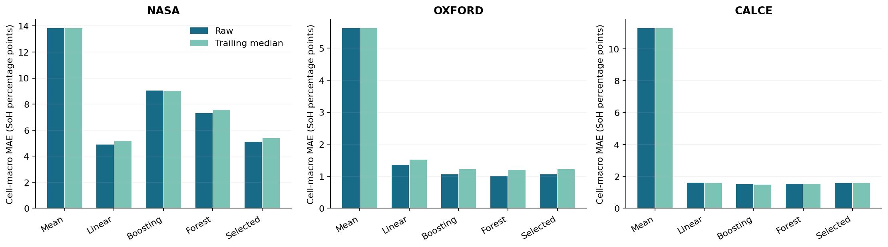
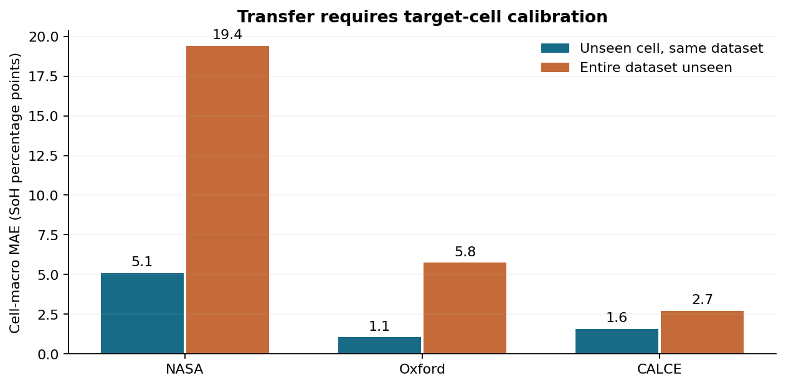
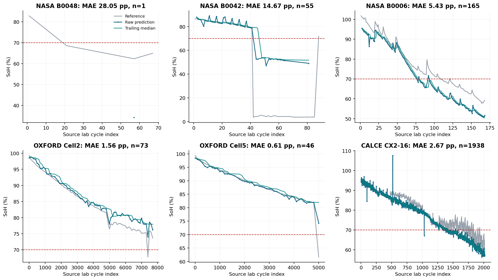
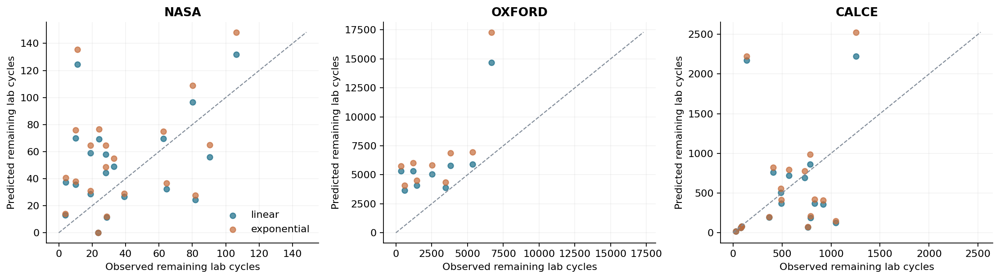
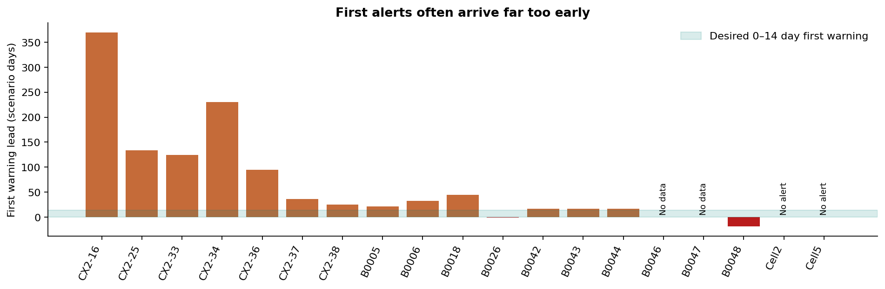
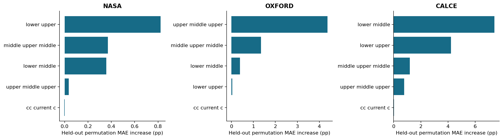

# Skeptical review for the Baaz Bikes pitch

## Verdict

Pitch-ready with caveats for a paid calibration and validation pilot. The charge-only SoH workflow achieves 3.72 percentage points cell-macro MAE on 41 held-out laboratory cells, but the NASA tail and low-health errors are material. Entire-dataset holdout error rises to 13.89 points. RUL forecasts and the first replacement-alert timing are not reliable enough for operational replacement claims. No battery life extension, energy saving, avoided breakdown or Baaz pack accuracy has been demonstrated.

## Data inventory

All 7,599 downloaded files were inspected before modelling. See [the complete inventory](inventory_report.md), [all per-file schemas and checks](inventory/file_manifest.json), and [all 49 cells](inventory/cells.csv). Sources remain unchanged. NASA is a cleaned CSV derivative, Oxford is a readable MATLAB struct, and CALCE is a CSV mirror. None is Baaz operational data.

| dataset   |   charge_episodes |   cells |   valid_labels |   valid_upper_windows |   core_eligible |   started_above_window |   observed_cv_tapers |   observed_cv_durations |   measured_temperature |   no_temperature_eligible |   temperature_eligible |   cv_no_temperature_eligible |
|:----------|------------------:|--------:|---------------:|----------------------:|----------------:|-----------------------:|---------------------:|------------------------:|-----------------------:|--------------------------:|-----------------------:|-----------------------------:|
| calce     |             12416 |       7 |          12070 |                 12256 |           11911 |                    157 |                11579 |                   11948 |                      0 |                     11911 |                      0 |                        11545 |
| nasa      |              2815 |      34 |           2142 |                  2082 |            1680 |                    699 |                 2081 |                    2081 |                   2082 |                      1680 |                   1680 |                         1680 |
| oxford    |               519 |       8 |            519 |                   519 |             519 |                      0 |                    0 |                       0 |                    519 |                       519 |                    519 |                            0 |

There are 15,750 parsed charge episodes and 14,110 eligible labelled upper-window rows. NASA contributes 1,680 rows from 26 cells, Oxford 519 from eight, CALCE 11,911 from seven. Of 49 inventoried cells, eight NASA cells have no eligible core prediction. Reasons overlap: 699 NASA and 157 CALCE episodes start above the voltage window, some records lack a usable next discharge, some discharges fail physical trace checks, and incomplete CC–CV charging cannot provide a standard full-capacity label. CALCE event counts differ from raw vendor cycle-group counts because one vendor index can contain multiple episodes or interrupted charging. Detailed exclusions are in [the exclusion log](../data/processed/excluded_charge_episodes.csv).

NASA readmes document unexplained cold-test low capacities and a test-control crash in the B0049–B0052 series. CALCE's 12.497Ah counter for a nominal 1.35Ah cell is flagged, not silently corrected. CALCE has no measured temperature values despite two named temperature columns. NASA includes 43–44°C controlled tests; Oxford has a documented 40°C chamber. These do not establish Delhi station performance above 45°C.

## Unified data and label pairing

The cached [cycle table](../data/processed/cycles.parquet) contains dataset, cell identifier, source ageing-cycle index, episode identifier, rated Ah, discharge-measured Ah, nominal-relative SoH, ambient metadata, all charge features, eligibility reasons and exact source references. CSV copies and separate discharge-reference tables are included. A fingerprint covers source file sizes and modification times, loader/feature/QC code and configuration so changed inputs invalidate parsing caches.

NASA charge traces pair to the next discharge, with superseded charges excluded. CALCE uses chronological sign episodes and the next discharge's own capacity-counter excursion, cross-checked against negative-current integration. It does not reuse the vendor summary maximum when multiple episodes share a cycle index. Oxford uses the nearest same-checkpoint C1 discharge reference, which occurs before the C1 charge in the stored chronology. This is permitted periodic-reference estimation, not a claim to predict a future discharge. Its label comes from `C1dc.q`, never `C1ch.q`.

SoH is measured Ah divided by the documented nominal Ah: NASA 2.0, Oxford 0.740, CALCE CX2 1.350. Initial capacity is never used as the denominator. Nominal normalisation aligns units, but does not remove chemistry, current, temperature or cutoff differences. NASA available capacity under cold/deep-discharge conditions is not automatically irreversible ageing. The CALCE mirror's CX2-25 identity and filename-only ambient setting remain provenance limitations.

## Features and leakage assessment

| Feature                    | Definition at current configuration                     | Unit         | Use                                   |
|:---------------------------|:--------------------------------------------------------|:-------------|:--------------------------------------|
| time_lower_middle_s        | 3.9 to 4.0 V charge time                                | s            | Common                                |
| time_middle_upper_middle_s | 4.0 to 4.1 V charge time                                | s            | Common                                |
| time_upper_middle_upper_s  | 4.1 to 4.18 V charge time                               | s            | Common                                |
| time_lower_upper_s         | 3.9 to 4.18 V total charge time                         | s            | Common; sum of previous three         |
| cc_current_c               | Median charging current / rated Ah                      | 1/h (C-rate) | Common                                |
| window_mean_temp_c         | Mean cell temperature in upper window                   | °C           | Temperature variant                   |
| window_temp_rise_c         | Temperature change from lower to upper crossing         | °C           | Temperature variant                   |
| ambient_temp_c             | Known charging ambient setting                          | °C           | Temperature variant, NASA/Oxford only |
| time_lower_cv_s            | Lower crossing to 4.19 V band                           | s            | CV variant                            |
| cv_duration_s              | Duration in near-limit voltage band with observed taper | s            | CV variant                            |
| cv_taper_slope_c_per_s     | Elapsed-time-weighted current taper slope               | C-rate/s     | CV variant                            |
| cv_tau_s                   | Time constant from time-weighted log-current fit        | s            | CV variant                            |

All voltage thresholds are configurable per dataset. The common model requires a complete 3.9–4.18V window and omits temperature and CV information. Upper-window times are relative to the lower crossing, and temperature rise is measured across that window rather than from the start of a potentially partial charge. A synthetic partial-start invariance check passes. This does not establish real partial-swap accuracy, which needs a separate perturbation and target-fleet study.

**No SoH regressor receives discharge capacity, discharge current/voltage, full-charge capacity, cycle number, timestamps, cell ID, dataset ID or a previous observed SoH label.** Oxford current is reconstructed from the local derivative of the charging-only mAh counter, with serial days converted to seconds. That counter must remain independently sourced from the C1 discharge label. Charging durations legitimately correlate with capacity; that physical relation is not discharge-label leakage. The four timing features are correlated and one is their sum, so individual coefficients and permutation ranks are not causal explanations. No incremental-capacity peak feature is used.

Oxford C1 traces do not supply a CV taper and receive no fabricated zero. CALCE temperature remains missing. Separate temperature and CV variants use only feature-complete records. CALCE CV samples are irregular current-change observations, so taper fits use actual time and elapsed-time weights, with minimum-count and gap-coverage checks.

## Models and validation

Fixed candidates are a cell-balanced mean baseline, Ridge linear regression, histogram gradient boosting and random forest. Parameters were fixed before evaluating results. A separate 25% split of whole training cells selects the family inside each outer fold. Scalers and models fit training rows only. No random row split or random row early-stopping validation is used. The final all-data model is a **laboratory reference linear model**, not the source of demo accuracy. The dashboard uses out-of-fold predictions.

There are 106 audited outer folds: 41 common-feature cell holdouts, three complete dataset holdouts, 34 temperature-variant cell holdouts, and 28 CV-variant cell holdouts. Every outer cell is absent from both inner fitting and inner validation. In leave-one-dataset-out, both other datasets supply training rows. [Fold memberships](evaluation/fold_audit.json) and [fixed model code](../src/battery_analytics/models.py) are included. The comparisons are exploratory across only three datasets, not a preregistered external field trial.

### Model comparison

Metrics below are means over cells, giving each cell equal weight. Pooled-row MAE is misleadingly lower because CALCE supplies 11,911 of 14,110 rows. For the selected workflow, pooled-row raw MAE is 1.82 points, compared with the more conservative 3.72-point cell-macro result. Equal-dataset macro MAE is 2.59 points. Use cell-macro results in the pitch and disclose the NASA failures.

| validation            | model             |   n_cells |   n_rows |   macro_cell_mae_raw_pp |   macro_cell_rmse_raw_pp |   macro_cell_mae_smoothed_pp |   macro_cell_rmse_smoothed_pp |
|:----------------------|:------------------|----------:|---------:|------------------------:|-------------------------:|-----------------------------:|------------------------------:|
| leave_one_cell_out    | gradient_boosting |        41 |    14110 |                    6.20 |                     7.35 |                         6.20 |                          7.25 |
| leave_one_cell_out    | linear_ridge      |        41 |    14110 |                    3.63 |                     4.67 |                         3.83 |                          4.82 |
| leave_one_cell_out    | mean_baseline     |        41 |    14110 |                   11.79 |                    13.22 |                        11.79 |                         13.22 |
| leave_one_cell_out    | random_forest     |        41 |    14110 |                    5.09 |                     6.13 |                         5.29 |                          6.26 |
| leave_one_cell_out    | training_selected |        41 |    14110 |                    3.72 |                     4.73 |                         3.92 |                          4.90 |
| leave_one_dataset_out | gradient_boosting |        41 |    14110 |                   15.17 |                    16.57 |                        15.21 |                         16.64 |
| leave_one_dataset_out | linear_ridge      |        41 |    14110 |                   10.46 |                    12.91 |                        12.29 |                         13.56 |
| leave_one_dataset_out | mean_baseline     |        41 |    14110 |                   11.85 |                    13.58 |                        11.85 |                         13.58 |
| leave_one_dataset_out | random_forest     |        41 |    14110 |                   27.09 |                    28.19 |                        27.24 |                         28.30 |
| leave_one_dataset_out | training_selected |        41 |    14110 |                   13.89 |                    14.94 |                        14.00 |                         15.02 |

### Per-dataset results and transfer

| validation            | dataset   |   n_cells |   n_rows |   macro_cell_mae_raw_pp |   macro_cell_rmse_raw_pp |   macro_cell_mae_smoothed_pp |   macro_cell_rmse_smoothed_pp |
|:----------------------|:----------|----------:|---------:|------------------------:|-------------------------:|-----------------------------:|------------------------------:|
| leave_one_cell_out    | calce     |         7 |    11911 |                    1.59 |                     2.08 |                         1.58 |                          2.07 |
| leave_one_cell_out    | nasa      |        26 |     1680 |                    5.11 |                     6.45 |                         5.38 |                          6.66 |
| leave_one_cell_out    | oxford    |         8 |      519 |                    1.06 |                     1.44 |                         1.23 |                          1.67 |
| leave_one_dataset_out | calce     |         7 |    11911 |                    2.73 |                     3.31 |                         2.62 |                          3.21 |
| leave_one_dataset_out | nasa      |        26 |     1680 |                   19.40 |                    20.54 |                        19.61 |                         20.70 |
| leave_one_dataset_out | oxford    |         8 |      519 |                    5.75 |                     6.91 |                         5.72 |                          6.89 |

Linear regression is the strongest fixed family overall, rather than gradient boosting. The training-selected workflow's smoothing worsens cell-macro MAE from 3.72 to 3.92 points, approximately 0.20 points or 5.4%. Entire-dataset holdout rises from 3.72 to 13.89 points, about 3.7 times worse. NASA's cross-dataset error is 19.40 points. This supports calibration on target batteries, not an out-of-box claim.

### Low-health accuracy

| dataset   | band      |   n_rows |   n_cells |   raw_mae_pp |   raw_rmse_pp |   smoothed_mae_pp |
|:----------|:----------|---------:|----------:|-------------:|--------------:|------------------:|
| calce     | below_70  |     3589 |         7 |         2.06 |          2.52 |              2.10 |
| calce     | 70_to_80  |     3141 |         7 |         1.30 |          1.59 |              1.31 |
| calce     | 80_to_90  |     3296 |         7 |         1.50 |          1.77 |              1.47 |
| calce     | 90_to_110 |     1885 |         7 |         1.40 |          1.71 |              1.30 |
| nasa      | below_70  |      334 |        14 |        16.05 |         16.38 |             16.95 |
| nasa      | 70_to_80  |      452 |        12 |         3.14 |          3.43 |              3.26 |
| nasa      | 80_to_90  |      692 |        21 |         2.13 |          2.47 |              2.05 |
| nasa      | 90_to_110 |      202 |        12 |         3.04 |          3.90 |              2.62 |
| oxford    | below_70  |        2 |         2 |         9.47 |          9.47 |             15.28 |
| oxford    | 70_to_80  |      113 |         7 |         1.59 |          1.75 |              1.43 |
| oxford    | 80_to_90  |      244 |         8 |         0.99 |          1.10 |              1.16 |
| oxford    | 90_to_110 |      160 |         8 |         0.74 |          0.89 |              0.96 |

The important below-70% region is weak: NASA 16.05 points MAE across 14 cells, Oxford 9.47 across only two observations from two cells, CALCE 2.06 across seven cells. At 70–80%, MAE is 3.14, 1.59 and 1.30 points for NASA, Oxford and CALCE respectively. Oxford's very sparse threshold evidence must not be hidden behind its 1.06-point whole-life average. A supplementary score weights observations at or below 80% three times as heavily; see `review/low_soh_weighted_error_per_cell.csv`.

### Outliers and complete per-cell results

B0048 has 28.05 points error on one eligible observation, B0042 14.67 on 55, and B0051 13.11 on two. B0042 RMSE is 25.79 points, showing severe individual failures. Cold exposure, changes in available capacity, documented source anomalies and sparse usable data are plausible explanations, not proven causes. No bad test cells were removed after inspecting their errors. Even the best selected-workflow cell averages are above 0.5 points, so there is no across-the-board suspiciously tiny result.

| dataset   | cell_id   |   n_rows |   mae_raw_pp |   rmse_raw_pp |   mae_smoothed_pp |   rmse_smoothed_pp |
|:----------|:----------|---------:|-------------:|--------------:|------------------:|-------------------:|
| calce     | CX2-16    |     1938 |         2.67 |          3.42 |              2.62 |               3.43 |
| calce     | CX2-25    |     1736 |         0.84 |          1.13 |              0.79 |               1.06 |
| calce     | CX2-33    |     1629 |         1.61 |          1.98 |              1.62 |               1.89 |
| calce     | CX2-34    |     1680 |         1.68 |          1.88 |              1.68 |               1.92 |
| calce     | CX2-36    |     1909 |         1.54 |          2.01 |              1.54 |               2.03 |
| calce     | CX2-37    |     1242 |         1.15 |          1.43 |              1.12 |               1.41 |
| calce     | CX2-38    |     1777 |         1.65 |          2.73 |              1.70 |               2.75 |
| nasa      | B0005     |      165 |         0.89 |          1.27 |              1.14 |               1.46 |
| nasa      | B0006     |      165 |         5.43 |          5.99 |              4.95 |               5.69 |
| nasa      | B0007     |      165 |         3.37 |          3.73 |              3.53 |               3.91 |
| nasa      | B0018     |      129 |         2.70 |          3.06 |              2.63 |               3.06 |
| nasa      | B0025     |       27 |         1.39 |          3.59 |              0.68 |               0.79 |
| nasa      | B0026     |       27 |         2.23 |          5.34 |              1.61 |               4.21 |
| nasa      | B0027     |       24 |         2.89 |          5.21 |              2.53 |               3.27 |
| nasa      | B0028     |       26 |         2.21 |          2.48 |              2.25 |               2.37 |
| nasa      | B0029     |       39 |         2.51 |          3.06 |              2.50 |               3.06 |
| nasa      | B0030     |       39 |         1.90 |          2.28 |              1.93 |               2.23 |
| nasa      | B0031     |       39 |         1.27 |          1.49 |              1.13 |               1.32 |
| nasa      | B0032     |       39 |         1.93 |          2.21 |              1.88 |               2.19 |
| nasa      | B0033     |      169 |         3.11 |          4.85 |              3.05 |               4.92 |
| nasa      | B0034     |      193 |         3.51 |          3.92 |              3.61 |               4.17 |
| nasa      | B0036     |      194 |         2.86 |          3.21 |              3.13 |               3.38 |
| nasa      | B0038     |       34 |         5.16 |          5.22 |              5.11 |               5.14 |
| nasa      | B0039     |       34 |         3.07 |          4.14 |              3.34 |               4.49 |
| nasa      | B0040     |       33 |         2.78 |         11.30 |              2.85 |              11.23 |
| nasa      | B0042     |       55 |        14.67 |         25.79 |             15.52 |              28.31 |
| nasa      | B0043     |       39 |         3.91 |          4.29 |              3.69 |               3.76 |
| nasa      | B0044     |       39 |         2.49 |          2.75 |              2.70 |               2.76 |
| nasa      | B0048     |        1 |        28.05 |         28.05 |             28.05 |              28.05 |
| nasa      | B0049     |        1 |         8.37 |          8.37 |              8.37 |               8.37 |
| nasa      | B0051     |        2 |        13.11 |         13.11 |             20.66 |              21.89 |
| nasa      | B0054     |        1 |         2.65 |          2.65 |              2.65 |               2.65 |
| nasa      | B0055     |        1 |        10.37 |         10.37 |             10.37 |              10.37 |
| oxford    | Cell1     |       78 |         0.81 |          0.96 |              1.25 |               1.41 |
| oxford    | Cell2     |       73 |         1.56 |          2.04 |              2.16 |               2.64 |
| oxford    | Cell3     |       76 |         0.70 |          0.90 |              0.74 |               0.87 |
| oxford    | Cell4     |       47 |         1.11 |          1.36 |              1.65 |               1.87 |
| oxford    | Cell5     |       46 |         0.61 |          1.92 |              0.98 |               3.07 |
| oxford    | Cell6     |       46 |         0.98 |          1.36 |              1.31 |               1.52 |
| oxford    | Cell7     |       77 |         1.25 |          1.35 |              0.81 |               0.91 |
| oxford    | Cell8     |       76 |         1.48 |          1.66 |              0.90 |               1.05 |

Cells without eligible core predictions:

| dataset   | cell_id   |   parsed_episodes |   eligible_episodes |   above_window |   excluded_episodes |
|:----------|:----------|------------------:|--------------------:|---------------:|--------------------:|
| nasa      | B0041     |                67 |                   0 |             64 |                  67 |
| nasa      | B0045     |                72 |                   0 |             72 |                  72 |
| nasa      | B0046     |                72 |                   0 |             12 |                  72 |
| nasa      | B0047     |                72 |                   0 |             17 |                  72 |
| nasa      | B0050     |                25 |                   0 |              9 |                  25 |
| nasa      | B0052     |                25 |                   0 |              5 |                  25 |
| nasa      | B0053     |                55 |                   0 |             13 |                  55 |
| nasa      | B0056     |               102 |                   0 |            102 |                 102 |

## RUL accuracy and censoring

Linear and exponential trends fit the last 12 distinct predicted cycle observations. At least six are required unless current predicted SoH is already below threshold. The input is only the prediction prefix available at today. Flat/increasing trends and extrapolations beyond 20,000 source cycles return unavailable rather than a fabricated precise lifetime. A trailing five-observation median is also evaluated; it is never centred. Oxford's five observations can span hundreds of ageing cycles, unlike daily station observations.

End of life is the first valid reference crossing of 70% nominal-relative capacity, interpolated between bracketing checks. Regeneration or test-condition shifts can cause later recrossings. A cell already below 70% at its first valid reference is left-censored and has no identifiable incident crossing. A cell never reaching 70% is right-censored: exact RUL error is unavailable, while an overly early forecast can still contradict the observed survival lower bound.

| dataset   | censoring                         |   cells |
|:----------|:----------------------------------|--------:|
| calce     | observed_crossing                 |       7 |
| nasa      | left_censored_already_below_70pct |      16 |
| nasa      | observed_crossing                 |      10 |
| nasa      | right_censored                    |       8 |
| oxford    | observed_crossing                 |       2 |
| oxford    | right_censored                    |       6 |

### Original multi-point backtest, smoothed histories

| validation            | dataset   | method      |   n_scored |   n_scored_cells |   mae_cycles |   rmse_cycles |   forecast_coverage |   n_censored_forecasts |   censor_bound_violation_rate |
|:----------------------|:----------|:------------|-----------:|-----------------:|-------------:|--------------:|--------------------:|-----------------------:|------------------------------:|
| leave_one_cell_out    | calce     | exponential |         17 |                7 |       451.29 |        698.32 |                0.77 |                      0 |                        nan    |
| leave_one_cell_out    | nasa      | exponential |         20 |                6 |        34.77 |         43.20 |                0.77 |                     29 |                          0.07 |
| leave_one_cell_out    | oxford    | exponential |          9 |                2 |      4014.55 |       4824.70 |                0.93 |                     28 |                          0.04 |
| leave_one_cell_out    | calce     | linear      |         17 |                7 |       424.25 |        663.53 |                0.77 |                      0 |                        nan    |
| leave_one_cell_out    | nasa      | linear      |         20 |                6 |        31.24 |         39.35 |                0.77 |                     29 |                          0.07 |
| leave_one_cell_out    | oxford    | linear      |          9 |                2 |      3136.43 |       3838.54 |                0.95 |                     29 |                          0.14 |
| leave_one_dataset_out | calce     | exponential |         16 |                7 |       356.36 |        448.45 |                0.73 |                      0 |                        nan    |
| leave_one_dataset_out | nasa      | exponential |         18 |                6 |       532.94 |       1027.51 |                0.69 |                     27 |                          0.70 |
| leave_one_dataset_out | oxford    | exponential |          0 |                0 |       nan    |        nan    |                0.03 |                      1 |                          0.00 |
| leave_one_dataset_out | calce     | linear      |         16 |                7 |       373.86 |        462.73 |                0.73 |                      0 |                        nan    |
| leave_one_dataset_out | nasa      | linear      |         18 |                6 |       461.58 |        888.83 |                0.69 |                     27 |                          0.70 |
| leave_one_dataset_out | oxford    | linear      |          1 |                1 |     15937.60 |      15937.60 |                0.07 |                      2 |                          0.00 |

Within-dataset linear MAE is 31.24 source cycles for NASA (20 scored anchors, six cells), 424.25 for CALCE (17 anchors, seven cells), and 3,136.43 for Oxford (nine anchors, two cells). Exponential extrapolation does not provide a clear improvement. These source cycles are different laboratory protocols and should not be pooled into an operational guarantee.

### Early, middle and late life

The additional review requested after initial modelling evaluates at approximately 20%, 50% and 85% of the interval to the observed endpoint. Future truth chooses evaluation anchors only; every forecast still receives only its past prediction prefix. Results below use raw histories and the predeclared linear trend. Percentage error is relative to actual remaining life at the latest available observation. Coverage matters because unavailable forecasts are not counted as successful predictions.

| dataset   | stage   |   requested_cells |   scored_cells |   forecast_coverage |   mae_cycles |   mean_ape_pct |   median_ape_pct |   median_true_remaining_cycles |
|:----------|:--------|------------------:|---------------:|--------------------:|-------------:|---------------:|-----------------:|-------------------------------:|
| calce     | early   |                 7 |              5 |                0.71 |      1695.16 |         171.82 |            73.16 |                         840.33 |
| calce     | late    |                 7 |              5 |                0.71 |       114.47 |          68.52 |            68.06 |                         158.33 |
| calce     | mid     |                 7 |              5 |                0.71 |       269.58 |          42.50 |            41.50 |                         609.00 |
| nasa      | early   |                10 |              4 |                0.40 |        10.12 |          22.80 |            24.52 |                          32.08 |
| nasa      | late    |                10 |              5 |                0.50 |        19.55 |         290.67 |           128.59 |                           6.11 |
| nasa      | mid     |                10 |              5 |                0.50 |        46.48 |         179.45 |           145.35 |                          20.11 |
| oxford    | early   |                 2 |              2 |                1.00 |      1215.08 |          25.28 |            25.28 |                        4993.66 |
| oxford    | late    |                 2 |              1 |                0.50 |      2576.05 |         315.28 |           315.28 |                         817.08 |
| oxford    | mid     |                 2 |              2 |                1.00 |      1241.54 |          48.87 |            48.87 |                        3143.66 |

At late life, errors are 19.55 cycles and 290.7% mean remaining-life error for NASA (five of ten incident cells scorable), 114.47 cycles and 68.5% for CALCE (five of seven), and 2,576.05 cycles and 315.3% for Oxford (one of two). Small denominators and large errors make a reliable replacement-date claim indefensible.

### Replacement decision backtest

The predeclared dashboard default is 14 scenario days, equivalent to 28 source cycles under the assumed two swaps/day and one source cycle/swap. An alarm predicts RUL at or below that horizon. The **first** alarm is premature if more than 28 cycles remain, timely if 0–28 remain, and late if the reference endpoint has passed. No alarm and no usable history remain separate. Repeated observations are not independent battery trials.

| dataset   |   observed_threshold_events |   timely_first_alerts |   premature_first_alerts |   late_first_alerts |   no_alerts |   no_eligible_history |   events_with_timely_observation |   median_first_alert_lead_days |
|:----------|----------------------------:|----------------------:|-------------------------:|--------------------:|------------:|----------------------:|---------------------------------:|-------------------------------:|
| calce     |                           7 |                     0 |                        7 |                   0 |           0 |                     0 |                                7 |                         124.50 |
| nasa      |                          10 |                     0 |                        6 |                   2 |           0 |                     2 |                                7 |                          16.54 |
| oxford    |                           2 |                     0 |                        0 |                   0 |           2 |                     0 |                                0 |                         nan    |

There are **zero timely first alerts among 19 observed threshold events**, or zero among 17 with an eligible prediction history. Thirteen first alerts are premature, two late, two never occur, and two cells have no eligible history. CALCE's median first alarm is 124.5 scenario days before the endpoint; NASA's is 16.54 days. Oxford has no sampled observation inside the 28-cycle window, because its checks are approximately 100 cycles apart.

Observation-level numbers provide a different, less operationally strict view:

| dataset   |   tp_observations |   fp_observations |   fn_observations |   tn_observations |   observation_recall |   observation_false_positive_rate |   observation_precision |   any_timely_alert_events |   median_timely_warning_days |
|:----------|------------------:|------------------:|------------------:|------------------:|---------------------:|----------------------------------:|------------------------:|--------------------------:|-----------------------------:|
| calce     |                84 |               206 |               103 |              7229 |                 0.45 |                              0.03 |                    0.29 |                         7 |                        13.58 |
| nasa      |                98 |                59 |                74 |               391 |                 0.57 |                              0.13 |                    0.62 |                         5 |                        12.13 |
| oxford    |                 0 |                 0 |                 0 |               508 |               nan    |                              0.00 |                  nan    |                         0 |                       nan    |

CALCE eventually produces an in-window alarm on all seven incident cells, but **all seven had already received a premature first alert**. Calling this a 100% useful catch rate would be misleading. Observation precision is only 29.0% for CALCE and 62.4% for NASA. Observational false-positive rates are 2.8% and 13.1% respectively, with repeated correlated measurements. None of these rates estimates the share of field breakdowns prevented. A 70% lab capacity crossing is not an observed stranding, fault or safety failure.

### Capacity bumps and flat histories

| dataset   |   upward_jumps_over_2pp |   affected_cells |
|:----------|------------------------:|-----------------:|
| calce     |                     120 |                7 |
| nasa      |                      95 |               25 |
| oxford    |                       1 |                1 |

These are upward reference-capacity changes over two percentage points, not proof of electrochemical regeneration. Rest, measurement conditions and source artefacts can contribute. In the original within-dataset raw linear RUL backtest, 19 of 160 anchors have flat/increasing recent predictions, 16 lack sufficient history and two exceed the supported horizon. A short trend can become very steep after a downward fluctuation, producing premature alarms, or flat after recovery, producing no useful lifetime estimate. Thresholds or persistence rules must not be tuned on these same test events and then advertised as independently validated.

## Feature sanity

Held-out within-cell permutation analysis finds upper-window timing is useful. CALCE's 3.9–4.0V interval raises MAE by about 7.42 points when permuted; Oxford's 4.1–4.18V interval by 4.38; NASA's total upper-window time by 0.82. Current C-rate has almost no within-cell permutation effect because charging current barely varies within a cell. This cannot prove that current or ambient temperature is irrelevant across protocols. Timing variables are correlated and individual permutations break their algebraic relation, so the rankings are diagnostic rather than a causal physical decomposition.

The statement “slower upper-voltage climb always means ageing” is unsafe. At fixed current, window duration is local charge quantity divided by current. Loss of capacity can shorten charging times, while resistance, temperature and electrode-curve shifts alter crossings. CV duration and heating are also protocol-dependent. Verify feature direction within matched operating conditions instead of imposing one global monotonic rule.

On matched test rows, adding CV features improves CALCE MAE from 1.53 to 1.32 points, but worsens NASA from 3.35 to 4.40. Adding temperature worsens NASA from 5.11 to 5.84 and Oxford from 1.06 to 1.20. These are sensitivity comparisons with different available cohorts and training selections, not evidence that temperature is unimportant or that CV always helps. The simpler common model remains the most defensible starting point.

## Limitations

- Only 49 laboratory cells were inventoried and 41 have any eligible common-feature predictions. Several NASA cell errors rest on one or two observations; effective sample size is cells, not 14,110 independent batteries. There are only three domains for cross-dataset evaluation and only two Oxford threshold crossings.
- Nominal-relative discharge capacity is an imperfect health target when discharge rate, temperature, cutoff and prior charge completion vary. It measures available capacity under those tests, not solely irreversible ageing. Some source anomalies remain despite conservative, trace-based checks. There is no independent clean capacity ground truth for every problematic record.
- The common model estimates individual cells. A ~1kWh multi-cell swappable pack can be limited by its weakest cell, imbalance, parallel current sharing, voltage sag, resistance, thermal gradients or BMS limits. No pack performance is demonstrated.
- Laboratory charging does not reproduce rider usage, station cooling, charger firmware, sensor offsets, vibration, maintenance practices, varying arrival SoC or pack rest periods. Synthetic partial-start invariance passes, but real cropped-window/noise robustness and high-SoC coverage have not been quantified.
- Controlled NASA 43–44°C and Oxford 40°C data exist. They do not establish Delhi station behaviour above 45°C or pack hot spots. CALCE temperature is missing and 25°C is only a filename assertion.
- Upper-window inference skips arrivals already above 3.9V, interrupted charges and records with unresolved channels. Coverage on actual Baaz partial swaps is unknown. Per-cell voltages, chemistry and series/parallel layout must be confirmed; these 4.2V single-cell thresholds cannot be applied directly to pack voltage.
- RUL extrapolation fails important late-life and replacement-decision tests. First-alert backtesting is exploratory, uses lab-capacity endpoints, has correlated repeated observations, and is not prospective validation. Censored and missing cases remain visible.
- Days assume two swaps per day and one source lab cycle per swap. Partial swaps do not justify that equivalence. No field-failure, downtime, maintenance-cost, battery-life-extension or charging-energy-saving effect has been measured.
- This is a centralised public-data prototype. Federated training, secure aggregation and company-to-company privacy protections are not implemented or tested. Do not claim a deployed federated product from this work.
- Hyperparameters and feature thresholds were chosen without test-error optimisation, but the overall engineering and review are exploratory. A frozen prospective Baaz test is needed before performance commitments. The Kaggle mirrors also have incomplete provenance/licence metadata, recorded beside the original downloads.

## What this would look like on Baaz's data

Required inputs: stable pack and station IDs, timestamps, series/parallel configuration, cell chemistry, rated Ah, per-cell voltages, pack charging current and charger setpoints, cell/module temperature channels with sensor locations, ambient/station temperature and cooling state, CC/CV transitions, cutoff conditions, and charger/BMS firmware and calibration versions. Swap logs need arrival SoC, departure SoC, preceding use/rest durations and the mapping of each pack across riders and stations. Outcomes need independent reference-capacity checks, repair/retirement decisions and classified failures. An existing BMS SoH estimate is a comparator, not automatically an independent label.

Additional features could include cell-voltage spread near full charge, imbalance and balancing duty, the earliest cell reaching its voltage limit, temperature spread and rise conditional on station ambient, current-normalised voltage response, station effects, rest recovery, usage severity and equivalent full-cycle throughput from actual current integration. These are proposals, not features validated by this prototype. Pack health must link to usable energy and power under the intended duty cycle.

A pilot should compare against Baaz's existing BMS and maintenance policy, set acceptable inspection/false-alarm cost in advance, reserve complete packs/stations/time periods for a locked evaluation, and measure eligible-window coverage. A starting design might use 20–30 packs spanning health and conditions, with a substantial whole-pack holdout; that is a planning proposal, not a statistically established sample requirement. A learning curve and event count must determine expansion. Accurate RUL validation needs actual degradation follow-up, not merely many repeated charges from a handful of packs.

## ROI inputs supported by evidence

| Input | Defensible incremental base-case value now | Evidence |
|---|---:|---|
| Battery life extension | 0% credited benefit | Prediction alone did not change charging, thermal control or retirement policy; no causal intervention trial |
| Share of field failures caught in advance | 0% credited benefit | No field failure labels. The current first-alert lab threshold backtest has zero timely first alerts out of 19 events |
| Energy saved | 0% credited benefit | No intervention, station kWh baseline or controlled charging-efficiency measurement |

These are evidence-accounting values, not a claim that a future service can never create value. Any positive upside scenario must be labelled an unvalidated pilot target. Avoid treating the seven CALCE cells' eventual in-window alarms as seven field failures prevented. Quantify value against Baaz's current policy using avoided downtime and unnecessary replacement costs, then measure whether a new action rule improves them.

## Defensible pitch claims

- “Across 41 held-out laboratory cells with eligible charging windows, our charge-only workflow achieved 3.72 SoH percentage points cell-macro MAE. Dataset results ranged from 1.06 to 5.11 points, with individual failures.”
- “The 14,110 eligible observations are repeated measurements of 41 cells, not 14,110 batteries.”
- “Entire-dataset holdout error was 13.89 points, so target-cell calibration and validation are necessary.”
- “We have an auditable parsing, label-pairing, grouped-validation and fleet-inspection prototype. Replacement timing and operational savings remain unproven.”

Do not claim accuracy on Baaz packs, reliable replacement dates, proven Delhi heat performance, pack-level validity, prevented stranding, life extension, energy savings, first-of-its-kind battery analytics, or implemented federation. Do not translate MAE into a percentage “accuracy” score or imply all predictions lie within the average error.

Recommended headline: **“About 4 SoH percentage points MAE on 41 unseen lab cells.”** Place “14 points on unseen datasets; Baaz calibration required” beside it, not buried in an appendix. The conservative cell-macro 3.72 rounds to four; the pooled-row 1.82 is an attractive but less defensible headline. A service-sales headline should be a pilot question, not a replacement guarantee.

## Tough questions from Baaz's engineers

1. **Does this work on our ~1kWh packs?** Not established. We need chemistry, topology and pack-level references. Weak-cell and power limitations matter beyond average cell capacity.
2. **What happens when riders return packs at 40%, 35% or 5% SoC?** The method ignores the earlier charging segment when the observed voltage window is complete. It skips a charge that starts above the lower voltage or never reaches the upper voltage. Fleet coverage and real truncation robustness still need measurement.
3. **Is it proven above 45°C?** No. Some 43–44°C laboratory tests help formulate an experiment, but do not reproduce station conditions or pack hot spots.
4. **How do you know the labels are true health?** We do not know that for every public record. We use documented nominal capacity, independent discharge references, chronology and trace QC, and retain the source limitations. A Baaz pilot needs independent capacity checks and a separate comparison with BMS SoH.
5. **How many of our packs and how much data are needed?** A proposed initial 20–30-pack study can map feasibility, with complete packs held out. That is not a proven production sample size. Learning curves, health coverage and event counts determine how much more is needed.
6. **Will sensor noise, balancing or firmware changes invalidate it?** Possibly. The current evidence lacks a quantified real-noise and firmware-shift study. Record calibration and balancing states, perturb signals and test held-out stations and time periods.
7. **Why trust a replacement recommendation when RUL is poor?** You should not yet. The current lab first-alert policy fails its timing target. Start with inspection prioritisation, predefined costs and a prospective decision backtest.
8. **Why pay us rather than extend your own BMS analytics?** Only incremental measured value can justify that. The public benchmark does not compare with Baaz's capable existing system. Agree that comparator and the commercial success criterion before the pilot.

## Ranked next experiments

1. **Target-domain calibration learning curve.** Freeze source-trained models, calibrate on a small set of target cells/packs, and score on completely different target packs. Repeat across target-cell counts and keep a final locked holdout. This most directly tests the paid-pilot story. A public-data version can assess 0/1/2/4 target-cell calibration, but still cannot establish Baaz accuracy.
2. **Partial-charge and sensor perturbation test.** Crop real charge traces at varying starts and endings, add voltage/current offsets and sampling gaps, and report both coverage and error. Keep perturbation settings independent of existing test errors. The current synthetic invariance test is a useful start, not this experiment's completion.
3. **Repair the decision formulation.** Replace a single noisy RUL threshold with an inspection queue, persistence and a cost-aware rule. Design it on training/validation cells and reserve new cells/time for an untouched alert backtest. Score first-alert precision, wasted remaining value and missed threshold events against the existing BMS policy.
4. **Temperature/protocol stress holdout.** Evaluate NASA warm, cold and mixed-temperature groups separately, then collect target-station pack data above 45°C where relevant. Adding more low-temperature cells will not resolve the Delhi question. Current generic temperature features actually worsen held-out MAE, so redesign requires validation.
5. **Pack-level reference and outcome study.** Obtain topology, imbalance, balancing and periodic independent usable-capacity/energy measurements. Track retirement and failure modes prospectively. This is slower than the first software experiments, but essential before life-extension, field-failure or energy-saving ROI claims.

## Reproduction and artifacts

See [README](../README.md) for setup, pipeline and dashboard commands. `python scripts/run_all.py` generates inventory, data cache, validation, RUL, review and this report in order. The source data are external siblings in `../datasets`. All per-cell metrics, fold memberships, exclusions, RUL anchors, censoring status, alarm observations and event denominators are saved as CSV/JSON/Parquet under `data/processed` and `reports`. Figures are standalone PNGs under `reports/figures`.
