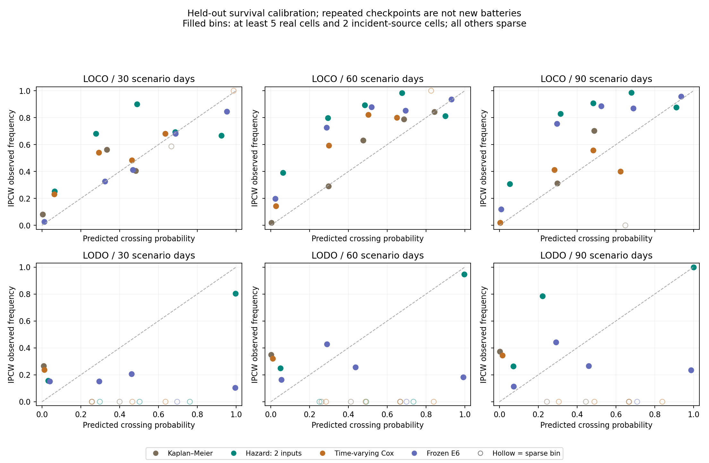

The primary survival model does not improve the within-dataset 14-day first-warning count: 0/19 timely warnings versus 0/19 for linear extrapolation and 2/19 for E6. Its matched probability errors are worse than E6 within datasets and better on unseen datasets; the calibration checks remain limited by sparse real-cell/event support and censoring. This is an indicative laboratory workflow demo for Baaz, not accuracy proof: only 19 source events exist, 17 among the 41 cells with frozen predictions.

# Survival analysis for replacement timing

## Frozen design, data and leakage controls

Preregistration `125c2632e9ad1ab7ef83f79e9e82f73fca07df06` was committed before
fitting. No outer-test results selected inputs, penalties, windows, models,
threshold grids or age mixtures. All pre-existing tracked files remain unchanged.
The endpoint is exactly the frozen RUL study's first observed reference 70%
crossing **interpolated** between valid capacity checks, not a field replacement.
One scenario day is two source cycles; these are not measured operator days.

| dataset   | censoring                         |   real_cells |   with_frozen_predictions |
|:----------|:----------------------------------|-------------:|--------------------------:|
| calce     | observed_crossing                 |            7 |                         7 |
| nasa      | left_censored_already_below_70pct |           16 |                        10 |
| nasa      | observed_crossing                 |           10 |                         8 |
| nasa      | right_censored                    |            8 |                         8 |
| oxford    | observed_crossing                 |            2 |                         2 |
| oxford    | right_censored                    |            6 |                         6 |

The complete inventory is **49 real cells / 19 observed crossings**. Frozen
predictions exist for 41 cells; removing their 10 initially below-threshold
cells leaves **31 incident-modelling cells / 17 observed events / 14 right
censors**. The other two crossing cells have no eligible frozen prediction
history. Initial-below cells are excluded from incident fitting and probability
validation, and are separately identified in [source_inventory.csv](source_inventory.csv).
The alert table retains all 19 events, including missing-history failures.

The same 44 outer folds are used: LOCO within dataset and LODO with an entire
dataset excluded. Outer test features are the original frozen held-out raw
charge estimates. Survival-training charge estimates are generated by two-fold
cross-fitting **inside** each training pool, so their upstream charge models,
scalers and model-family selection cannot see the outer test cell/dataset or
the predicted training cell. Inner alert-threshold validation is separately
cross-fitted inside its inner-training pool. Frozen charge model specifications
are reused; no frozen model/artifact is overwritten. Audits record every pool.

## What was fitted

- **Kaplan–Meier:** one event/censor record per training cell, delayed entry at
  first valid reference, population risk conditional on survival through today.
- **Primary discrete hazard:** L2 logistic regression, C=1, on 10-cycle
  person-periods, exactly two inputs: latest raw predicted SoH and minus the
  OLS slope of the last 12 distinct predicted points (minimum six).
- **Known-history hazard:** the same model plus source cycle count, clearly
  separate from the two-input primary model.
- **Time-varying Cox:** start/stop risk sets, Breslow baseline and ties, fixed
  L2 alpha=1 on event-normalised partial likelihood, the same two inputs.

Each cell contributes at most one event; right-censored cells contribute
observed at-risk exposure. Logistic drops a partly observed terminal non-event
bucket, while Cox retains its exact exposure. Events before feature entry are
lost to feature-based fitting and reported in the period audits. Future
covariates are held at current values for a forecast. Last observed inputs are
carried forward even after the last charge record, unlike v2's ended-record
abstention; age/staleness is recorded but is not an extra primary predictor.
KM/Cox probabilities are unavailable beyond their training time support, and
no alternative fit is substituted for failed models. No Weibull AFT was run.

All 14 right-censored source histories contribute to at least one
outer logistic training fit, and all 14 to Cox exposure across folds;
they are used as censored histories, not discarded or labelled as eventual
non-events. This counts real histories across fits, not that many in each fold.

Outer-fold model/convergence and event-exposure audit (inner folds also saved):

| validation            | method               | model_status   |   folds |   min_training_events |   max_training_events |   min_period_events |   max_period_events |
|:----------------------|:---------------------|:---------------|--------:|----------------------:|----------------------:|--------------------:|--------------------:|
| leave_one_cell_out    | cox                  | fitted         |      41 |                     1 |                     8 |                   1 |                   6 |
| leave_one_cell_out    | hazard               | fitted         |      41 |                     1 |                     8 |                   1 |                   6 |
| leave_one_cell_out    | hazard_known_history | fitted         |      41 |                     1 |                     8 |                   1 |                   6 |
| leave_one_cell_out    | km                   | fitted         |      41 |                     1 |                     8 |                   1 |                   6 |
| leave_one_dataset_out | cox                  | fitted         |       3 |                     9 |                    15 |                   8 |                  13 |
| leave_one_dataset_out | hazard               | fitted         |       3 |                     9 |                    15 |                   8 |                  13 |
| leave_one_dataset_out | hazard_known_history | fitted         |       3 |                     9 |                    15 |                   8 |                  13 |
| leave_one_dataset_out | km                   | fitted         |       3 |                     9 |                    15 |                   8 |                  13 |

The period-event columns describe availability of the common feature design.
KM uses all its training endpoint records and the training-event columns, without
the six-charge entry restriction. One inner fold had no feature-period events;
its feature models used the preregistered flagged zero-risk rule. Every outer
fold fit converged; no alternative hyperparameters were tried.

## Probability accuracy at 30/60/90 days

IPCW Brier is lower when probability predictions are better. It uses only the
corresponding outer-training cells' censoring distribution, conditional on
survival to the native charge checkpoint, and averages first within real cell,
then across cells. A test cell censored before a horizon has zero weighted
contribution and remains in the denominator; it is **not labelled healthy**.
Relevant conditional censor survival below .05 or beyond training support is
unscorable, not clipped. Independent censoring is an assumption, especially
questionable across lab protocols. Coverage is part of the result.

“Cells / event sources” counts unique scored cells and sources with an observed
endpoint, not checkpoints. Methods may have different supported populations,
so use the matched table for comparisons. Frozen linear is a deterministic 0/1
RUL-within-horizon indicator, not a calibrated probability. E6's unchanged fixed
posterior algorithm supplies a new 60-cycle horizon; its stored 28/120/180 risks
were checked exactly and no E6 model or threshold was refitted.

| Protocol   | Dataset   | Method           |   30d IPCW Brier | 30d cells / event sources   |   60d IPCW Brier | 60d cells / event sources   | 90d IPCW Brier   | 90d cells / event sources   |
|:-----------|:----------|:-----------------|-----------------:|:----------------------------|-----------------:|:----------------------------|:-----------------|:----------------------------|
| LOCO       | calce     | Time-varying Cox |            0.047 | 7 / 7                       |            0.07  | 7 / 7                       | 0.090            | 7 / 7                       |
| LOCO       | calce     | Frozen E6        |            0.051 | 7 / 7                       |            0.078 | 7 / 7                       | 0.100            | 7 / 7                       |
| LOCO       | calce     | Hazard: 2 inputs |            0.033 | 7 / 7                       |            0.049 | 7 / 7                       | 0.063            | 7 / 7                       |
| LOCO       | calce     | Hazard + cycles  |            0.034 | 7 / 7                       |            0.052 | 7 / 7                       | 0.069            | 7 / 7                       |
| LOCO       | calce     | Kaplan–Meier     |            0.05  | 7 / 7                       |            0.074 | 7 / 7                       | 0.094            | 7 / 7                       |
| LOCO       | calce     | Frozen linear    |            0.102 | 7 / 7                       |            0.248 | 7 / 7                       | 0.358            | 7 / 7                       |
| LOCO       | nasa      | Time-varying Cox |            0.246 | 14 / 6                      |            0.174 | 13 / 6                      | Unscored         | 0 / 0                       |
| LOCO       | nasa      | Frozen E6        |            0.147 | 14 / 6                      |            0.136 | 14 / 6                      | 0.114            | 14 / 6                      |
| LOCO       | nasa      | Hazard: 2 inputs |            0.264 | 14 / 6                      |            0.238 | 14 / 6                      | 0.170            | 14 / 6                      |
| LOCO       | nasa      | Hazard + cycles  |            0.286 | 14 / 6                      |            0.264 | 14 / 6                      | 0.193            | 14 / 6                      |
| LOCO       | nasa      | Kaplan–Meier     |            0.278 | 15 / 7                      |            0.141 | 15 / 7                      | Unscored         | 0 / 0                       |
| LOCO       | nasa      | Frozen linear    |            0.25  | 14 / 6                      |            0.108 | 14 / 6                      | 0.050            | 14 / 6                      |
| LOCO       | oxford    | Time-varying Cox |            0     | 8 / 2                       |            0.006 | 8 / 2                       | 0.008            | 8 / 2                       |
| LOCO       | oxford    | Frozen E6        |            0     | 8 / 2                       |            0.005 | 8 / 2                       | 0.007            | 8 / 2                       |
| LOCO       | oxford    | Hazard: 2 inputs |            0     | 8 / 2                       |            0.005 | 8 / 2                       | 0.007            | 8 / 2                       |
| LOCO       | oxford    | Hazard + cycles  |            0     | 8 / 2                       |            0.005 | 8 / 2                       | 0.007            | 8 / 2                       |
| LOCO       | oxford    | Kaplan–Meier     |            0     | 8 / 2                       |            0.005 | 8 / 2                       | 0.008            | 8 / 2                       |
| LOCO       | oxford    | Frozen linear    |            0     | 8 / 2                       |            0.005 | 8 / 2                       | 0.007            | 8 / 2                       |
| LODO       | calce     | Time-varying Cox |            0.069 | 7 / 7                       |            0.138 | 7 / 7                       | 0.193            | 7 / 7                       |
| LODO       | calce     | Frozen E6        |            0.485 | 7 / 7                       |            0.516 | 7 / 7                       | 0.566            | 7 / 7                       |
| LODO       | calce     | Hazard: 2 inputs |            0.049 | 7 / 7                       |            0.09  | 7 / 7                       | 0.127            | 7 / 7                       |
| LODO       | calce     | Hazard + cycles  |            0.081 | 7 / 7                       |            0.123 | 7 / 7                       | 0.144            | 7 / 7                       |
| LODO       | calce     | Kaplan–Meier     |            0.06  | 7 / 7                       |            0.121 | 7 / 7                       | 0.177            | 7 / 7                       |
| LODO       | calce     | Frozen linear    |            0.144 | 7 / 7                       |            0.319 | 7 / 7                       | 0.443            | 7 / 7                       |
| LODO       | nasa      | Time-varying Cox |            0.34  | 14 / 6                      |            0.429 | 14 / 6                      | 0.429            | 14 / 6                      |
| LODO       | nasa      | Frozen E6        |            0.2   | 14 / 6                      |            0.234 | 14 / 6                      | 0.229            | 14 / 6                      |
| LODO       | nasa      | Hazard: 2 inputs |            0.226 | 14 / 6                      |            0.294 | 14 / 6                      | 0.285            | 14 / 6                      |
| LODO       | nasa      | Hazard + cycles  |            0.226 | 14 / 6                      |            0.295 | 14 / 6                      | 0.285            | 14 / 6                      |
| LODO       | nasa      | Kaplan–Meier     |            0.378 | 15 / 7                      |            0.465 | 15 / 7                      | 0.467            | 15 / 7                      |
| LODO       | nasa      | Frozen linear    |            0.239 | 14 / 6                      |            0.29  | 14 / 6                      | 0.270            | 14 / 6                      |
| LODO       | oxford    | Time-varying Cox |            0.008 | 8 / 2                       |            0.026 | 8 / 2                       | 0.050            | 8 / 2                       |
| LODO       | oxford    | Frozen E6        |            0.01  | 8 / 2                       |            0.02  | 8 / 2                       | 0.031            | 8 / 2                       |
| LODO       | oxford    | Hazard: 2 inputs |            0.002 | 8 / 2                       |            0.008 | 8 / 2                       | 0.017            | 8 / 2                       |
| LODO       | oxford    | Hazard + cycles  |            0.002 | 8 / 2                       |            0.009 | 8 / 2                       | 0.019            | 8 / 2                       |
| LODO       | oxford    | Kaplan–Meier     |            0.026 | 8 / 2                       |            0.073 | 8 / 2                       | 0.127            | 8 / 2                       |
| LODO       | oxford    | Frozen linear    |            0     | 7 / 2                       |            0     | 7 / 2                       | 0.000            | 7 / 2                       |

Matched two-input hazard versus each comparator: same cell/checkpoint/censoring
support, cell-macro Brier, then equal-dataset average within each horizon.
Negative difference favours the primary hazard. Counts sum disjoint datasets
within a horizon; repeated horizons are not new cells/events.

| Protocol   |   Days | Baseline         |   Common real cells |   Hazard Brier |   Baseline Brier |   Hazard minus baseline |
|:-----------|-------:|:-----------------|--------------------:|---------------:|-----------------:|------------------------:|
| LOCO       |     30 | Time-varying Cox |                  29 |          0.099 |            0.098 |                   0.002 |
| LOCO       |     30 | Frozen E6        |                  29 |          0.099 |            0.066 |                   0.033 |
| LOCO       |     30 | Hazard + cycles  |                  29 |          0.099 |            0.107 |                  -0.008 |
| LOCO       |     30 | Kaplan–Meier     |                  29 |          0.099 |            0.108 |                  -0.009 |
| LOCO       |     30 | Frozen linear    |                  29 |          0.095 |            0.118 |                  -0.023 |
| LOCO       |     60 | Time-varying Cox |                  28 |          0.143 |            0.083 |                   0.059 |
| LOCO       |     60 | Frozen E6        |                  29 |          0.097 |            0.073 |                   0.024 |
| LOCO       |     60 | Hazard + cycles  |                  29 |          0.097 |            0.107 |                  -0.01  |
| LOCO       |     60 | Kaplan–Meier     |                  28 |          0.143 |            0.035 |                   0.107 |
| LOCO       |     60 | Frozen linear    |                  29 |          0.088 |            0.12  |                  -0.032 |
| LOCO       |     90 | Time-varying Cox |                  15 |          0.035 |            0.049 |                  -0.014 |
| LOCO       |     90 | Frozen E6        |                  29 |          0.08  |            0.074 |                   0.006 |
| LOCO       |     90 | Hazard + cycles  |                  29 |          0.08  |            0.09  |                  -0.01  |
| LOCO       |     90 | Kaplan–Meier     |                  15 |          0.035 |            0.051 |                  -0.016 |
| LOCO       |     90 | Frozen linear    |                  29 |          0.071 |            0.138 |                  -0.067 |
| LODO       |     30 | Time-varying Cox |                  29 |          0.092 |            0.139 |                  -0.047 |
| LODO       |     30 | Frozen E6        |                  29 |          0.092 |            0.232 |                  -0.139 |
| LODO       |     30 | Hazard + cycles  |                  29 |          0.092 |            0.103 |                  -0.011 |
| LODO       |     30 | Kaplan–Meier     |                  29 |          0.092 |            0.144 |                  -0.052 |
| LODO       |     30 | Frozen linear    |                  28 |          0.097 |            0.127 |                  -0.03  |
| LODO       |     60 | Time-varying Cox |                  29 |          0.131 |            0.197 |                  -0.066 |
| LODO       |     60 | Frozen E6        |                  29 |          0.131 |            0.257 |                  -0.126 |
| LODO       |     60 | Hazard + cycles  |                  29 |          0.131 |            0.142 |                  -0.011 |
| LODO       |     60 | Kaplan–Meier     |                  29 |          0.131 |            0.217 |                  -0.086 |
| LODO       |     60 | Frozen linear    |                  28 |          0.135 |            0.202 |                  -0.067 |
| LODO       |     90 | Time-varying Cox |                  29 |          0.143 |            0.224 |                  -0.081 |
| LODO       |     90 | Frozen E6        |                  29 |          0.143 |            0.275 |                  -0.132 |
| LODO       |     90 | Hazard + cycles  |                  29 |          0.143 |            0.149 |                  -0.006 |
| LODO       |     90 | Kaplan–Meier     |                  29 |          0.143 |            0.263 |                  -0.12  |
| LODO       |     90 | Frozen linear    |                  28 |          0.149 |            0.238 |                  -0.089 |

Against E6, the primary hazard's equal-dataset/horizon matched Brier difference
is +0.021 within datasets (worse) and
-0.132 on unseen datasets (better). This does not
establish calibrated probabilities: the calibration plot shows substantial
departures from the diagonal, and the supported populations differ by protocol.

All raw known-outcome conditional Brier, row-weighted scores, availability,
right-censor contribution counts and per-dataset matched comparisons are in
[probability_metrics.csv](probability_metrics.csv), [paired_brier.csv](paired_brier.csv)
and [probability_scores.parquet](probability_scores.parquet). A score reduction
does not by itself establish calibration or reliable decisions.

## Calibration and sparse-bin check

Fixed probability bins are 0–20–40–60–80–100%. Cell-balanced IPCW observed
frequencies and predicted means use the same weights within each bin. Filled
points require at least five real cells and two distinct horizon-incident
sources; hollow points are sparse, including zero-event bins. No recalibration
or confidence interval treating repeated checkpoints as independent is fitted.
Even the populated bins have very little independent support and cannot
validate a “30% means 30%” claim on another battery type.

All six methods, both protocols, datasets and horizons, including bins with no
usable observations, are in [calibration.csv](calibration.csv). The plot displays
KM, primary hazard, Cox and E6; the cycle-input variant and deterministic linear
bins are retained in that table. [calibration_support.csv](calibration_support.csv)
counts populated versus sparse bins using real cells/events.

## Time-dependent ranking

C(H) is the preregistered **event-landmark concordance**: today=T_i−H for an
earlier observed event i; comparator j must be known to survive beyond T_i.
Compare their held-out as-of H risks, with half credit for ties and training-only
inverse-censoring pair weights. It is a specifically defined dynamic statistic,
not a static Harrell C-index. Early events lacking an H-long prefix, missing
features and unsupported censoring/time tails are excluded and counted. E6 uses
the latest past state here, with no future state. Larger C is better; .5 is the
tie/random reference. Cell pairs and repeated horizons are correlated.

| Protocol   | Dataset   | Method           | 30d C    | 30d pairs / event sources   | 60d C    | 60d pairs / event sources   | 90d C    | 90d pairs / event sources   |
|:-----------|:----------|:-----------------|:---------|:----------------------------|:---------|:----------------------------|:---------|:----------------------------|
| LOCO       | calce     | Time-varying Cox | 0.048    | 21 / 6                      | 0.048    | 21 / 6                      | 0.048    | 21 / 6                      |
| LOCO       | calce     | Frozen E6        | 0.595    | 21 / 6                      | 0.595    | 21 / 6                      | 0.571    | 21 / 6                      |
| LOCO       | calce     | Hazard: 2 inputs | 0.714    | 21 / 6                      | 0.857    | 21 / 6                      | 0.714    | 21 / 6                      |
| LOCO       | calce     | Hazard + cycles  | 0.619    | 21 / 6                      | 0.857    | 21 / 6                      | 0.714    | 21 / 6                      |
| LOCO       | calce     | Kaplan–Meier     | 0.000    | 21 / 6                      | 0.000    | 21 / 6                      | 0.000    | 21 / 6                      |
| LOCO       | calce     | Frozen linear    | 0.583    | 6 / 2                       | 0.545    | 11 / 4                      | 0.571    | 7 / 4                       |
| LOCO       | nasa      | Time-varying Cox | 0.735    | 6 / 3                       | Unscored | 0 / 0                       | Unscored | 0 / 0                       |
| LOCO       | nasa      | Frozen E6        | 0.956    | 6 / 3                       | Unscored | 0 / 0                       | Unscored | 0 / 0                       |
| LOCO       | nasa      | Hazard: 2 inputs | 0.912    | 6 / 3                       | Unscored | 0 / 0                       | Unscored | 0 / 0                       |
| LOCO       | nasa      | Hazard + cycles  | 0.912    | 6 / 3                       | Unscored | 0 / 0                       | Unscored | 0 / 0                       |
| LOCO       | nasa      | Kaplan–Meier     | 0.000    | 6 / 3                       | 0.000    | 1 / 1                       | Unscored | 0 / 0                       |
| LOCO       | nasa      | Frozen linear    | 0.789    | 6 / 3                       | Unscored | 0 / 0                       | Unscored | 0 / 0                       |
| LOCO       | oxford    | Time-varying Cox | 0.000    | 11 / 2                      | 0.000    | 11 / 2                      | 0.000    | 11 / 2                      |
| LOCO       | oxford    | Frozen E6        | 0.500    | 11 / 2                      | 0.500    | 11 / 2                      | 0.500    | 11 / 2                      |
| LOCO       | oxford    | Hazard: 2 inputs | 0.091    | 11 / 2                      | 0.091    | 11 / 2                      | 0.091    | 11 / 2                      |
| LOCO       | oxford    | Hazard + cycles  | 0.000    | 11 / 2                      | 0.091    | 11 / 2                      | 0.091    | 11 / 2                      |
| LOCO       | oxford    | Kaplan–Meier     | 0.000    | 11 / 2                      | 0.000    | 11 / 2                      | 0.000    | 11 / 2                      |
| LOCO       | oxford    | Frozen linear    | 0.500    | 11 / 2                      | 0.500    | 11 / 2                      | 0.500    | 11 / 2                      |
| LODO       | calce     | Time-varying Cox | 0.500    | 21 / 6                      | 0.500    | 21 / 6                      | 0.500    | 21 / 6                      |
| LODO       | calce     | Frozen E6        | 0.500    | 21 / 6                      | 0.500    | 21 / 6                      | 0.500    | 21 / 6                      |
| LODO       | calce     | Hazard: 2 inputs | 0.714    | 21 / 6                      | 0.810    | 21 / 6                      | 0.714    | 21 / 6                      |
| LODO       | calce     | Hazard + cycles  | 0.762    | 21 / 6                      | 0.857    | 21 / 6                      | 0.714    | 21 / 6                      |
| LODO       | calce     | Kaplan–Meier     | 0.500    | 21 / 6                      | 0.500    | 21 / 6                      | 0.500    | 21 / 6                      |
| LODO       | calce     | Frozen linear    | 0.917    | 6 / 3                       | 0.441    | 17 / 5                      | 0.300    | 10 / 4                      |
| LODO       | nasa      | Time-varying Cox | 0.500    | 6 / 3                       | Unscored | 0 / 0                       | Unscored | 0 / 0                       |
| LODO       | nasa      | Frozen E6        | 0.500    | 6 / 3                       | Unscored | 0 / 0                       | Unscored | 0 / 0                       |
| LODO       | nasa      | Hazard: 2 inputs | 0.500    | 6 / 3                       | Unscored | 0 / 0                       | Unscored | 0 / 0                       |
| LODO       | nasa      | Hazard + cycles  | 0.500    | 6 / 3                       | Unscored | 0 / 0                       | Unscored | 0 / 0                       |
| LODO       | nasa      | Kaplan–Meier     | 0.500    | 6 / 3                       | 0.500    | 1 / 1                       | Unscored | 0 / 0                       |
| LODO       | nasa      | Frozen linear    | 0.250    | 6 / 3                       | Unscored | 0 / 0                       | Unscored | 0 / 0                       |
| LODO       | oxford    | Time-varying Cox | Unscored | 0 / 0                       | Unscored | 0 / 0                       | Unscored | 0 / 0                       |
| LODO       | oxford    | Frozen E6        | Unscored | 0 / 0                       | Unscored | 0 / 0                       | Unscored | 0 / 0                       |
| LODO       | oxford    | Hazard: 2 inputs | Unscored | 0 / 0                       | Unscored | 0 / 0                       | Unscored | 0 / 0                       |
| LODO       | oxford    | Hazard + cycles  | Unscored | 0 / 0                       | Unscored | 0 / 0                       | Unscored | 0 / 0                       |
| LODO       | oxford    | Kaplan–Meier     | Unscored | 0 / 0                       | Unscored | 0 / 0                       | Unscored | 0 / 0                       |
| LODO       | oxford    | Frozen linear    | Unscored | 0 / 0                       | Unscored | 0 / 0                       | Unscored | 0 / 0                       |

[concordance_pairs.csv](concordance_pairs.csv) records all candidate/usable pairs,
weights and source IDs; [paired_concordance.csv](paired_concordance.csv) restricts
comparisons to the exact same pairs. Some dataset/horizon combinations have no
comparable earlier events: an unscored C is not a successful ranking result.

## First-alert decision backtest: 14/60/90 days

Survival thresholds are selected only on the frozen inner-validation cells from
the preregistered grid/cost. The **first** alarm determines timely/premature/
late/none, with late alarms retained after the endpoint as in the original
blind-history backtest. A later timely alarm does not erase an earlier bad one.
All-19-event results follow. `no_history` is included in `none`; timely
opportunities are method-specific available checks, not a filtered denominator.
Frozen linear and E6 first-alert timestamps/categories match the earlier saved
event records; neither comparator was retuned.

| validation            | method           |   days |   real_events |   timely |   premature |   late |   none |   no_history |   timely_opportunities |
|:----------------------|:-----------------|-------:|--------------:|---------:|------------:|-------:|-------:|-------------:|-----------------------:|
| leave_one_cell_out    | Time-varying Cox |     14 |            19 |        0 |           1 |      4 |     14 |            3 |                     12 |
| leave_one_cell_out    | Time-varying Cox |     60 |            19 |        5 |           2 |      4 |      8 |            3 |                     14 |
| leave_one_cell_out    | Time-varying Cox |     90 |            19 |        1 |           2 |      3 |     13 |           10 |                      8 |
| leave_one_cell_out    | Frozen E6        |     14 |            19 |        2 |           3 |      6 |      8 |            3 |                     13 |
| leave_one_cell_out    | Frozen E6        |     60 |            19 |        6 |           2 |      3 |      8 |            3 |                     15 |
| leave_one_cell_out    | Frozen E6        |     90 |            19 |        8 |           1 |      2 |      8 |            3 |                     15 |
| leave_one_cell_out    | Hazard: 2 inputs |     14 |            19 |        0 |           3 |      5 |     11 |            3 |                     13 |
| leave_one_cell_out    | Hazard: 2 inputs |     60 |            19 |        4 |           2 |      6 |      7 |            3 |                     15 |
| leave_one_cell_out    | Hazard: 2 inputs |     90 |            19 |        5 |           2 |      5 |      7 |            3 |                     15 |
| leave_one_cell_out    | Hazard + cycles  |     14 |            19 |        1 |           1 |      5 |     12 |            3 |                     13 |
| leave_one_cell_out    | Hazard + cycles  |     60 |            19 |        4 |           2 |      6 |      7 |            3 |                     15 |
| leave_one_cell_out    | Hazard + cycles  |     90 |            19 |        5 |           2 |      5 |      7 |            3 |                     15 |
| leave_one_cell_out    | Kaplan–Meier     |     14 |            19 |        0 |           5 |      1 |     13 |            2 |                     13 |
| leave_one_cell_out    | Kaplan–Meier     |     60 |            19 |        6 |           4 |      0 |      9 |            3 |                     15 |
| leave_one_cell_out    | Kaplan–Meier     |     90 |            19 |        0 |           3 |      0 |     16 |           10 |                      8 |
| leave_one_cell_out    | Frozen linear    |     14 |            19 |        0 |          13 |      2 |      4 |            2 |                     13 |
| leave_one_cell_out    | Frozen linear    |     60 |            19 |        6 |           7 |      2 |      4 |            2 |                     15 |
| leave_one_cell_out    | Frozen linear    |     90 |            19 |        6 |           7 |      2 |      4 |            2 |                     15 |
| leave_one_dataset_out | Time-varying Cox |     14 |            19 |        0 |           0 |      0 |     19 |            3 |                     13 |
| leave_one_dataset_out | Time-varying Cox |     60 |            19 |        0 |           0 |      0 |     19 |            3 |                     13 |
| leave_one_dataset_out | Time-varying Cox |     90 |            19 |        0 |           0 |      0 |     19 |            3 |                     13 |
| leave_one_dataset_out | Frozen E6        |     14 |            19 |        0 |           7 |      0 |     12 |            3 |                     13 |
| leave_one_dataset_out | Frozen E6        |     60 |            19 |        0 |           7 |      0 |     12 |            3 |                     15 |
| leave_one_dataset_out | Frozen E6        |     90 |            19 |        0 |           7 |      0 |     12 |            3 |                     15 |
| leave_one_dataset_out | Hazard: 2 inputs |     14 |            19 |        0 |           2 |      5 |     12 |            3 |                     13 |
| leave_one_dataset_out | Hazard: 2 inputs |     60 |            19 |        2 |           0 |      6 |     11 |            3 |                     15 |
| leave_one_dataset_out | Hazard: 2 inputs |     90 |            19 |        2 |           0 |      6 |     11 |            3 |                     15 |
| leave_one_dataset_out | Hazard + cycles  |     14 |            19 |        0 |           3 |      7 |      9 |            3 |                     13 |
| leave_one_dataset_out | Hazard + cycles  |     60 |            19 |        7 |           1 |      3 |      8 |            3 |                     15 |
| leave_one_dataset_out | Hazard + cycles  |     90 |            19 |        6 |           3 |      2 |      8 |            3 |                     15 |
| leave_one_dataset_out | Kaplan–Meier     |     14 |            19 |        0 |           0 |      0 |     19 |            2 |                     14 |
| leave_one_dataset_out | Kaplan–Meier     |     60 |            19 |        0 |           0 |      0 |     19 |            2 |                     14 |
| leave_one_dataset_out | Kaplan–Meier     |     90 |            19 |        0 |           0 |      0 |     19 |            2 |                     14 |
| leave_one_dataset_out | Frozen linear    |     14 |            19 |        0 |           9 |      3 |      7 |            2 |                     13 |
| leave_one_dataset_out | Frozen linear    |     60 |            19 |        4 |           7 |      3 |      5 |            2 |                     13 |
| leave_one_dataset_out | Frozen linear    |     90 |            19 |        4 |           7 |      3 |      5 |            2 |                     13 |

The primary hazard has fewer timely first alerts than E6 at all three within-
dataset horizons, and fewer than linear at 60/90 days. On unseen datasets it
catches two events at 60/90 days versus linear's four and E6's zero. The separate
known-history variant catches seven/six unseen-dataset events at 60/90 days,
versus linear's four/four, but has no timely unseen 14-day alerts; this small
positive result does not rescue the preregistered two-input primary model.

Right-censored cells cannot be assumed to have no future event. A first alarm is
a verified false alert only if its full horizon is observed without a crossing;
otherwise it is unresolved. The fixed threshold-selection cost assigns zero
to unresolved censored alarms, as E6 did; that permissive cost is a limitation,
not proof such alarms are harmless.

| Protocol   | Method           | 14d false / unresolved / none   | 60d false / unresolved / none   | 90d false / unresolved / none   |
|:-----------|:-----------------|:--------------------------------|:--------------------------------|:--------------------------------|
| LOCO       | Time-varying Cox | 0 / 0 / 14                      | 0 / 7 / 7                       | 0 / 0 / 14                      |
| LOCO       | Frozen E6        | 0 / 0 / 14                      | 0 / 1 / 13                      | 0 / 1 / 13                      |
| LOCO       | Hazard: 2 inputs | 0 / 1 / 13                      | 0 / 2 / 12                      | 0 / 2 / 12                      |
| LOCO       | Hazard + cycles  | 1 / 1 / 12                      | 0 / 2 / 12                      | 0 / 2 / 12                      |
| LOCO       | Kaplan–Meier     | 1 / 0 / 13                      | 0 / 7 / 7                       | 0 / 0 / 14                      |
| LOCO       | Frozen linear    | 0 / 3 / 11                      | 1 / 6 / 7                       | 0 / 8 / 6                       |
| LODO       | Time-varying Cox | 0 / 0 / 14                      | 0 / 0 / 14                      | 0 / 0 / 14                      |
| LODO       | Frozen E6        | 0 / 0 / 14                      | 0 / 0 / 14                      | 0 / 0 / 14                      |
| LODO       | Hazard: 2 inputs | 1 / 3 / 10                      | 1 / 3 / 10                      | 0 / 4 / 10                      |
| LODO       | Hazard + cycles  | 1 / 3 / 10                      | 5 / 3 / 6                       | 4 / 4 / 6                       |
| LODO       | Kaplan–Meier     | 0 / 0 / 14                      | 0 / 0 / 14                      | 0 / 0 / 14                      |
| LODO       | Frozen linear    | 3 / 2 / 9                       | 1 / 4 / 9                       | 0 / 5 / 9                       |

Per-dataset counts, the separate 17-event eligible-source cohort and every
cell's lead/threshold/history are in [alert_metrics.csv](alert_metrics.csv),
[alert_events.csv](alert_events.csv) and [censored_alerts.csv](censored_alerts.csv).
[threshold_audit.json](threshold_audit.json) retains the inner candidates/costs
and training/selection/outer-test IDs, including abstention thresholds.

## Fleet expected counts on the unchanged v2 layouts

Each held-out source risk is copied to its v2 commissioning age and summed over
the at-risk pool for 30/60/90 days, across all fixed seeds/todays/sizes. These are
expected-count **subtotals** when probabilities are missing. For each method,
matched count MAE/bias compares it with the historical rate on precisely its own
known-outcome/usable-probability subset. Historical errors differ between rows
because those subsets differ; they are not an unqualified contest across models.
The following averages weight sizes/horizons equally; detailed rows retain each.

| Protocol   | Fleet   | Method           | Real source range   |   Mean matched real sources |   Missing probabilities % |   Model count MAE |   Historical count MAE |   Model signed bias |
|:-----------|:--------|:-----------------|:--------------------|----------------------------:|--------------------------:|------------------:|-----------------------:|--------------------:|
| LOCO       | calce   | Time-varying Cox | 7–7                 |                       6.946 |                     4.404 |             6.108 |                  7.223 |              -5.708 |
| LOCO       | calce   | Hazard: 2 inputs | 7–7                 |                       6.970 |                     0.130 |             5.490 |                 10.147 |              -4.893 |
| LOCO       | calce   | Hazard + cycles  | 7–7                 |                       6.970 |                     0.130 |             5.570 |                 10.147 |              -4.647 |
| LOCO       | calce   | Kaplan–Meier     | 7–7                 |                       6.946 |                     4.282 |             4.107 |                  7.208 |              -2.898 |
| LOCO       | mixed   | Time-varying Cox | 22–49               |                      14.663 |                    18.113 |             3.115 |                  5.620 |              -2.783 |
| LOCO       | mixed   | Hazard: 2 inputs | 22–49               |                      15.570 |                     4.266 |             3.134 |                  8.954 |              -2.788 |
| LOCO       | mixed   | Hazard + cycles  | 22–49               |                      15.570 |                     4.266 |             3.180 |                  8.954 |              -2.677 |
| LOCO       | mixed   | Kaplan–Meier     | 22–49               |                      14.779 |                    14.267 |             2.375 |                  5.571 |              -1.605 |
| LOCO       | nasa    | Time-varying Cox | 24–34               |                       1.300 |                    87.605 |             3.772 |                  1.216 |              -3.739 |
| LOCO       | nasa    | Hazard: 2 inputs | 24–34               |                       2.652 |                     3.303 |             3.167 |                  1.009 |              -3.038 |
| LOCO       | nasa    | Hazard + cycles  | 24–34               |                       2.652 |                     3.303 |             3.212 |                  1.009 |              -3.009 |
| LOCO       | nasa    | Kaplan–Meier     | 24–34               |                       1.420 |                    86.885 |             2.375 |                  1.412 |              -2.216 |
| LOCO       | oxford  | Time-varying Cox | 8–8                 |                       7.983 |                     7.700 |             0.830 |                  1.132 |              -0.192 |
| LOCO       | oxford  | Hazard: 2 inputs | 8–8                 |                       7.983 |                     5.875 |             0.742 |                  1.131 |               0.035 |
| LOCO       | oxford  | Hazard + cycles  | 8–8                 |                       7.983 |                     5.875 |             0.747 |                  1.131 |               0.042 |
| LOCO       | oxford  | Kaplan–Meier     | 8–8                 |                       7.983 |                     1.825 |             0.831 |                  1.101 |              -0.062 |
| LODO       | calce   | Time-varying Cox | 7–7                 |                       6.970 |                     0.130 |            19.660 |                 10.147 |             -19.562 |
| LODO       | calce   | Hazard: 2 inputs | 7–7                 |                       6.970 |                     0.130 |            17.369 |                 10.147 |             -17.334 |
| LODO       | calce   | Hazard + cycles  | 7–7                 |                       6.970 |                     0.130 |            53.270 |                 10.147 |              53.270 |
| LODO       | calce   | Kaplan–Meier     | 7–7                 |                       6.970 |                     0.008 |            21.806 |                 10.132 |             -21.769 |
| LODO       | mixed   | Time-varying Cox | 22–49               |                      12.914 |                    49.084 |             8.774 |                 10.196 |              -8.665 |
| LODO       | mixed   | Hazard: 2 inputs | 22–49               |                      15.570 |                     4.266 |             2.719 |                  8.954 |               0.269 |
| LODO       | mixed   | Hazard + cycles  | 22–49               |                      15.570 |                     4.266 |            43.890 |                  8.954 |              43.890 |
| LODO       | mixed   | Kaplan–Meier     | 22–49               |                      13.763 |                    45.201 |             8.087 |                 10.211 |              -7.923 |
| LODO       | nasa    | Time-varying Cox | 24–34               |                       2.652 |                     3.303 |            11.869 |                  1.009 |             -11.869 |
| LODO       | nasa    | Hazard: 2 inputs | 24–34               |                       2.652 |                     3.303 |             9.509 |                  1.009 |              -9.413 |
| LODO       | nasa    | Hazard + cycles  | 24–34               |                       2.652 |                     3.303 |             9.501 |                  1.009 |              -9.405 |
| LODO       | nasa    | Kaplan–Meier     | 24–34               |                       2.800 |                     2.210 |            12.597 |                  1.108 |             -12.597 |
| LODO       | oxford  | Time-varying Cox | 8–8                 |                       6.414 |                    89.243 |             4.352 |                  0.079 |               4.352 |
| LODO       | oxford  | Hazard: 2 inputs | 8–8                 |                       7.983 |                     5.875 |            27.153 |                  1.131 |              27.153 |
| LODO       | oxford  | Hazard + cycles  | 8–8                 |                       7.983 |                     5.875 |            88.290 |                  1.131 |              88.290 |
| LODO       | oxford  | Kaplan–Meier     | 8–8                 |                       6.998 |                    83.369 |             9.401 |                  0.123 |               9.401 |

The two-input hazard's matched count MAE is
3.13 versus historical
5.31 within datasets,
but 14.19 versus historical
5.31 when a dataset is
unseen. Historical rate wins the aggregate unseen-dataset comparison for every
survival method. The cycle-input hazard is particularly poor there: count MAE
48.74; its alert
timing gain therefore does not imply useful replacement budgeting.

For the pre-existing v2 1,000-copy mixed fleet / 60-day scenario, means of full
prediction/truth bounds show what the matched subset omits:

| Protocol   | Method           | Actual bounds   | Predicted bounds   | Missing / at risk   | Full signed-error bounds   |
|:-----------|:-----------------|:----------------|:-------------------|:--------------------|:---------------------------|
| LOCO       | Time-varying Cox | 31.8–148.2      | 17.2–133.1         | 115.8 / 582.1       | [-131.0, +101.2]           |
| LOCO       | Hazard: 2 inputs | 31.8–148.2      | 52.0–74.3          | 22.3 / 582.1        | [-96.3, +42.4]             |
| LOCO       | Hazard + cycles  | 31.8–148.2      | 52.0–74.2          | 22.3 / 582.1        | [-96.3, +42.4]             |
| LOCO       | Kaplan–Meier     | 31.8–148.2      | 22.5–117.8         | 95.3 / 582.1        | [-125.7, +86.0]            |
| LODO       | Time-varying Cox | 31.8–148.2      | 8.1–292.5          | 284.4 / 582.1       | [-140.1, +260.6]           |
| LODO       | Hazard: 2 inputs | 31.8–148.2      | 79.7–102.0         | 22.3 / 582.1        | [-68.5, +70.2]             |
| LODO       | Hazard + cycles  | 31.8–148.2      | 208.5–230.8        | 22.3 / 582.1        | [+60.3, +199.0]            |
| LODO       | Kaplan–Meier     | 31.8–148.2      | 10.4–274.2         | 263.8 / 582.1       | [-137.9, +242.3]           |

These are missing-data bounds, not probability confidence intervals. A 1,000-copy
CALCE fleet still has only **seven real degradation histories**, and mixed fleets
have at most 49 inventory sources, only 41 with frozen predictions. Probability
summation does not require independent events for its arithmetic, but copies do
not validate probabilities or accuracy at 1,000-pack scale. See
[fleet_scenarios.csv](fleet_scenarios.csv), [fleet_metrics.csv](fleet_metrics.csv)
and [fleet_probabilities.parquet](fleet_probabilities.parquet) for all count,
coverage, bias, unique-support and full error-bound records.

## Hybrid ranking with survival risks

The four survival probabilities rank candidates highest first at each horizon,
using the original hybrid's historical K, half-up rounding, tie keys and
finite-first/missing-oldest fallback. Candidate pools, truth, unique-cell offsets
and oracle availability are identical. Missing risks never silently disappear.
Below are equal kind/horizon macro averages on **unique-cell** cohorts; conditional
precision/recall omit undefined ratios, with counts shown. Oracle K is future
information and unavailable when any candidate outcome is unknown.

| Protocol   | K          | Method           |   Conditional precision % |   Known-incident recall % |   Defined precision windows |   Defined recall windows |
|:-----------|:-----------|:-----------------|--------------------------:|--------------------------:|----------------------------:|-------------------------:|
| LOCO       | historical | age              |                     37.50 |                     25.93 |                          15 |                       23 |
| LOCO       | historical | charge_rul       |                     45.50 |                     39.44 |                          16 |                       23 |
| LOCO       | historical | charge_soh       |                     52.00 |                     43.70 |                          18 |                       23 |
| LOCO       | historical | Time-varying Cox |                     49.50 |                     36.48 |                          15 |                       23 |
| LOCO       | historical | cycle_soh        |                     20.00 |                     25.93 |                          11 |                       23 |
| LOCO       | historical | Hazard: 2 inputs |                     50.83 |                     34.44 |                          12 |                       23 |
| LOCO       | historical | Hazard + cycles  |                     47.50 |                     29.44 |                          10 |                       23 |
| LOCO       | historical | Kaplan–Meier     |                     48.17 |                     41.11 |                          16 |                       23 |
| LOCO       | historical | random           |                     26.06 |                     30.35 |                          18 |                       23 |
| LOCO       | oracle     | age              |                    100.00 |                    100.00 |                           9 |                        9 |
| LOCO       | oracle     | charge_rul       |                     93.33 |                     93.33 |                           9 |                        9 |
| LOCO       | oracle     | charge_soh       |                    100.00 |                    100.00 |                           9 |                        9 |
| LOCO       | oracle     | Time-varying Cox |                     75.56 |                     75.56 |                           9 |                        9 |
| LOCO       | oracle     | cycle_soh        |                    100.00 |                    100.00 |                           9 |                        9 |
| LOCO       | oracle     | Hazard: 2 inputs |                     93.33 |                     93.33 |                           9 |                        9 |
| LOCO       | oracle     | Hazard + cycles  |                     93.33 |                     93.33 |                           9 |                        9 |
| LOCO       | oracle     | Kaplan–Meier     |                     75.56 |                     75.56 |                           9 |                        9 |
| LOCO       | oracle     | random           |                     24.77 |                     24.77 |                           9 |                        9 |
| LODO       | historical | age              |                     37.50 |                     25.93 |                          15 |                       23 |
| LODO       | historical | charge_rul       |                     21.88 |                     22.22 |                          10 |                       23 |
| LODO       | historical | charge_soh       |                     25.00 |                     25.93 |                          10 |                       23 |
| LODO       | historical | Time-varying Cox |                     50.50 |                     41.48 |                          18 |                       23 |
| LODO       | historical | cycle_soh        |                     20.00 |                     25.93 |                          18 |                       23 |
| LODO       | historical | Hazard: 2 inputs |                     37.50 |                     25.93 |                           8 |                       23 |
| LODO       | historical | Hazard + cycles  |                     37.50 |                     25.93 |                           8 |                       23 |
| LODO       | historical | Kaplan–Meier     |                     48.83 |                     45.19 |                          18 |                       23 |
| LODO       | historical | random           |                     26.06 |                     30.35 |                          18 |                       23 |
| LODO       | oracle     | age              |                    100.00 |                    100.00 |                           9 |                        9 |
| LODO       | oracle     | charge_rul       |                     93.33 |                     93.33 |                           9 |                        9 |
| LODO       | oracle     | charge_soh       |                    100.00 |                    100.00 |                           9 |                        9 |
| LODO       | oracle     | Time-varying Cox |                      0.00 |                      0.00 |                           9 |                        9 |
| LODO       | oracle     | cycle_soh        |                      0.00 |                      0.00 |                           9 |                        9 |
| LODO       | oracle     | Hazard: 2 inputs |                    100.00 |                    100.00 |                           9 |                        9 |
| LODO       | oracle     | Hazard + cycles  |                    100.00 |                    100.00 |                           9 |                        9 |
| LODO       | oracle     | Kaplan–Meier     |                      0.00 |                      0.00 |                           9 |                        9 |
| LODO       | oracle     | random           |                     24.77 |                     24.77 |                           9 |                        9 |

Primary hazard minus the saved hybrid rankers on mutually defined unique-cell
historical-K windows (percentage points):

| validation            | baseline   | metric    |   common_window_records |   difference_pp |
|:----------------------|:-----------|:----------|------------------------:|----------------:|
| leave_one_cell_out    | age        | precision |                      10 |           41.67 |
| leave_one_cell_out    | age        | recall    |                      23 |            8.52 |
| leave_one_cell_out    | charge_rul | precision |                      11 |            0.00 |
| leave_one_cell_out    | charge_rul | recall    |                      23 |           -5.00 |
| leave_one_cell_out    | charge_soh | precision |                      12 |            0.00 |
| leave_one_cell_out    | charge_soh | recall    |                      23 |           -9.26 |
| leave_one_cell_out    | cycle_soh  | precision |                       7 |            0.00 |
| leave_one_cell_out    | cycle_soh  | recall    |                      23 |            8.52 |
| leave_one_cell_out    | random     | precision |                      12 |           30.10 |
| leave_one_cell_out    | random     | recall    |                      23 |            4.10 |
| leave_one_dataset_out | age        | precision |                       5 |            0.00 |
| leave_one_dataset_out | age        | recall    |                      23 |            0.00 |
| leave_one_dataset_out | charge_rul | precision |                       8 |            8.33 |
| leave_one_dataset_out | charge_rul | recall    |                      23 |            3.70 |
| leave_one_dataset_out | charge_soh | precision |                       8 |            4.17 |
| leave_one_dataset_out | charge_soh | recall    |                      23 |            0.00 |
| leave_one_dataset_out | cycle_soh  | precision |                       8 |            4.17 |
| leave_one_dataset_out | cycle_soh  | recall    |                      23 |            0.00 |
| leave_one_dataset_out | random     | precision |                       8 |            2.10 |
| leave_one_dataset_out | random     | recall    |                      23 |           -4.42 |

Survival probabilities do not establish a better top-K policy: within datasets,
the primary hazard loses known-incident recall to the prior charge-SoH ranking;
on unseen datasets it has no recall gain over age and loses recall to random.

Only **four distinct incident histories** occur in the prior hybrid's fixed
unique-cell windows; all 19 appear somewhere among its resampled scenarios.
CALCE historical K rounds to zero throughout the unique version, NASA's longer
horizons flag all at-risk members, and Oxford has no unique incident windows.
Survival ranking cannot repair a zero or indiscriminate count budget. Oracle
results cannot establish an operational gain. All four methods, both K choices,
both protocols, each dataset/mixed fleet, every v2 size and their conditional/
full-bound metrics are in [hybrid_metrics.csv](hybrid_metrics.csv),
[hybrid_scenarios.csv](hybrid_scenarios.csv) and [hybrid_paired.csv](hybrid_paired.csv).

## Limits and data needed from Baaz

There are only **19 full-inventory events, 17 among the 41 prediction cells**,
and just 31 eligible incident-modelling cells after initial-below exclusions.
This is very little evidence: every result is **indicative, not proof**.
LOCO/LODO models share training histories; records, pairs, windows and copies
do not increase independent support. Sparse calibration, charge-feature entry,
held covariates, fixed 10-cycle buckets, unsupported Cox/KM tails, censoring
assumptions and chemistry/protocol transfer all limit interpretation. A labelled
workflow demo can explain these outputs; it cannot promise accurate Baaz
replacement warnings, budgeting, targeting or savings.

Baaz would need stable **pack IDs/types**, original **commissioning dates** and
refurbishment/exit history; dated permanent **replacement records with reasons**
and successor IDs; periodic independent **capacity checks** with rated reference,
Ah/Wh, temperature, current, cutoffs and QC; and linked timestamped **swap/charge
logs** measuring SoC, throughput and temperature. Obtain complete follow-up
through 90 days after the final today, record censoring and competing removals,
and enough unique packs and independently observed replacement events per type.
Freeze pack/type/calendar holdouts and thresholds before outcomes, with any
target-calibration packs separate from evaluation.

## Reproduction and integrity

Run `.venv/bin/python scripts/survival.py` from the repository root, or use
`--stage fit`, `--stage evaluate`, and `--stage report` in order. The fit stage
uses only its registered training pools; evaluate/report reuse those saved fits
without tuning. [preregistration.md](preregistration.md),
[execution_start.json](execution_start.json) and [run_manifest.json](run_manifest.json)
record the pre-fit commit, timestamps, frozen inputs, code and before/after
protected-file hashes. [nested_charge_audit.json](nested_charge_audit.json),
[nested_charge_predictions.parquet](nested_charge_predictions.parquet),
[training_person_periods.parquet](training_person_periods.parquet),
[model_audit.json](model_audit.json), [inner_probabilities.parquet](inner_probabilities.parquet)
and [outer_probabilities.parquet](outer_probabilities.parquet) expose the full
cross-fitting, exposure, coefficient, threshold and prediction trail.
`models.joblib` contains held-out fold models, not a new production all-cell refit.

The implementation follows the declared [training-only IPCW Brier framework](https://scikit-survival.readthedocs.io/en/stable/api/generated/sksurv.metrics.brier_score.html)
and its [censoring-support restrictions](https://scikit-survival.readthedocs.io/en/stable/api/generated/sksurv.metrics.concordance_index_ipcw.html);
the Cox design uses [time-varying start/stop risk sets](https://lifelines.readthedocs.io/en/latest/Time%20varying%20survival%20regression.html).
The event-landmark concordance definition here is explicitly study-specific.
